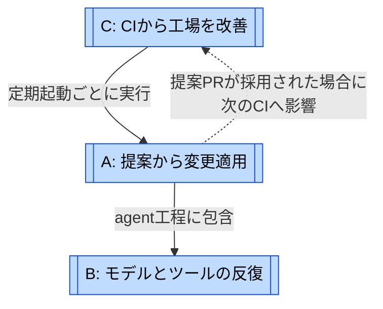
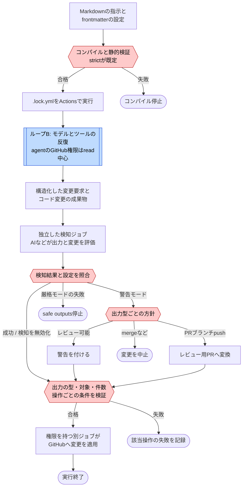
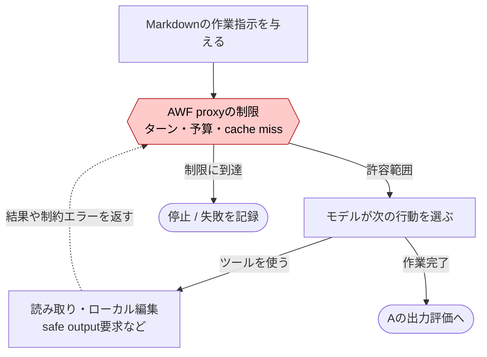
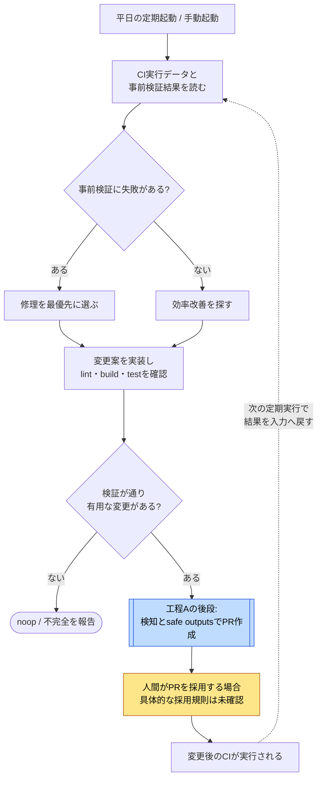

# GitHub Agentic Workflowsのループ

[← ループで読む](index.md) · [gh-awの事例ページ](../cases/gh-aw.md)

調査対象は `github/gh-aw@633bb2c2383d3ec0623e46b8c928c20c209b38ff`、調査日は2026-10-31 JST。名前と分解は調査者の整理である。Aは1回の実行工程で、Bはその中でモデルを呼ぶ反復。Cはリポジトリ自身のci-coachを例にした運用上のフィードバックで、全利用者に組み込まれた機能ではない。

## 地図: 工程と反復と改善を分ける

実線のラベルで実行順序と包含を区別し、点線は結果のフィードバックを示す。CのPR採用は自動では保証されず、Aの終了後に必ずCへ戻る実装ではない。

| 図 | 回る単位 / 種類 | 評価と戻り先 | 抜ける条件 / 上限 | 強制 |
| --- | --- | --- | --- | --- |
| [A: 提案から変更適用](#loop-a) | Actions実行1回 / 工程 | コンパイラ・出力検証・検知。失敗は通常その実行で停止し、入力へ自動差し戻ししない | 出力適用、noop、失敗、タイムアウト | 権限・適用判定はコード。検知評価はAI |
| [B: モデルとツールの反復](#loop-b) | モデル応答とツール呼び出し / 反復実行 | ツール結果や制限エラーが同じagentへ戻る | agent完了、ターン・予算・時間の上限 | コンパイラが制限をAWFへ渡す。AWF内部の停止実装は未監査 |
| [C: CIから工場を改善](#loop-c) | ci-coach定期実行と改善PR / 運用上の修正 | CIログ・事前検証結果からCI設定やコードの改善へ | 改善なしでnoop、PR作成、失敗。改善全体の回数上限は未確認 | 起動はActions。テスト成功時だけPRにするのはプロンプト。採用は別工程 |

## A: 提案から変更適用 {#loop-a}

生成済み `ci-coach.lock.yml` を基準にした工程図。入力ファイルの編集→コンパイルは実行前の準備であり、検知失敗からモデルに修理を自動依頼する経路は描かない。

参照先: [B: モデルとツールの反復](#loop-b)

図は通常の組み込み出力を示す。警告モードで未分類の出力型は警告付き実行を許可する。`strict: false`、検知無効化、独自job・トークン・MCPなどを含む構成は管理者の設定を別途確認する必要がある。生成物にはactivationなどの補助ジョブもあるが、ここでは推論と書き込みの境界に絞っている。

**人間の承認待ちは必須工程ではない。** 警告付きPRも作成されうる。PRをレビューして採用することと、出力自体を許可することは別である。実験的mergeはdefault/protected branchを拒否し、別の開いたPRのheadだけを宛先に許可する。

根拠: [agentと権限](https://github.com/github/gh-aw/blob/633bb2c2383d3ec0623e46b8c928c20c209b38ff/.github/workflows/ci-coach.lock.yml#L564)、[適用ジョブ](https://github.com/github/gh-aw/blob/633bb2c2383d3ec0623e46b8c928c20c209b38ff/.github/workflows/ci-coach.lock.yml#L2856)、[検知設定](https://github.com/github/gh-aw/blob/633bb2c2383d3ec0623e46b8c928c20c209b38ff/pkg/workflow/threat_detection_config.go#L32)、[警告時の適用方針](https://github.com/github/gh-aw/blob/633bb2c2383d3ec0623e46b8c928c20c209b38ff/actions/setup/js/safe_output_handler_manager.cjs#L1115)、[merge制約](https://github.com/github/gh-aw/blob/633bb2c2383d3ec0623e46b8c928c20c209b38ff/actions/setup/js/merge_pull_request.cjs#L502)。

## B: モデルとツールの反復 {#loop-b}

回る単位は1回のモデル応答とそれに伴うツール実行。これは合格まで実装し直す製品共通の修正手順ではなく、エンジンの作業反復である。

既定の設定は500ターン、1,000 AI Credits、連続cache miss 5回。検知は別予算で既定400 AI Credits。負数の予算で無効化できる。コンパイラがproxyへ設定することは確認したが、外部AWFの実行経路全体は監査していない。図のゲートはその実行契約を示す。生成済みci-coachのagent jobは60分で打ち切る。

CLIの `ExecuteWithRepeat` は明示した回数の反復で、初回のエラーは即時に返す。HTTP/APIの再試行やmergeabilityの再取得はこのモデル反復と別であり、成功するまで無制限に修正して起動し直す仕組みとは解釈しない。

根拠: [既定定数](https://github.com/github/gh-aw/blob/633bb2c2383d3ec0623e46b8c928c20c209b38ff/pkg/constants/constants.go#L433)、[AWFへの設定](https://github.com/github/gh-aw/blob/633bb2c2383d3ec0623e46b8c928c20c209b38ff/pkg/workflow/awf_config_build.go#L109)、[生成済みタイムアウト](https://github.com/github/gh-aw/blob/633bb2c2383d3ec0623e46b8c928c20c209b38ff/.github/workflows/ci-coach.lock.yml#L581)、[repeat](https://github.com/github/gh-aw/blob/633bb2c2383d3ec0623e46b8c928c20c209b38ff/pkg/cli/retry.go#L37)。

## C: CIから工場を改善 {#loop-c}

ci-coachが実装するのは、CIの記録から改善PRを作るところまで。下図の採用以降は運用上のフィードバックとして明示する。

参照先: [A: 提案から変更適用](#loop-a)

菱形はエージェントが指示に従って判断する場所。「検証が通るまでPRを作らない」は本文の指示で、safe outputsがテスト成功証明を必須にする実装とは確認できなかった。事前検証は非致命的な実行なので、失敗していても分析へ進める。PRを作っただけで自動採用されるとは描かない。各実行の上限はBとActionsのtimeoutで区切るが、何日まで改善を続けるかという全体の上限は未確認。

根拠: [ci-coachの設定と使命](https://github.com/github/gh-aw/blob/633bb2c2383d3ec0623e46b8c928c20c209b38ff/.github/workflows/ci-coach.md#L1)、[事前検証の扱い](https://github.com/github/gh-aw/blob/633bb2c2383d3ec0623e46b8c928c20c209b38ff/.github/workflows/ci-coach.md#L80)、[完了条件](https://github.com/github/gh-aw/blob/633bb2c2383d3ec0623e46b8c928c20c209b38ff/.github/workflows/ci-coach.md#L320)、[通常CI](https://github.com/github/gh-aw/blob/633bb2c2383d3ec0623e46b8c928c20c209b38ff/.github/workflows/ci.yml#L1)。
