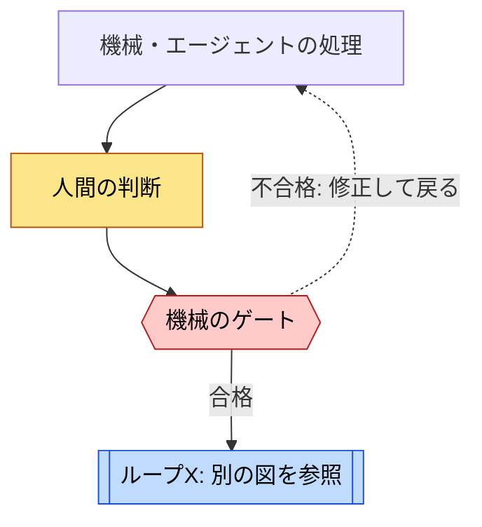

# ループで読む

[← トップ](../../index.md) · [事例一覧](../index.md) · [用語一覧](../concepts.md)

ループはソフトウェアファクトリーを理解する入口になる。特に、**作る → 評価する → 結果に応じて直す**というフィードバックをたどると、単なるコード生成と、品質を保ちながら開発する仕組みの違いが見える。

ただし、工程を丸くつなげただけでは説明にならない。順に進む**工程**、次の入力を処理する**反復実行**、評価結果で作り方を変える**修正ループ**を区別する。さらに、人間の権限・共有する状態・信頼の境界を見る必要がある。

## 1つのループで見ること

| 観点 | 読み取る内容 |
| --- | --- |
| 目的と対象 | 何をよくするのか。計画、コード、実行結果、ファクトリー自体のどれか |
| 起動と単位 | 何が契機で始まり、issue・計画の版・コミットなど何を単位に回るか |
| 評価 | 何と比べるか。誰が評価し、どの記録を根拠にするか |
| 戻り先 | 失敗したとき、計画・実装・設定など何を変えて戻るか |
| 終了と停止 | 何を満たすと抜けるか。人間に引き継ぐ条件、回数上限はあるか |
| 強制と限界 | コードのゲートか、手順書の指示か、調査者の解釈か |

「合格まで繰り返す」という説明だけでは、停止条件や費用の上限は分からない。確認できない制限は、あるものとして補わない。

## 図の読み方

- 1つの図では、1つのループの中身だけを説明する。全体の工程図と関係の地図は別に置く。
- 子ループは `ループB` のような参照箱に留め、直下のリンクから別の図へ進む。内部の処理を入れ子で描かない。
- **包含・順序・フィードバックを区別する。** 同じ親の中で順に動く工程を、親子関係と誤解しないようにする。
- ループ名や分け方は理解のための整理である。実装の正式名称や自動実行の保証とは限らない。

## 凡例

実線は処理が進む方向、点線は評価結果を戻す方向。関係の地図で別の意味を使うときは、矢印に明記する。色に加えて、文字と形でも役割を示す。

狭い画面では図を横にスクロールして読む。

## 事例

| 事例 | 図の構成 | ページ |
| --- | --- | --- |
| Swamp | 開発の全体図A、詳細B〜E、改善F、利用側の実行G・改善H | [Swampのループ](swamp.md) |
| Superpowers | 全工程A、タスクループB、修正ループC（最大5ラウンド）、SDD最終レビューD、TDD E、skillの改善F、Native最終レビューG | [Superpowersのループ](superpowers.md) |
| Symphony | トラッカー上の工程A、オーケストレーターの起動とリトライB（回数上限なし）、ワーカー内のターンC（最大20）、検証とPRフィードバックD、land E、Rework F | [Symphonyのループ](symphony.md) |
| OpenHands | 独立scannerの関係、triage A、実装とreview B、base更新とmerge C、delivery再試行D。status発行の未確認部分を明示 | [OpenHandsのループ](openhands.md) |
| Orchestrator.inc | 工程A、事実の観測B、担当ワーカーへの差し戻しC、head単位レビューD、条件付きマージE | [Orchestrator.incのループ](orchestrator.md) |
| GitHub Agentic Workflows | 提案から変更適用A、モデルとツールの反復B、CIから工場を改善C。工程と改善の反復を区別 | [GitHub Agentic Workflowsのループ](gh-aw.md) |
| Matt Pocock | 工程A、AIレビューと修正B、factory改善C。実装の強制ではなくskillの設計方針として図示 | [Matt Pocockのループ](matt-pocock.md) |
| Stripe Minions | 依頼から人間レビューへの工程A、ローカルlint B、CI最大2巡の修正C。公式記事に基づく | [Stripe Minionsのループ](stripe-minions.md) |
| StrongDM | 運用方針の評価Aと、公開Attractor仕様の工程B・ノード再試行Cを分離 | [StrongDMのループ](strongdm.md) |
| SSSF | 工程A、レビュー3回・修正2回のB、JSON訂正C、別テンプレートのテスト修正D | [SSSFのループ](sssf.md) |

ループの数は、説明の粒度で変わる。事例の優劣を数で比べず、評価の独立性、差し戻しの実効性、人間が介入できる場所、根拠の強さで比較する。
