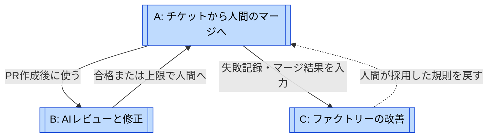
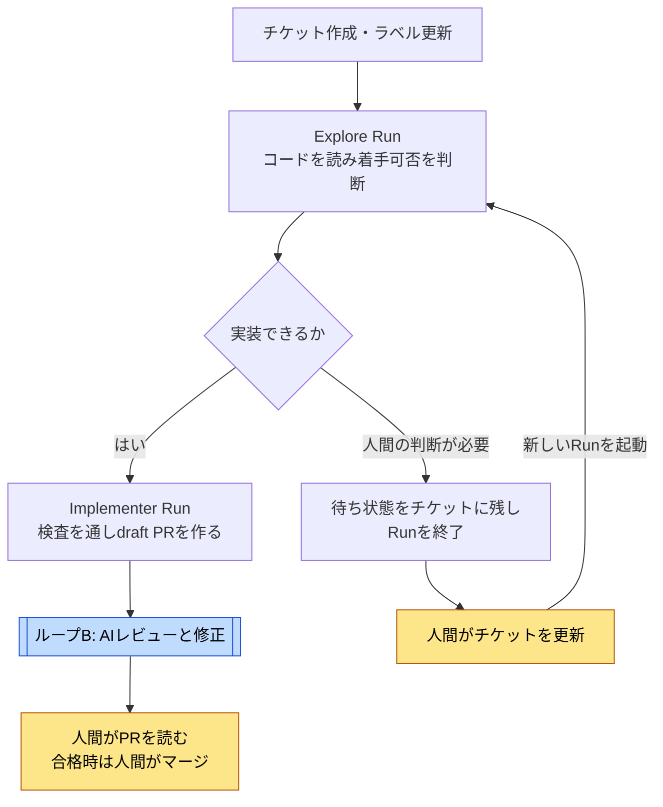
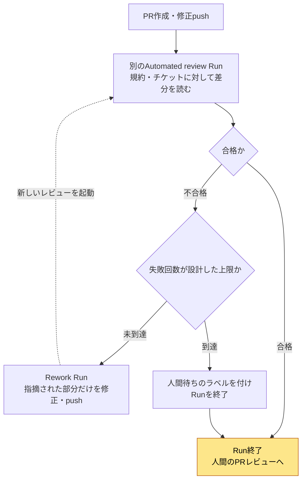
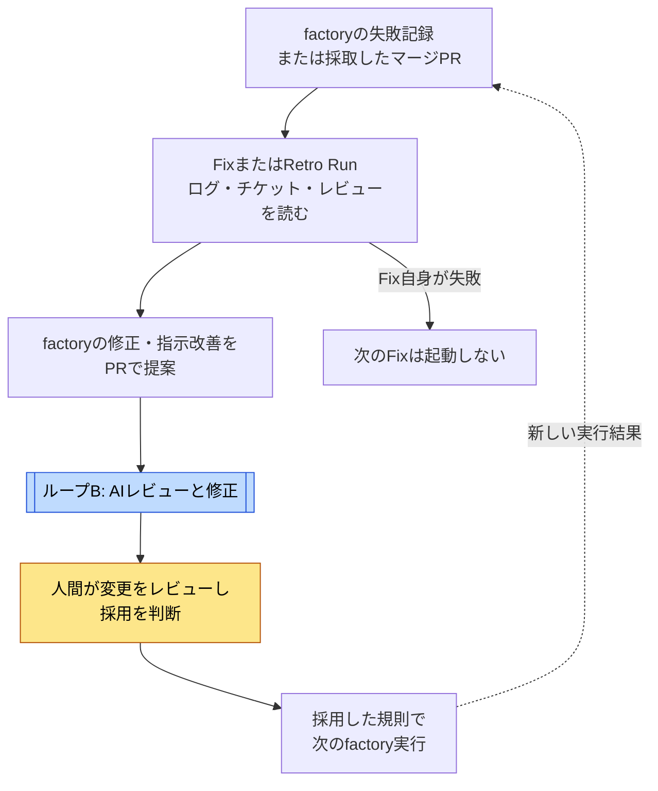

# Matt Pocockのループ

[← ループで読む](index.md) · [事例ページ](../cases/matt-pocock.md)

調査日: 2026-11-02。対象は `mattpocock/skills@b59cab42bf1206e1363eafc37f71b21c3bcaa12f`。図はSKILL.mdとEXAMPLE-TASKS.mdの設計方針を整理したもの。稼働中の実装を復元した図ではない。名前と分解は調査者の整理である。

条件の分岐は手順上の要求なので菱形で描く。機械的な強制を確認した六角形のゲートは、この事例の図には置かない。

## 関係の地図

参照先: [A](#loop-a) · [B](#loop-b) · [C](#loop-c)。Aは全体工程、Bはコードの修正ループ、Cは実行結果を使って工程そのものを変えるフィードバックである。Cが自動で自分自身を再帰的に修理する構成ではない。

| 図 | 回る単位 | 評価と戻り先 | 抜ける条件・限界 |
| --- | --- | --- | --- |
| A | チケットからPRまでの工程。内部で複数Runを使う | Exploreが着手可能か判断し、判断が必要なら人間へ | 人間がPRをマージ。人間待ちではRunを終了する設計 |
| B | PRに対するreviewとreworkの各Run | 規約・チケットと差分を比べ、指摘箇所だけを修正 | 合格または規定回数の失敗で人間へ。回数の具体値・強制実装はない |
| C | 失敗したRun、または採取したマージPR | ログ・指摘・結果からfactory変更を提案 | 人間の判断後に反映。Fix自身の失敗からFixを起動しない指示 |

## A: チケットから人間のマージへ {#loop-a}

参照先: [B](#loop-b)。チケット更新の検出、検査の実行、状態の保存、実行環境の破棄は利用者が実装する。Runは人間の返答まで待機するプロセスではない。

根拠: [Run / Runner](https://github.com/mattpocock/skills/blob/b59cab42bf1206e1363eafc37f71b21c3bcaa12f/skills/in-progress/software-factory/SKILL.md#L18)、[Explore / Implementer](https://github.com/mattpocock/skills/blob/b59cab42bf1206e1363eafc37f71b21c3bcaa12f/skills/in-progress/software-factory/EXAMPLE-TASKS.md#L5)。

## B: AIレビューと修正 {#loop-b}

上限は設計時に決める条件で、skillがカウンターを実装するわけではない。上限に達したPRを合格扱いにはせず、人間の判断へ戻す。総額による停止条件と具体的な回数は未指定。

根拠: [自動化の開始方針](https://github.com/mattpocock/skills/blob/b59cab42bf1206e1363eafc37f71b21c3bcaa12f/skills/in-progress/software-factory/SKILL.md#L54)、[Automated review / Rework](https://github.com/mattpocock/skills/blob/b59cab42bf1206e1363eafc37f71b21c3bcaa12f/skills/in-progress/software-factory/EXAMPLE-TASKS.md#L19)。

## C: ファクトリーの改善 {#loop-c}

参照先: [B](#loop-b)。FixとRetroを共通の改善経路としてまとめた図で、同じtriggerではない。Fixは実行失敗、Retroはマージ結果の採取で始まる。マージ10件に1回という値は例示であり固定の既定値ではない。人間の採用判断を挟むため、変更案が必ず次の実行へ反映されるわけではない。

Ratchetは別の移行例で、例外一覧のファイルを1つずつ厳しい検査へ移す。Architectureは候補をチケットに残すだけで、人間が選ぶまで実装を起動しない。この図の中へ無条件には組み込まない。

根拠: [Fix / Architecture / Retro](https://github.com/mattpocock/skills/blob/b59cab42bf1206e1363eafc37f71b21c3bcaa12f/skills/in-progress/software-factory/EXAMPLE-TASKS.md#L61)、[Ratchet](https://github.com/mattpocock/skills/blob/b59cab42bf1206e1363eafc37f71b21c3bcaa12f/skills/in-progress/software-factory/EXAMPLE-TASKS.md#L39)。
