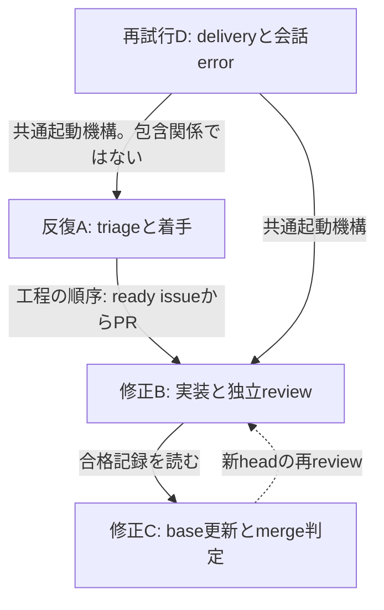
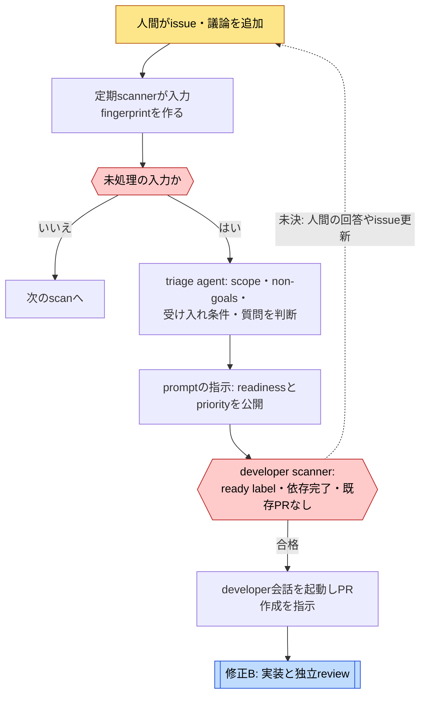
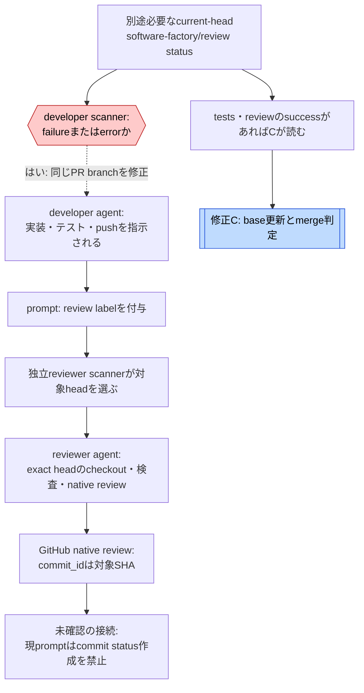
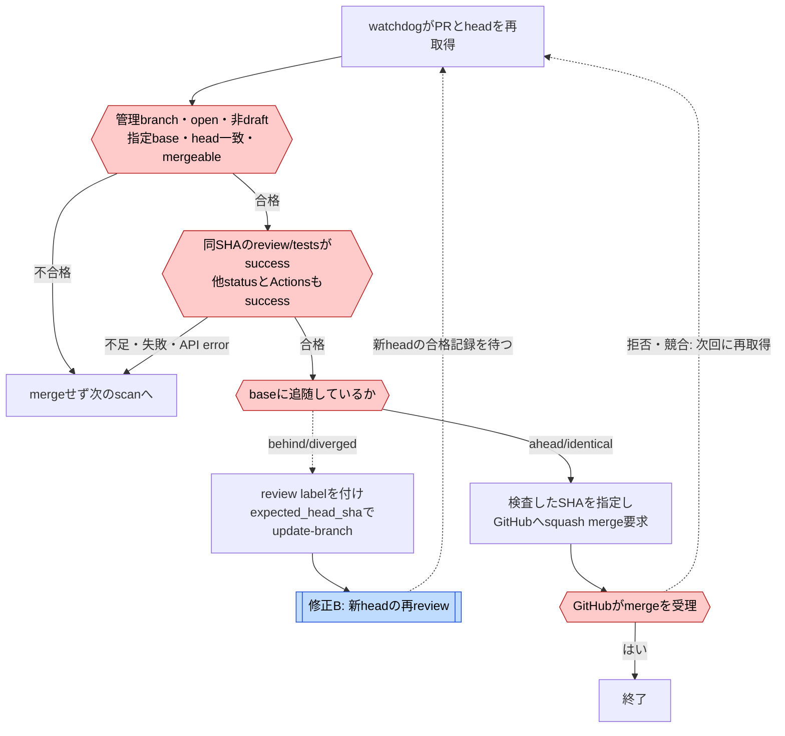
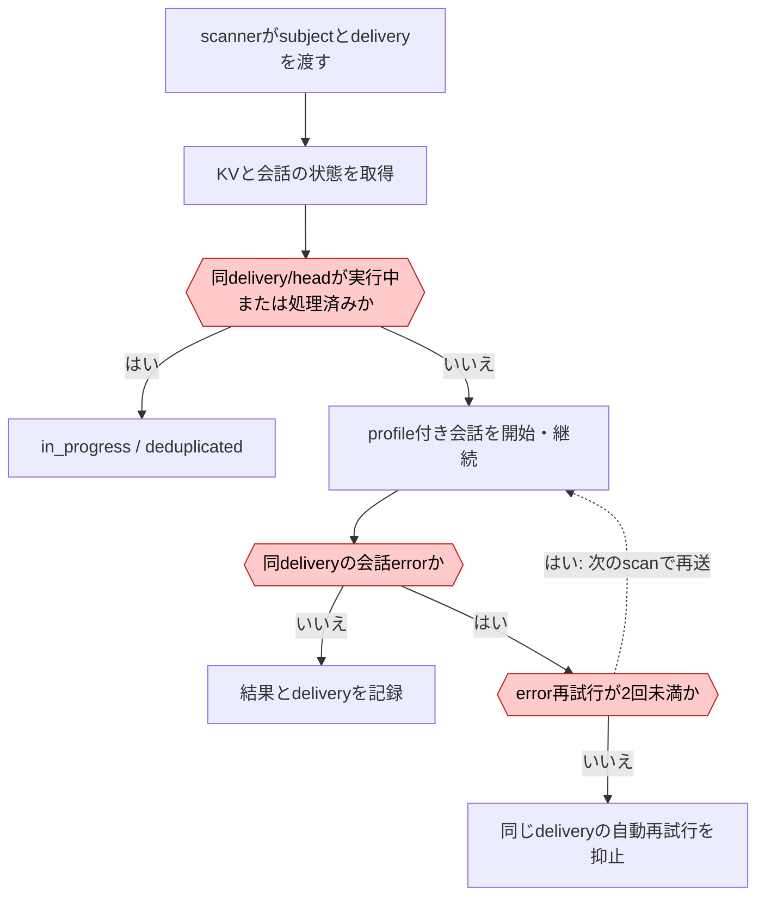

# OpenHandsのループ

[← 事例](../cases/openhands.md) · [ループ一覧・凡例](index.md)

調査日: 2026-10-31（JST）。主対象: `OpenHands/extensions@6fb2b67680b9a5b41452a148e5705f99c7df1a75`。以下の名前と分解は調査者の整理である。

## 関係の地図

四つのautomationは独立して定期起動する。上図は単一の親ループが四役を呼ぶという意味ではない。B→Cの合格記録とB内部の修正起動は、**現reviewer catalogが必要なstatusを作る経路を確認できない**ため、接続が未確認。公式デモの説明と現HEADの実装を重ねて一つの完成した循環として描かない。

| 単位 | 回る単位 | 評価と戻り先 | 抜ける条件 / 強制と限界 |
| --- | --- | --- | --- |
| 反復A | issueの入力fingerprint、定期scan | triageがscope・質問・受け入れ条件を判断。未決なら人間の議論へ | `ready-for-dev` と依存完了でdeveloper起動。triage内容の正しさはprompt |
| 修正B | PR head SHA | reviewerの指摘をdeveloperが読む指示。scannerの自動差し戻し条件はreview statusのfailure/error | 新headを再review。現catalogのstatus発行元は未確認。全修正回数の上限なしとは断定せず、未確認とする |
| 修正C | 合格記録があるPR headと現在のbase | baseが古ければGitHubへupdate-branchを要求しBへ | 同じheadの合格status、全status/Actions success、base freshness、mergeable。SHA指定merge。LLMなし |
| 再試行D | automationとsubjectに属するdelivery | 同じdeliveryの会話errorなら同じ仕事を再送 | error再試行は2回。新deliveryは回数リセット。総額・総修正回数の制限ではない |

## 反復A: triageと着手 {#loop-a}

[修正Bへ](#loop-b)

これは入力の反復であり、同じ実装を評価して直すループではない。標準catalogのtriageはlegacy direct modeであり、JSON recommendationを検査するguarded publisherは任意設定。エージェントが指示どおりreadinessを判断したことを、developer scannerが再評価するわけではない。[triage](https://github.com/OpenHands/extensions/blob/6fb2b67680b9a5b41452a148e5705f99c7df1a75/skills/github-issue-triage/scripts/worker.py) · [developer](https://github.com/OpenHands/extensions/blob/6fb2b67680b9a5b41452a148e5705f99c7df1a75/skills/github-issue-to-pr/scripts/worker.py#L117)

## 修正B: 実装と独立review {#loop-b}

[修正Cへ](#loop-c)

native reviewからstatusへの矢印を描いていないのは意図的である。現reviewerは `commit_id` 指定をpromptで求め、完了判定では同account・同SHAのreviewを読む。ただしdeveloperの修正起動はnative reviewを直接見ず、`software-factory/review` のfailure/errorを読む。testsだけが失敗した場合にも、この条件だけでは修正が始まらない。statusを出す別配備の存在と、公式デモが過去に動いたことは否定しない。[reviewer prompt](https://github.com/OpenHands/extensions/blob/6fb2b67680b9a5b41452a148e5705f99c7df1a75/skills/github-pr-reviewer/scripts/main.py#L934) · [修正起動](https://github.com/OpenHands/extensions/blob/6fb2b67680b9a5b41452a148e5705f99c7df1a75/skills/github-issue-to-pr/scripts/worker.py#L136)

## 修正C: base更新とmerge判定 {#loop-c}

[修正Bへ](#loop-b)

すべて決定的なPython処理。Actionsが存在しない場合は、`required_workflow_ids` が空なら通過できる。statusの作成者は検査せず、contextとstateを信頼する。SHA指定でheadを固定するが、compareとmergeの間のbase更新をそれだけで固定するわけではない。[watchdog](https://github.com/OpenHands/extensions/blob/6fb2b67680b9a5b41452a148e5705f99c7df1a75/skills/github-delivery-watchdog/scripts/worker.py#L12) · [statusの読取り](https://github.com/OpenHands/extensions/blob/6fb2b67680b9a5b41452a148e5705f99c7df1a75/skills/github/scripts/github_client.py#L214)

## 再試行D: deliveryと会話error {#loop-d}

図は共通dispatcherの判断を要約したもの。local/cloudそれぞれの起動・復旧経路がある。error retry数はdelivery単位であり、新head・新入力でdeliveryが変わるとリセットする。reviewerは1 scanあたり新規会話既定2件、catalog scannerは300秒timeoutだが、どちらもfactory全体の費用・修正回数の上限ではない。[dispatcher](https://github.com/OpenHands/extensions/blob/6fb2b67680b9a5b41452a148e5705f99c7df1a75/skills/github/scripts/agent_conversation.py#L228) · [reviewerの起動枠](https://github.com/OpenHands/extensions/blob/6fb2b67680b9a5b41452a148e5705f99c7df1a75/skills/github-pr-reviewer/scripts/worker.py#L45)
