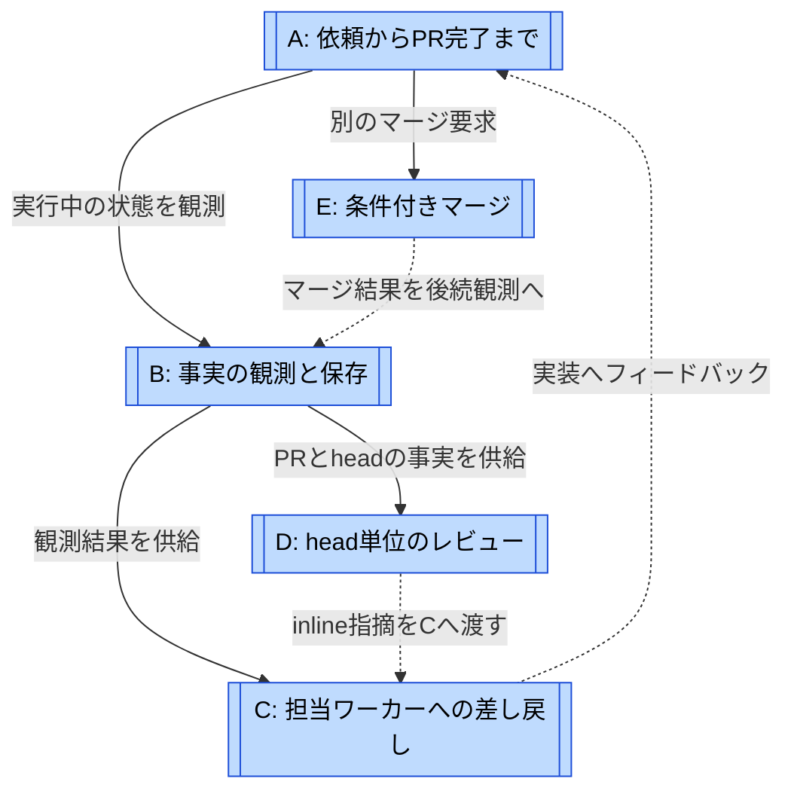
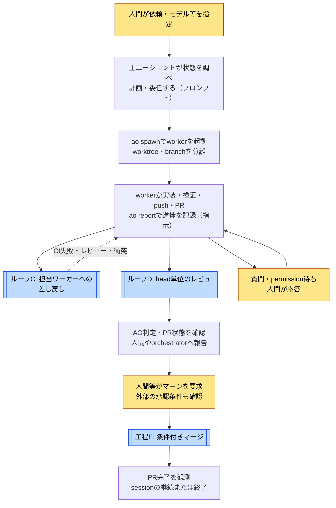
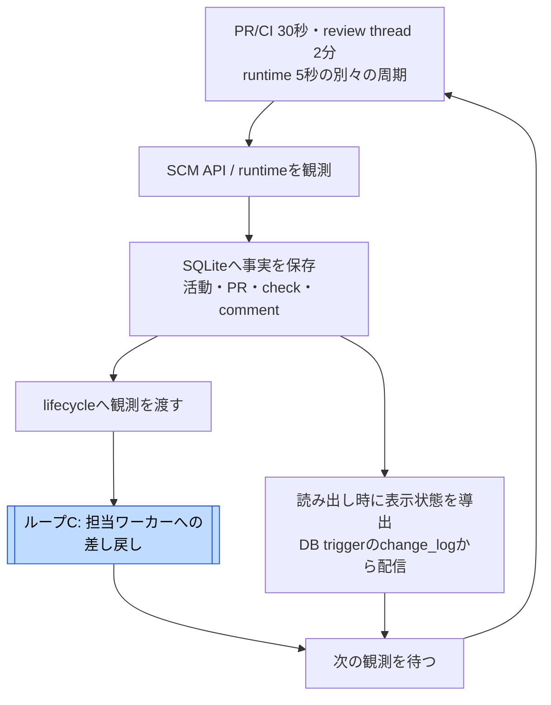
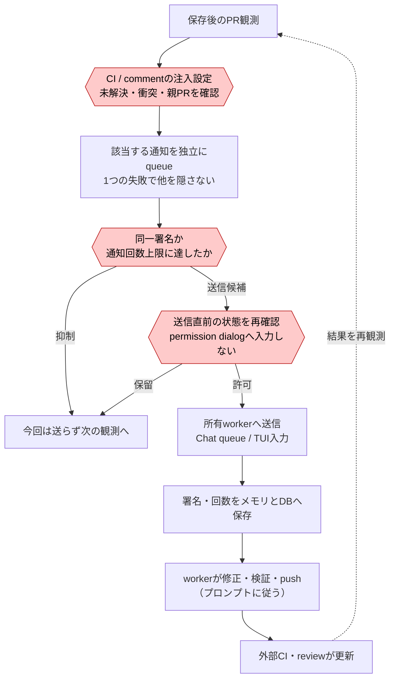
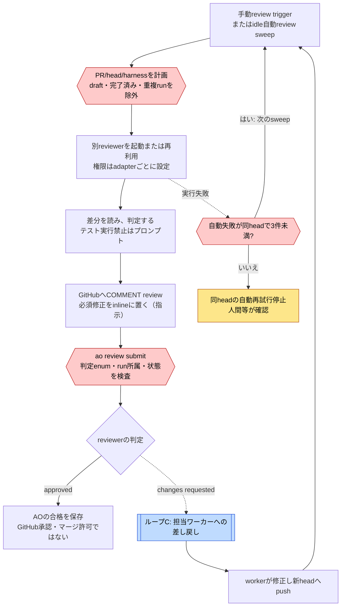
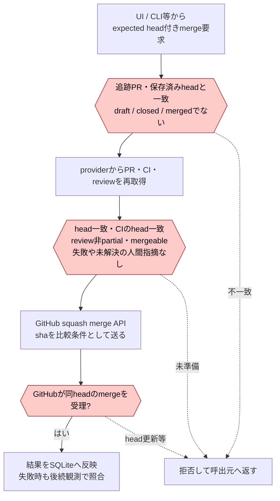

# Orchestrator.incのループ

[← ループで読む](index.md) · [事例ページ](../cases/orchestrator.md)

調査対象は `OrchestratorInc/agent-orchestrator@c0b351a31eccaf1ac55f8e5015fd21ab414545ca`、調査日2026-10-31（JST）。ループ名と分け方は調査者の整理。**Aは全体の工程、Bは観測の反復、C・Dは評価を戻す修正経路、Eはマージの工程**である。BがC・Dを必ず直列に呼ぶという意味ではない。

六角形はコードの判定、菱形は人間・agentの判断。役割分担や修正指示と、機械が強制するゲートを分ける。公開のローカルdaemonを対象とし、非公開AO Cloudのループは描かない。

## 関係の地図

参照先: [A](#loop-a) · [B](#loop-b) · [C](#loop-c) · [D](#loop-d) · [E](#loop-e)

実線は実行・情報供給、点線は結果のフィードバック。Aは工程上C・Dを利用するが、Bのポーリング、Dの自動レビューsweep、agentの作業は別の実行主体で並行する。**DのapprovedからEのマージを自動的に起動する線はない。**

| 図 | 回る単位 / 種類 | 評価と戻り先 | 抜ける条件 / 上限 |
| --- | --- | --- | --- |
| [A](#loop-a) | 依頼とworker session。全工程 | CI・レビュー・人間の指示をworkerへ | PRの完了や人間の停止。全体の回数・金額上限は未確認 |
| [B](#loop-b) | PR/CIとruntimeのpoll。反復実行 | 観測を保存し、表示状態と処置へ | daemon停止・観測対象外。既定PR/CI 30秒、review thread 2分、runtime 5秒 |
| [C](#loop-c) | PRと通知key。修正ループ | CI失敗・comment・衝突を所有workerへ | 同一署名は再送しない。review/comment通知はkeyごと最大3回、CI/衝突は回数上限なし |
| [D](#loop-d) | PR/head/harnessごとのreview run。修正ループ | 必須inline指摘をC経由でworkerへ | 同じheadの結果は通常再利用。自動起動の失敗3件で同headの再試行停止。修正全体の上限ではない |
| [E](#loop-e) | expected headを持つmerge要求。工程 | 不合格なら要求を拒否、呼出元へ | 最新条件とSHA照合に合格してsquash merge。AOレビュー合格は必須でない |

## A: 依頼からPR完了まで {#loop-a}

参照先: [C](#loop-c) · [D](#loop-d) · [E](#loop-e)

これは代表的な利用工程。レビューの起動や最終の承認は設定・依頼によって変わり、全sessionにDを強制しない。主エージェントは調整専用、workerが修正という制約はプロンプト上の指示。マージAPIに人間の独立した承認を証明するAO専用ゲートはない。

根拠: [役割プロンプト](https://github.com/OrchestratorInc/agent-orchestrator/blob/c0b351a31e/backend/internal/session_manager/prompt.go#L215)、[workerとレビュー方針](https://github.com/OrchestratorInc/agent-orchestrator/blob/c0b351a31e/backend/internal/session_manager/prompt.go#L324)。

## B: 事実の観測と保存 {#loop-b}

参照先: [C](#loop-c)

pollの反復であって、B自身がコードを改良するループではない。probe失敗を死亡と決めつけない。UI上の列を保存して遷移させるのではなく、保存した事実から列を算出する。review threadはPR/CIと同じ30秒周期ではない。

根拠: [SCM周期](https://github.com/OrchestratorInc/agent-orchestrator/blob/c0b351a31e/backend/internal/observe/scm/observer.go#L29)、[reaper周期](https://github.com/OrchestratorInc/agent-orchestrator/blob/c0b351a31e/backend/internal/observe/reaper/reaper.go#L19)、[architecture](https://github.com/OrchestratorInc/agent-orchestrator/blob/c0b351a31e/docs/architecture.md#L639)。

## C: 担当ワーカーへの差し戻し {#loop-c}

CIと衝突の通知は回数上限なしだが同一署名は再送しない。review/commentはkeyごと最大3回。同じ指摘を3回まで機械的に修正する保証ではない。未解決のまま署名が変わらなければ再通知しない。衝突が確実に解消した観測でre-armし、再発時に通知できる。

送信後にDB保存するため、永続化失敗と再起動の組合せでは余分な通知があり得る。通常の通知はneeds-input中に保留する。衝突のurgent経路も、安全と確認できない入力欄やpermission待ちへは送らない。

根拠: [通知条件](https://github.com/OrchestratorInc/agent-orchestrator/blob/c0b351a31e/backend/internal/lifecycle/reactions.go#L65)、[重複排除・送信順](https://github.com/OrchestratorInc/agent-orchestrator/blob/c0b351a31e/backend/internal/lifecycle/reactions.go#L929)。

## D: head単位のレビュー {#loop-d}

参照先: [C](#loop-c)

自動起動は有効なworkerが既定1分idleのときに、既定1分のsweepで評価する。同headでchanges requestedなら自動で同じレビューを回さず、新しいheadを待つ。`--rerun` は同headを意図的に再レビューする別経路。自動実行の失敗3件という上限を、レビュー修正3ラウンドと読み替えない。

プロンプトはGitHub投稿後にAOへ構造化結果を提出させる。GitHub投稿に失敗した場合もIDなしでAOへ記録できる。Codexのread-only sandboxやClaude Codeのtool制限はadapterのコードにあるが、実験的host-trusted reviewerを一律のsandboxとは扱わない。

根拠: [自動review条件・上限](https://github.com/OrchestratorInc/agent-orchestrator/blob/c0b351a31e/backend/internal/autoreview/coordinator.go)、[prompt](https://github.com/OrchestratorInc/agent-orchestrator/blob/c0b351a31e/backend/internal/review/prompt.go)、[submit](https://github.com/OrchestratorInc/agent-orchestrator/blob/c0b351a31e/backend/internal/service/review/review.go#L884)、[gateway ADR](https://github.com/OrchestratorInc/agent-orchestrator/blob/c0b351a31e/docs/adr/0002-secure-interactive-reviewer-gateway.md)。

## E: 条件付きマージ {#loop-e}

E自体は修正ループではなく、失敗を呼出元へ返す工程。呼出元が修正して再要求するかは別の判断。**AO reviewerのapproved、人間の独立した承認は、このAPI独自の必須入力ではない**。GitHub側の保護規則は別途適用される。

マージ後の終了条件はsession単位。設定が有効で、open PRがなく、少なくとも1件mergedがあり、workerがactiveでないときに停止する。新しいPRを作成中のworkerを、1件のmergeだけで止めない。

根拠: [merge service](https://github.com/OrchestratorInc/agent-orchestrator/blob/c0b351a31e/backend/internal/service/pr/action_service.go#L125)、[readiness](https://github.com/OrchestratorInc/agent-orchestrator/blob/c0b351a31e/backend/internal/domain/pr.go#L235)、[GitHub SHA条件](https://github.com/OrchestratorInc/agent-orchestrator/blob/c0b351a31e/backend/internal/adapters/scm/github/merge_action.go#L19)、[session完了](https://github.com/OrchestratorInc/agent-orchestrator/blob/c0b351a31e/backend/internal/lifecycle/reactions.go#L65)。
