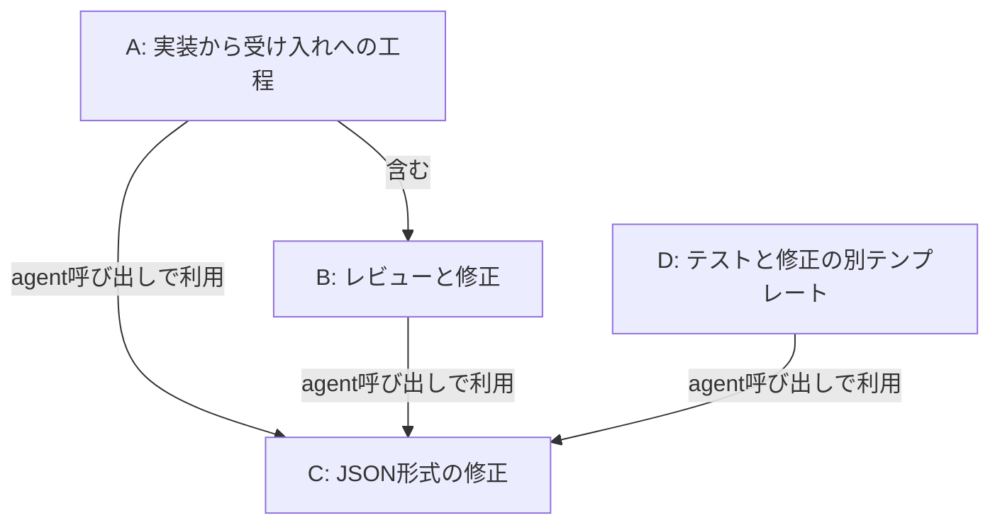
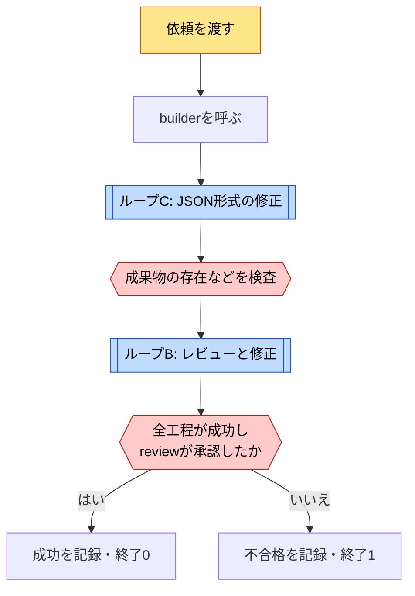
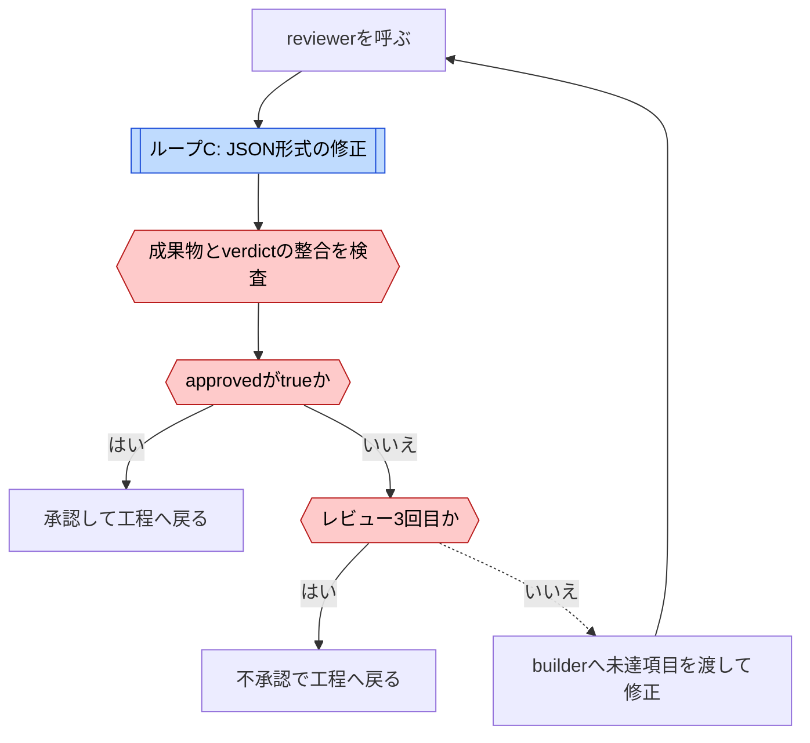
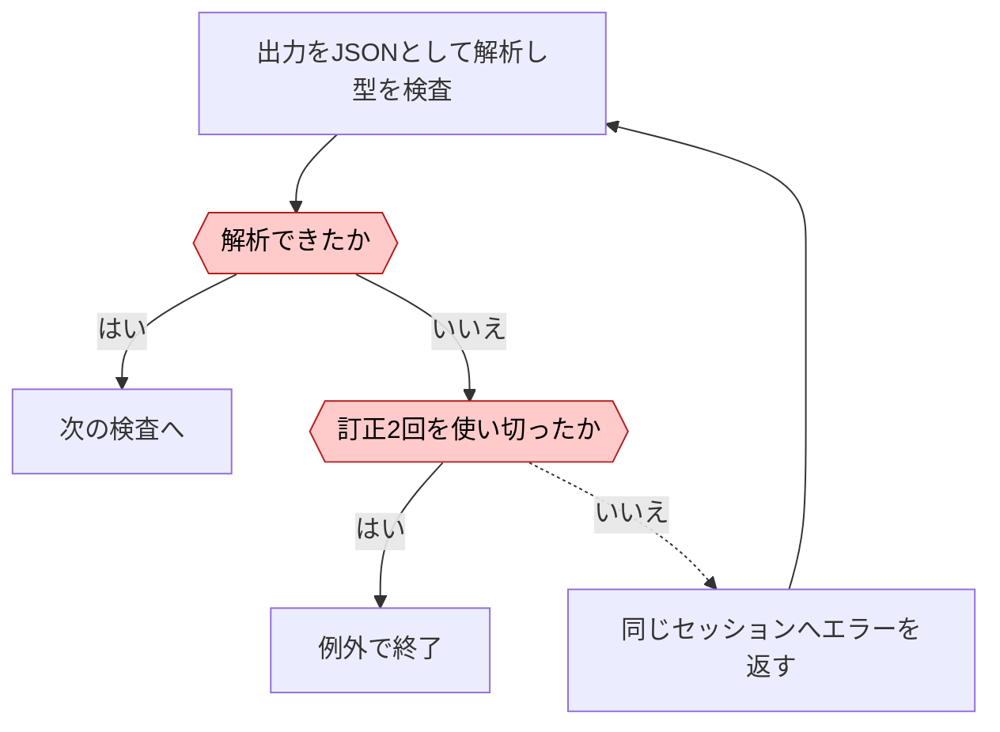
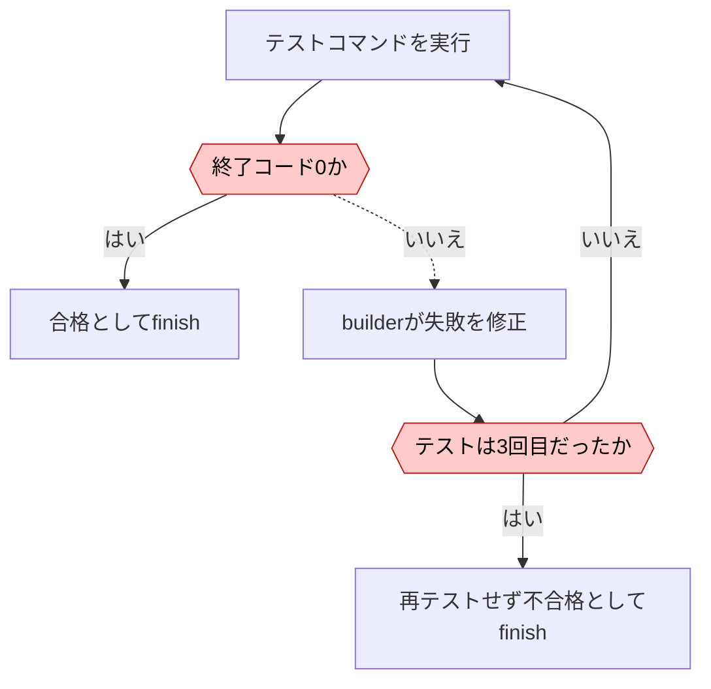

# SSSFのループ

[← ループ一覧](index.md) · [事例](../cases/sssf.md)

調査日: 2026-11-02。対象コミットは `de31374882e7a4e3e5b7bb9bd09e69dc2f779356`。A・Bは `adw_build_review.py`、Dは別の `adw_build_test.py`。Cは共通部品内のJSON解析再試行である。図の分解は調査者の整理。

| 図 | 回る単位 | 評価と戻り先 | 抜ける条件 |
| --- | --- | --- | --- |
| A 工程 | 依頼1件 | 全工程の状態とreview承認 | `finish` が記録と終了コードを確定 |
| B 修正 | 実装結果 | reviewerの未達・blockingをbuilderへ返す | 承認またはレビュー3回。修正は最大2回 |
| C 再試行 | 1応答の解析 | JSON解析エラーを同じセッションへ返す | 型に適合、または訂正2回後に例外 |
| D 修正 | テスト対象の変更 | コマンドの失敗をbuilderへ返す | 合格、またはテスト3回と最後の修正後に不合格 |

## A. 実装から受け入れへの工程 {#loop-a}

[B: レビューと修正](#loop-b) · [C: JSON形式の修正](#loop-c)

途中の例外は工程を失敗にして送出する。図は正常な呼び出し経路を示す。人間のPR承認やマージはこのテンプレートに含まれない。[工程](https://github.com/disler/super-simple-software-factory/blob/de31374882e7a4e3e5b7bb9bd09e69dc2f779356/.claude/skills/sssf/templates/adws/adw_build_review.py)、[finish](https://github.com/disler/super-simple-software-factory/blob/de31374882e7a4e3e5b7bb9bd09e69dc2f779356/.claude/skills/sssf/templates/adws/adw_modules/runner.py#L114)

## B. レビューと修正 {#loop-b}

[C: JSON形式の修正](#loop-c)

ゲート違反は不承認とは別の例外である。既定の `retries=0` ではそこで失敗する。修正工程は `retries=1` を指定し、ゲートの訂正を1回許す。この局所再送は図Bのレビュー回数に数えない。[工程の指定](https://github.com/disler/super-simple-software-factory/blob/de31374882e7a4e3e5b7bb9bd09e69dc2f779356/.claude/skills/sssf/templates/adws/adw_build_review.py)、[ゲートの反復](https://github.com/disler/super-simple-software-factory/blob/de31374882e7a4e3e5b7bb9bd09e69dc2f779356/.claude/skills/sssf/templates/adws/adw_modules/agents.py#L148)

## C. JSON形式の修正 {#loop-c}

初回と最大2回の訂正で解析する。形式が正しいことは成果物の正しさではない。権限の事後検査はさらに後にあるため、解析例外でその検査に到達しない経路がある。[解析](https://github.com/disler/super-simple-software-factory/blob/de31374882e7a4e3e5b7bb9bd09e69dc2f779356/.claude/skills/sssf/templates/adws/adw_modules/agents.py#L267)、[呼び出し順](https://github.com/disler/super-simple-software-factory/blob/de31374882e7a4e3e5b7bb9bd09e69dc2f779356/.claude/skills/sssf/templates/adws/adw_modules/agents.py#L141)

## D. テストと修正の別テンプレート {#loop-d}

初回実装後の反復を示す。最後の修正を再テストしない点は実装通りであり、コメントから補正しない。既定のテストコマンドは成功する `echo` なので、実テストの接続前は最初に合格する。[工程](https://github.com/disler/super-simple-software-factory/blob/de31374882e7a4e3e5b7bb9bd09e69dc2f779356/.claude/skills/sssf/templates/adws/adw_build_test.py)、[仮コマンド](https://github.com/disler/super-simple-software-factory/blob/de31374882e7a4e3e5b7bb9bd09e69dc2f779356/.claude/skills/sssf/templates/adws/adw_modules/quality.py)
