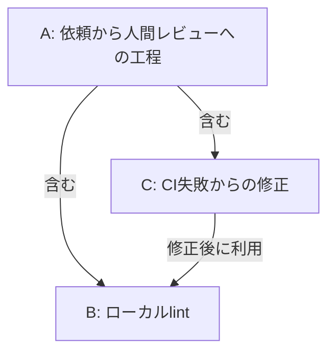
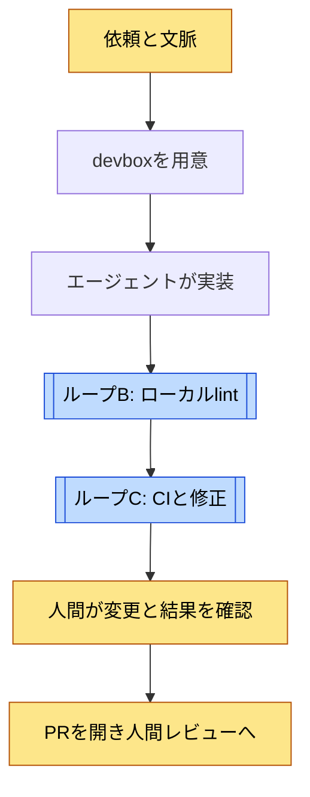
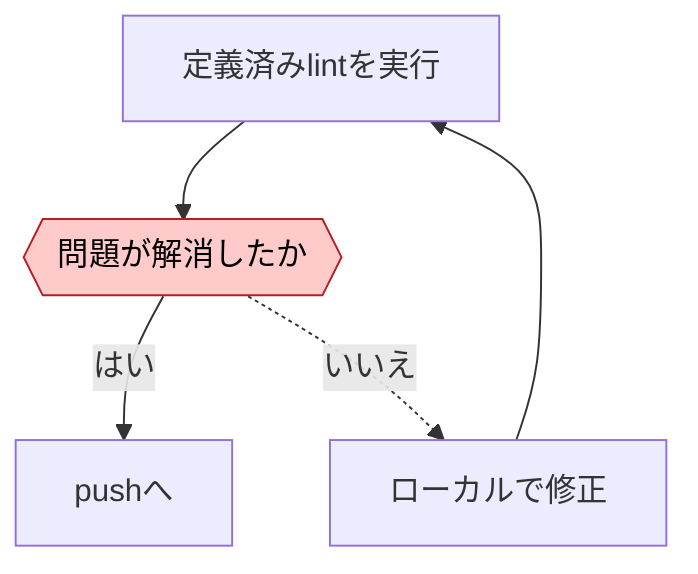
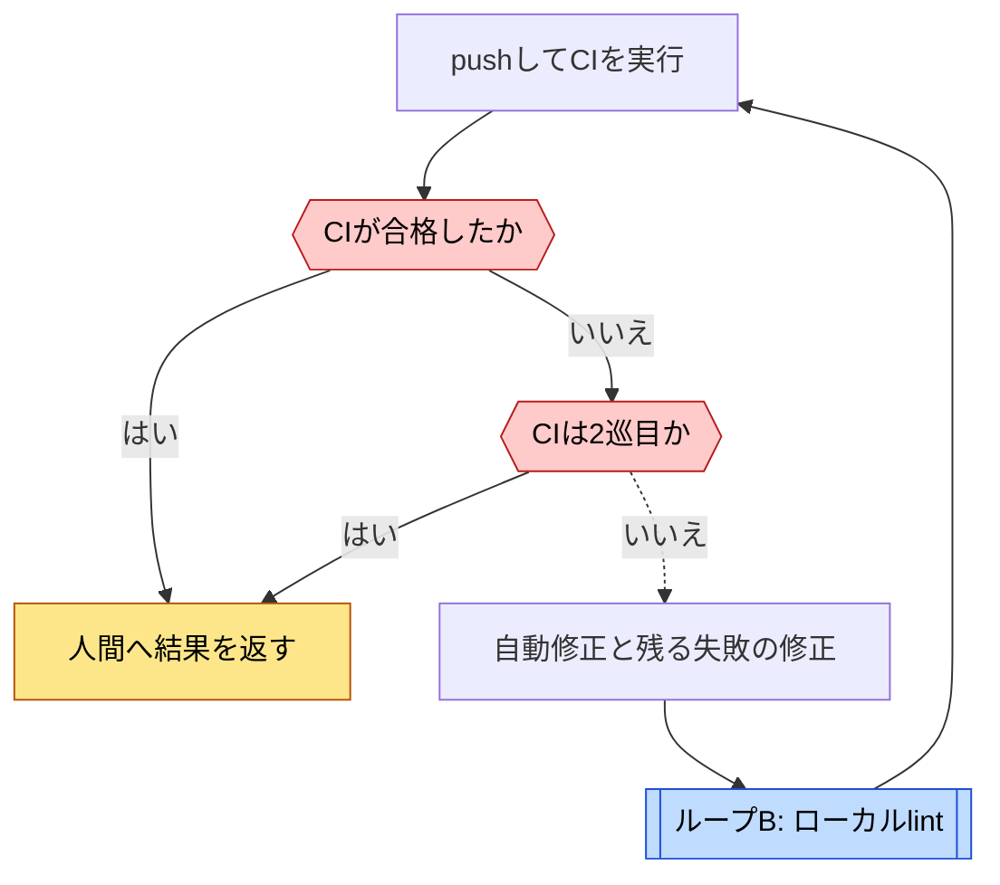

# Stripe Minionsのループ

[← ループ一覧](index.md) · [事例](../cases/stripe-minions.md)

調査日: 2026-11-02。図は公式記事を調査者が整理したもの。コードによる強制は未確認。Aは全工程、B・Cは内部の修正ループである。

| 図 | 回る単位 | 評価と戻り先 | 抜ける条件 |
| --- | --- | --- | --- |
| A 工程 | 依頼1件 | 人間が提出物を読む | 人間レビューへ引き渡す。自動マージは図示しない |
| B 修正 | ローカル変更 | lint結果をローカル修正へ戻す | lint解消。最大回数は未確認 |
| C 修正 | 1回のMinion実行 | CI失敗を修正工程へ戻す | 合格またはCI2巡後に人間へ返す |

## A. 依頼から人間レビューへの工程 {#loop-a}

[B: ローカルlint](#loop-b) · [C: CIと修正](#loop-c)

人間は追加指示や手作業で修正できるが、その後の総反復回数は未確認。全PRが自動的にレビューへ進むという意味ではない。[Part 1](https://stripe.dev/blog/minions-stripes-one-shot-end-to-end-coding-agents)

## B. ローカルlint {#loop-b}

記事はlint工程をコードで回すと説明する。自動修正とエージェント修正の細かな分担、停止上限は未確認。[Part 2](https://stripe.dev/blog/minions-stripes-one-shot-end-to-end-coding-agents-part-2)

## C. CIと修正 {#loop-c}

[B: ローカルlint](#loop-b)

CI2巡という上限は公式説明に基づく。合格しないまま人間へ返る場合もある。人間の追加依頼を含む生涯の試行数ではない。[Part 1](https://stripe.dev/blog/minions-stripes-one-shot-end-to-end-coding-agents)、[Part 2](https://stripe.dev/blog/minions-stripes-one-shot-end-to-end-coding-agents-part-2)
