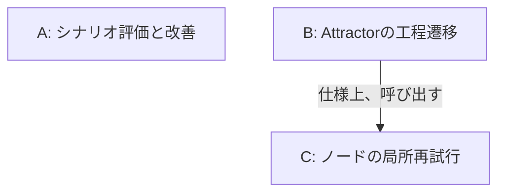
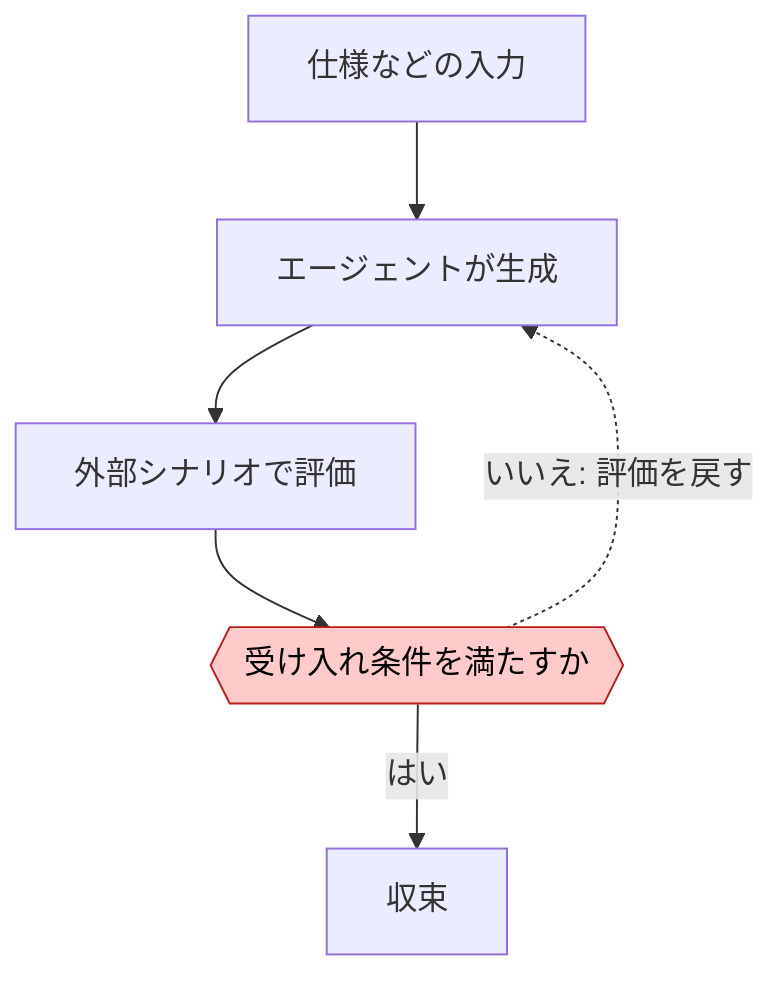
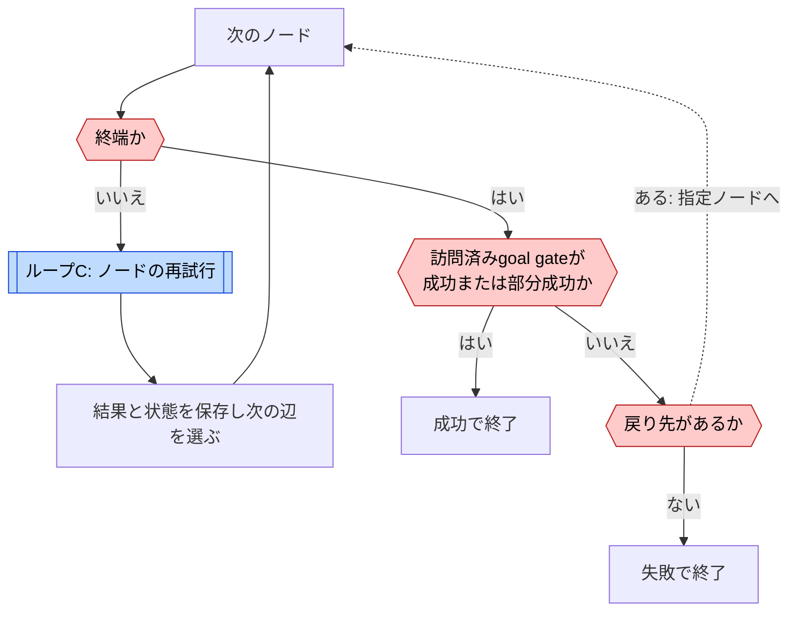
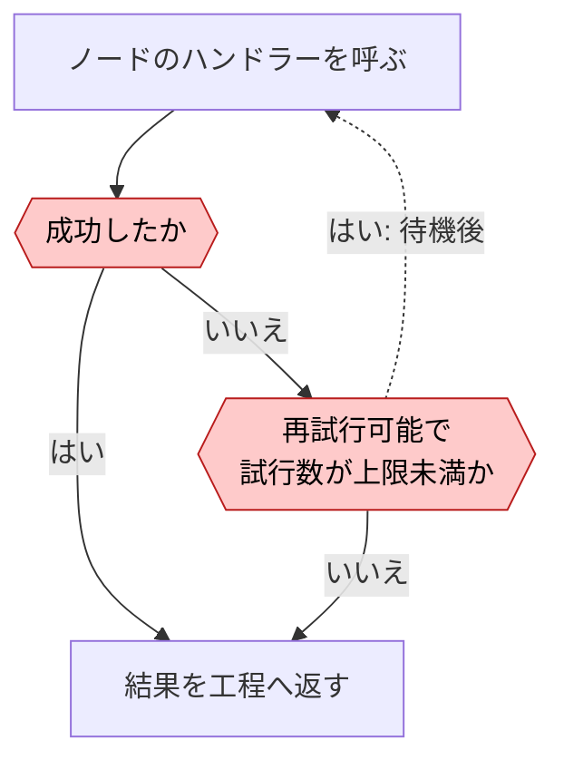

# StrongDMのループ

[← ループ一覧](index.md) · [事例](../cases/strongdm.md)

調査日: 2026-11-02。Aは運用方針、B・Cは公開Attractor仕様を整理したもの。仕様は `fb57a55ed97372a27ac90102f436947e29f48426` に固定した。社内factoryがB・Cの構成でAを実行することは未確認であり、包含関係を描かない。

| 図 | 回る単位 | 評価と戻り先 | 抜ける条件 |
| --- | --- | --- | --- |
| A 修正 | 生成したソフトウェア | シナリオ評価を次の生成へ戻す | 評価用シナリオが通り続ける。数値と費用上限は未確認 |
| B 反復・条件付き差し戻し | DOTグラフの実行 | 終端で訪問済みgoal gateを検査 | 成功または戻り先なしの失敗。総周回上限は未確認 |
| C 再試行 | ノード1回の呼び出し | 失敗・再試行結果から同じノードへ戻す | 成功、非再試行エラー、局所上限 |

## A. シナリオ評価と改善 {#loop-a}

受け入れ条件と収束の表現は[Principles](https://factory.strongdm.ai/principles)を整理したもの。採点の閾値、連続合格の回数、実装の判定コードは未公開。人間のコードレビューをしない方針は、人間が仕様や評価を設計しないという意味ではない。

## B. Attractorの工程遷移 {#loop-b}

[C: ノードの再試行](#loop-c)

図は終端のgoal gate経路に焦点を絞り、辺なし終了、`loop_restart`、個別のfailure edgeは省略する。未訪問のノードまで必ず実行する保証や、すべてのgoal gateに完全成功を要求する仕様ではない。[仕様§3.3〜3.4](https://github.com/strongdm/attractor/blob/fb57a55ed97372a27ac90102f436947e29f48426/attractor-spec.md#L335)

## C. ノードの局所再試行 {#loop-c}

`max_retries` は追加試行数、既定0。たとえば3なら初回を含め最大4回になる。この数値をBの総周回上限とは解釈しない。仕様の `allow_partial` による部分成功の扱いも、実装時の確認対象である。[仕様§3.5](https://github.com/strongdm/attractor/blob/fb57a55ed97372a27ac90102f436947e29f48426/attractor-spec.md#L480)
