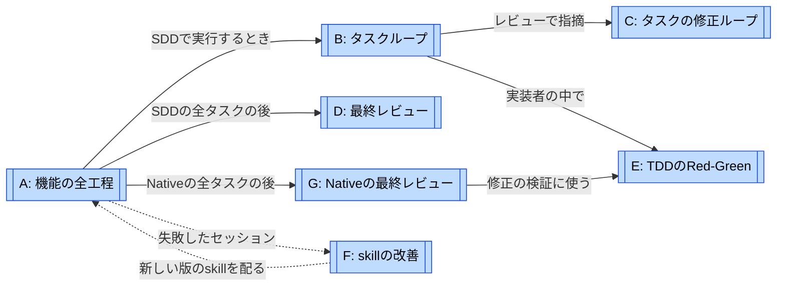
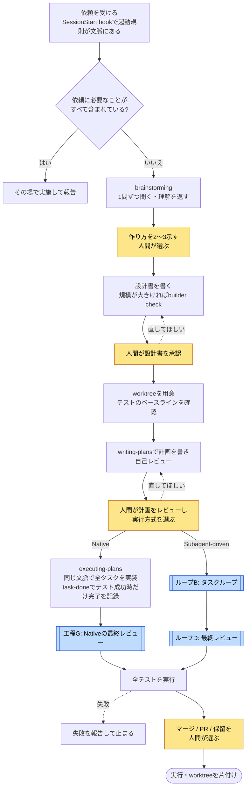
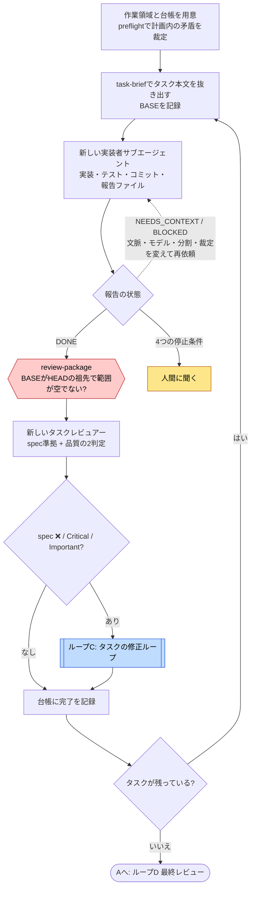
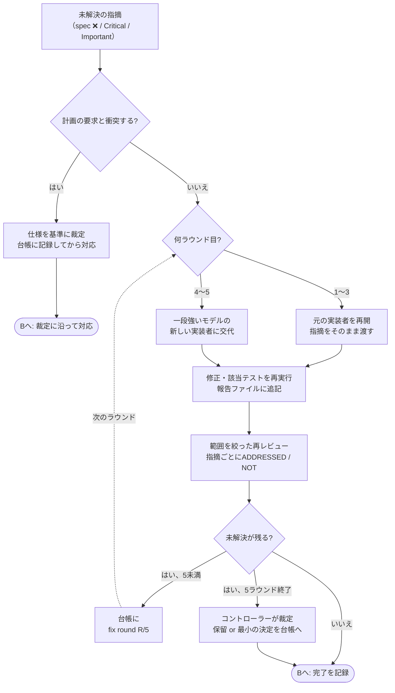
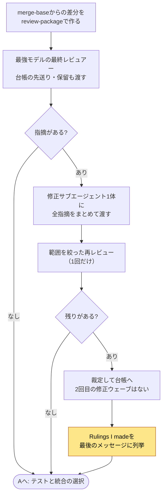
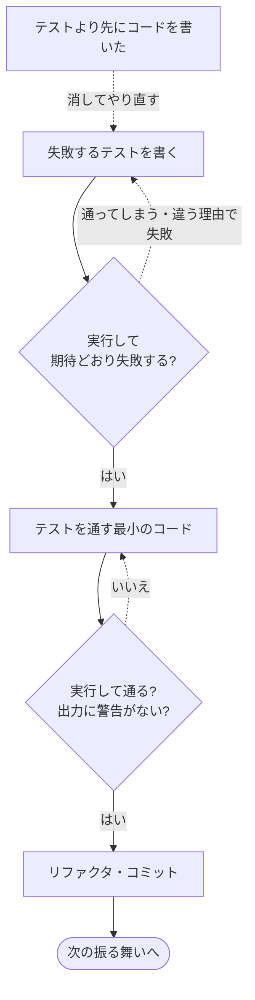
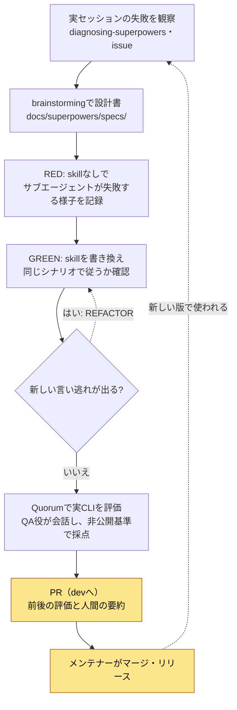
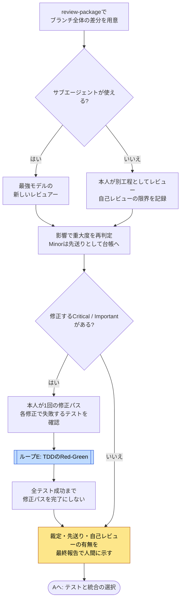

# Superpowersのループ

[← ループで読む](index.md) · [Superpowersの事例ページ](../cases/superpowers.md)

**最初は A → B → C の順に読む。** Aで1つの機能を作る全工程、Bでタスクを1つずつ処理する反復、Cでタスク単位の修正ループを見る。Dは最後のブランチ全体のレビュー、Eは実装者の中のTDD。FはSuperpowers自体（skill）を改善するループである。GはNativeの最終レビュー工程で、Dとは分けて読む。

調査対象は `obra/superpowers@2ce8aa1`。ループ名と分け方は調査者の整理で、Superpowersが「7つのループ」を定義しているわけではない。SDD（`subagent-driven-development`）で実行する経路を中心に描き、`executing-plans`（同じセッションで実行）はAの分岐として扱う。

**強制の区別**: この事例では、ほぼすべてのゲートが**skillの指示**であり、コードで止める仕組みは少ない。図の六角形（機械のゲート）は、コードで判定するものに限った。LLMのコントローラーが判断する分岐は菱形で描く。

## 地図: 呼び出しとフィードバックを分ける

実線は「その工程で使う」、点線は「結果を戻す」。NativeはB・C・Dを通らず、同じ文脈でタスクを実装してからGへ進む。Fは実装上の親ループではなく、利用者のセッションで起きた失敗が、メンテナーによるskillの改訂として次の版に戻る運用上の関係。

| 図 | 回る単位・種類 | 何を見て戻るか | 終了・次へ進む条件 |
| --- | --- | --- | --- |
| [A: 機能の全工程](#loop-a) | 1つの依頼を扱う工程。設計の会話と計画のレビューで人間に戻る | 人間の訂正、設計書・計画への意見 | 人間が統合方法を選び、実行する。破棄は人間の明示的な依頼のみ |
| [B: タスクループ](#loop-b) | 計画のタスクを1つずつ処理する反復実行 | 実装者の状態報告、タスクレビューの判定 | 全タスクが完了（クリーン、または上限後に保留つき）。4つの停止条件では人間に戻る |
| [C: タスクの修正ループ](#loop-c) | 1タスクの修正ラウンド（修正 + 範囲を絞った再レビュー） | 再レビューのADDRESSED / NOT ADDRESSED、修正差分の新しい破損 | 計画と衝突する指摘は開始前に裁定。それ以外は指摘がすべて解決、または5ラウンド後に裁定 |
| [D: 最終レビュー](#loop-d) | SDDのブランチ全体。修正ウェーブは1回だけ | 最強モデルのレビュー指摘 | クリーン、または残りを裁定して統合へ。2回目の修正ウェーブはない |
| [E: TDDのRed-Green](#loop-e) | 1つの振る舞いのテストと実装 | テストが期待どおり失敗・成功するか | テストが通り、コミット。先に書いたコードは消してやり直す |
| [F: skillの改善](#loop-f) | skillの版を改訂する運用上の改善 | 実セッションの失敗、圧力テスト、Quorumの評価 | 個々の変更が評価を通り `dev` → `main` でリリース。改善全体に終わりはない |
| [G: Nativeの最終レビュー](#loop-g) | Nativeのブランチ全体。本人の修正パスは1回 | 新しいレビュアー（使えなければ自己レビュー）の指摘、修正のテスト結果 | 修正をRED→GREENと全テスト成功で検証。再レビューはせず、裁定と先送りを人間に示す |

## A: 機能の全工程 {#loop-a}

依頼から統合までの一本道と、人間に戻る場所を示す全体図。タスクの反復はBの参照箱に留める。

参照先: [B](#loop-b) · [D](#loop-d) · [G](#loop-g)

**強制の境界**: 承認・レビュー・選択はすべてskillの指示（[brainstormingのHARD-GATE](https://github.com/obra/superpowers/blob/2ce8aa1/skills/brainstorming/SKILL.md#L247)、[writing-plansのExecution Handoff](https://github.com/obra/superpowers/blob/2ce8aa1/skills/writing-plans/SKILL.md#L179)、[finishingのStep 4](https://github.com/obra/superpowers/blob/2ce8aa1/skills/finishing-a-development-branch/SKILL.md#L53)）。セッション開始時の [hook](https://github.com/obra/superpowers/blob/2ce8aa1/hooks/session-start#L41) は起動規則を注入するが、skillを呼ぶかはモデルの判断。Nativeの [`task-done`](https://github.com/obra/superpowers/blob/2ce8aa1/skills/executing-plans/scripts/task-done#L39) は各タスクのテストコマンドを実行し、成功時だけ完了を台帳に書く。ただし適切なコマンドの選択と、このスクリプトを使うことは手順に依存する。

**図の範囲**: 人間が質問を断れば、brainstormingは終わりHARD-GATEも外れる。worktreeの作成は、人間の既存の好みがなければ同意を聞く（[using-git-worktrees L41](https://github.com/obra/superpowers/blob/2ce8aa1/skills/using-git-worktrees/SKILL.md#L41)）。testsの失敗時は報告して停止し、自動でレビューには戻らない（[finishing L18](https://github.com/obra/superpowers/blob/2ce8aa1/skills/finishing-a-development-branch/SKILL.md#L18)）。

## B: タスクループ {#loop-b}

**回る単位は計画のタスク。** 失敗を直すループではなく、次のタスクへ進む反復実行。中の修正はCに切り出す。

参照先: [C: タスクの修正ループ](#loop-c)。実装者の中のRed-Greenは[E](#loop-e)。

**機械が強制すること**: `review-package` は、BASEがHEADの祖先でないか範囲が空のとき終了コード3で止まる（[L27-28](https://github.com/obra/superpowers/blob/2ce8aa1/skills/subagent-driven-development/scripts/review-package#L27)）。`review-package` は `HEAD~1` も受け付け、タスク全体を含むかは検査しないため、開始時のBASEを正しく渡す手順が必要。`sdd-workspace` は `plan-path` マーカーで所有者を確かめて作業領域を分ける。台帳1行目の計画パスを照合するのはコントローラーへの指示。`task-brief` は該当タスクが見つからなければ終了コード3。**レビューの合否、タスクを完了にするかどうかは、コントローラー（LLM）がレビュアーの文章を読んで判断する。**

**手順書の指示**: タスクの間で人間に確認しない。止まるのは、取り返しのつかない操作、セキュリティに関わる操作、worktree外への副作用、どの道も推測になるほど壊れた計画の4つだけ（[SKILL.md L27](https://github.com/obra/superpowers/blob/2ce8aa1/skills/subagent-driven-development/SKILL.md#L27)）。それ以外の矛盾や曖昧さは裁定して台帳に書く。実装者は並列に出さない。BLOCKEDには「同じモデルで変更なしに再試行させない」（[handling-reports](https://github.com/obra/superpowers/blob/2ce8aa1/skills/subagent-driven-development/references/handling-reports.md)）。

**図の範囲**: Minorの指摘は修正ループに入らず、台帳に「deferred」として書いてDに渡す。⚠️（差分だけでは確認できない）項目は、コントローラーが確かめて本当の欠落ならCに入れる。statusの差し戻しに回数の上限は書かれていない（未確認）。

## C: タスクの修正ループ {#loop-c}

**評価対象は1タスクの修正差分。** 回数に上限があり、途中で実装者を交代させる。この事例で最も明示的に設計された修正ループ。

**手順書の指示**: 1ラウンド = 修正1回 + 再レビュー1回、最大5ラウンド（[fix-loop.md L21](https://github.com/obra/superpowers/blob/2ce8aa1/skills/subagent-driven-development/references/fix-loop.md#L21)）。再レビューは前回のheadからの修正差分だけを見て、範囲外の気づきは台帳の先送りに回す。修正の範囲外を見ないので、毎回新しい指摘が出て収束しない状態を避けられる。コントローラー自身は修正しない。例外として、計画が要求する実装への指摘や、計画の要求と衝突する指摘は、ループ開始前に仕様を基準に裁定して記録する（[fix-loop L14](https://github.com/obra/superpowers/blob/2ce8aa1/skills/subagent-driven-development/references/fix-loop.md#L14)）。それ以外の指摘を早く打ち切るための裁定は禁じ、5ラウンド後のbreakerで裁定する。

**上限の根拠**: 5ラウンドは2026-07-15の設計書で「Jesseの判断」と記録されている。以前は「承認されるまで繰り返す」で上限がなく、レビューループの回数が実行ごとのコストのばらつきの最大要因だった（[設計書](https://github.com/obra/superpowers/blob/2ce8aa1/docs/superpowers/specs/2026-07-15-sdd-fix-loop-redesign-design.md)）。

**図の範囲**: 上限はコードで数えていない。ラウンド数は台帳の行で管理し、守るかどうかはコントローラーに任される。裁定で保留にした指摘は、最終レビューと最後の「Rulings I made」で人間に見える。

## D: 最終レビュー {#loop-d}

**評価対象はブランチ全体。** 修正のやり直しを1回に限った、短い修正ループ。

**手順書の指示**: 指摘ごとに修正者を出さない（実セッションで最終修正の費用が全タスクの合計を超えた、という観察）。2回目の修正ウェーブはなく、残った重要な指摘は統合の選択肢を示すときに人間に見せる（[final-review.md](https://github.com/obra/superpowers/blob/2ce8aa1/skills/subagent-driven-development/references/final-review.md#L17)）。台帳の `Ruling:` 行はすべて「Rulings I made」に並べてから作業領域を消す。

Nativeでは修正者と再レビューの扱いが異なるため、[G](#loop-g)に分ける。

## E: TDDのRed-Green {#loop-e}

**評価対象は1つの振る舞い。** 実装者（またはNativeのセッション）の中で回る、最も短いループ。

**手順書の指示**: 「失敗するテストより先に本番コードを書かない。書いたら消してやり直す」（[TDD L31](https://github.com/obra/superpowers/blob/2ce8aa1/skills/test-driven-development/SKILL.md#L31)）。計画のステップもこの順で書く。ただし実装者テンプレートの指示は「タスクがTDDを指示していれば」で、守ったかどうかは報告のTDD証拠とレビューで見る。テストの合否は実行結果で決まるが、Red-Greenの順序をコードで確かめる仕組みはない。

## F: skillの改善 {#loop-f}

**評価対象は個々の作業ではなく、作業の仕方を決めるskill。** 利用者のセッションで起きた失敗を、次の版のskillに戻す運用上のループ。

**手順書の指示**: skillの変更には `writing-skills` での圧力テストと前後の評価結果が要る。調整済みの文言は証拠なしに変えない（[AGENTS.md L99](https://github.com/obra/superpowers/blob/2ce8aa1/AGENTS.md#L99)、[writing-skills](https://github.com/obra/superpowers/blob/2ce8aa1/skills/writing-skills/SKILL.md#L30)）。PRには人間の要約と、人間が差分全体を見たことを求める。

**Quorum**: [superpowers-evals](https://github.com/prime-radiant-inc/superpowers-evals)（`e64684c`）。採点は非公開の受け入れ基準と決定的な事後チェック。live評価はエージェントを権限確認なしで動かすので、公開CIでは静的チェックだけを実行し、live評価は信頼されたメンテナーが手元か専用のapplianceで回す。campaignは試行回数・実行時間・予備で区切り、金額のしきい値では止めない（README）。

**図の範囲**: Superpowers本体のリポジトリにCIはなく、評価を通らないとマージできない仕組みもない。マージの判断はメンテナーが持つ。すべての変更がこの順序を通るとは確認していない（ハーネス対応やhookの修正は、Quorumではなく `tests/` や手動確認で済ませているものがある）。`diagnosing-superpowers` はセッションの記録から証拠つきで報告を作るだけで、skillを直すかどうかはメンテナーが決める。

根拠: [設計書の一覧](https://github.com/obra/superpowers/tree/2ce8aa1/docs/superpowers/specs)、[計画ごとの作業領域の評価結果](https://github.com/obra/superpowers/blob/2ce8aa1/docs/superpowers/specs/2026-07-06-sdd-plan-scoped-workspace-eval-results.md)、[diagnosing-superpowers](https://github.com/obra/superpowers/blob/2ce8aa1/skills/diagnosing-superpowers/SKILL.md)。

## G: Nativeの最終レビュー {#loop-g}

**評価対象はNativeで実装したブランチ全体。** SDDのDと異なり、修正は実装者本人が行う1回のパスで、再レビューはしない。

参照先: [E: TDDのRed-Green](#loop-e)。

**手順書の指示**: サブエージェントが使えれば最終レビューを新しい文脈で行い、使えなければ自己レビューであることを台帳と最終報告に明記する。Critical / Importantの修正は本人が行い、各修正のRED→GREENと全テスト成功を記録する。Minorは先送りとして台帳と最終報告へ。直さないと決めた指摘は `Ruling:` として記録する。再レビューは禁止で、2回目の修正パスもない（[executing-plans: Final Review](https://github.com/obra/superpowers/blob/2ce8aa1/skills/executing-plans/SKILL.md#L234)）。

**強制の境界**: 修正パスの回数、TDDの順序、再レビュー禁止は手順書の指示。各タスクの完了行は `task-done` がテストコマンド成功時だけ追記するが、最終修正の記録や台帳の直接編集を禁止するコードのゲートではない。
