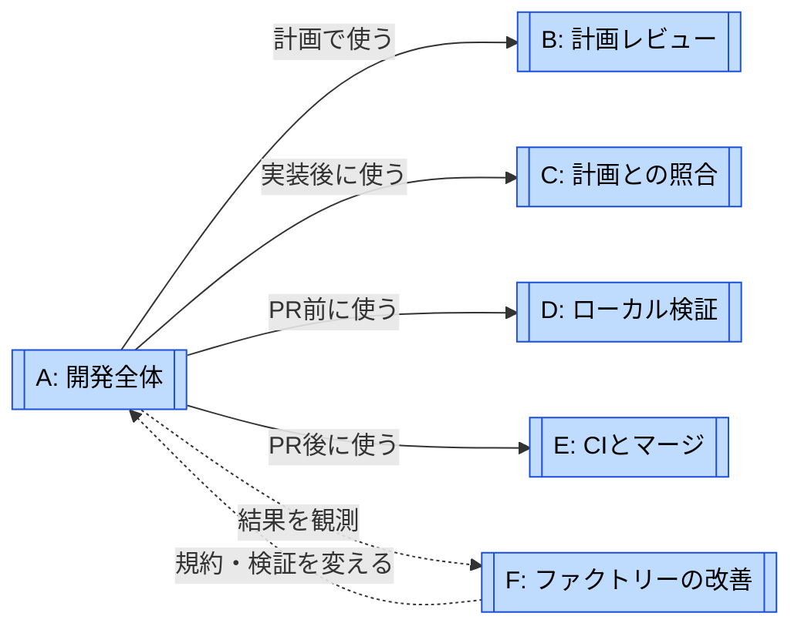
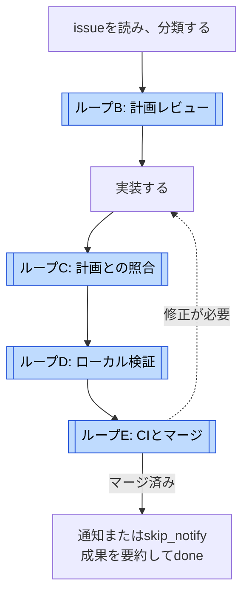
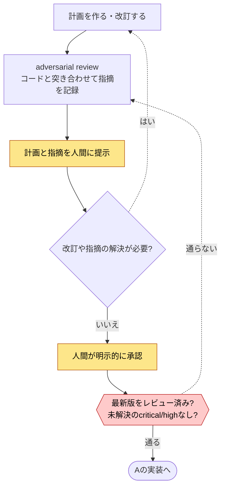
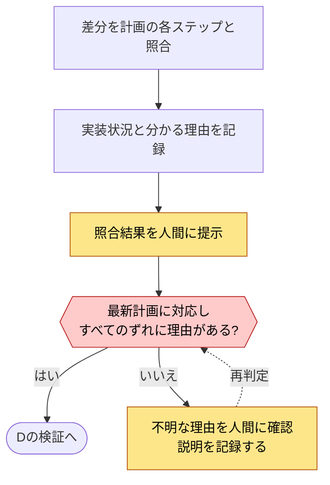
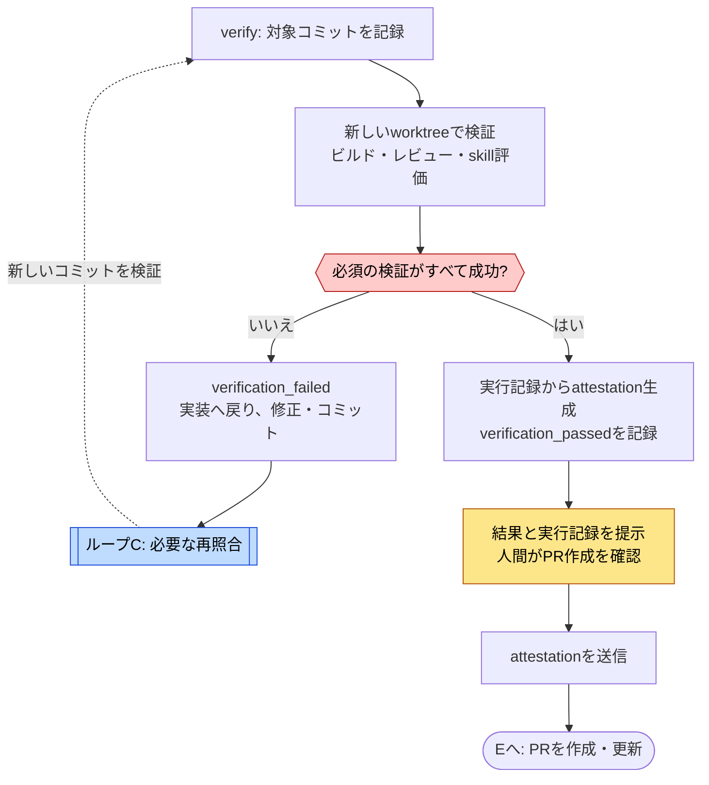
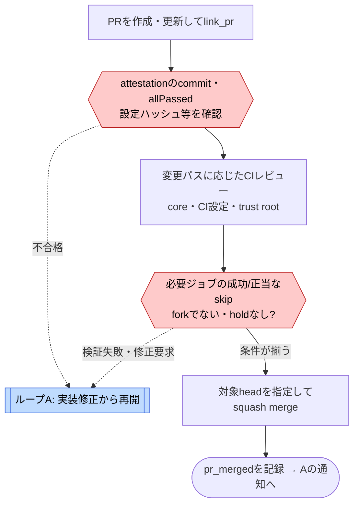
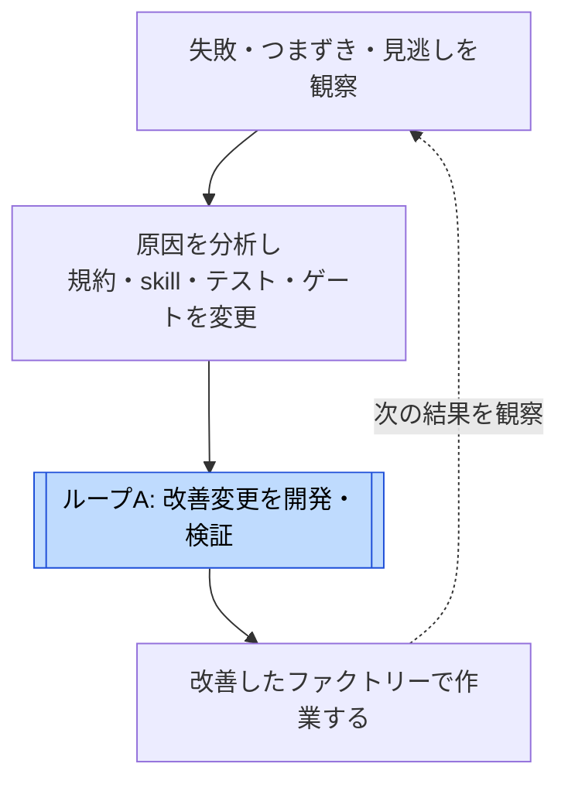
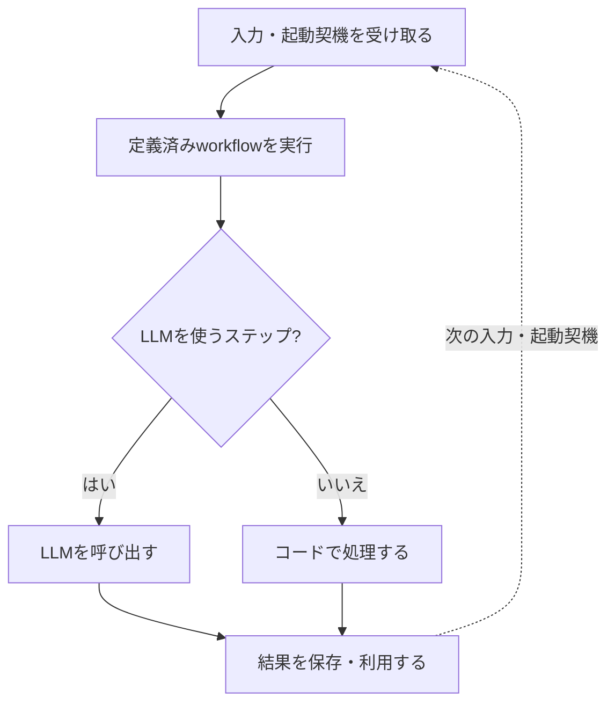
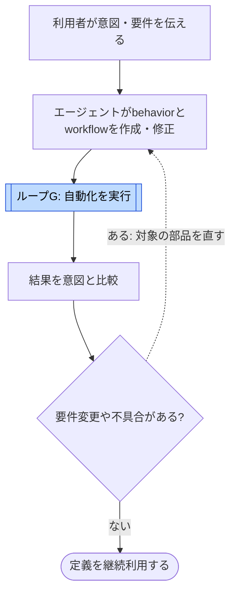

# Swampのループ

[← ループで読む](index.md) · [Swampの事例ページ](../cases/swamp.md)

**最初は A → D → E → F の順に読む。** Aで開発全体をつかみ、Dで修正の反復、Eでマージ前の信頼境界、Fでファクトリー自体の改善を見る。BとCは計画に関する詳細。GとHは、利用者がSwampで自動化を作る側の話である。

調査対象は `swamp-club/swamp@963e0d2`。図はコードと手順書から整理した**読み解きのための分解**であり、Swampが公式に「8つのループ」を定義しているわけではない。通常の計画型の開発経路を中心に描き、例外経路と未確認の点を本文に記す。

## 地図: 呼び出しとフィードバックを分ける

**Aの中でB・C・D・Eを使う。** これが処理の包含関係。Fはその外で結果を観察し、次に使うファクトリーを改善する運用上の関係である。Fが実装上の親ループとしてAを呼び続けている、とまでは確認できない。

地図の実線は「その工程で使う」、点線は「観測結果を戻す」。**B→C→D→Eの実行順は、次のAの図で示す。** Dは修正後の再照合でCを参照し、Eは失敗時にAの実装へ戻る。完全な木構造ではない。

| 図 | 回る単位・種類 | 何を見て戻るか | 終了・次へ進む条件 |
| --- | --- | --- | --- |
| [A: 開発全体](#loop-a) | issueを扱う工程全体 | 下位の検証やCIでの失敗 | マージ後の通知・要約まで記録。ただし `done` は目的達成の保証ではない |
| [B: 計画レビュー](#loop-b) | 計画の版を改訂する反復 | レビューの指摘、人間のフィードバック | 最新計画のcritical/highが解決済みで、人間が承認 |
| [C: 計画との照合](#loop-c) | ずれの説明を補う反復 | `implemented` 以外の項目に理由がない | 最新計画に対するレビューがあり、すべてのずれに理由がある |
| [D: ローカル検証](#loop-d) | コミットを修正する反復 | テスト・レビュー・skill評価の失敗 | 必須の検証に合格し、PR前の人間の確認を得る |
| [E: CIとマージ](#loop-e) | PRのheadを更新する反復 | CIの拒否、修正要求 | 対象ジョブが成功または正当なskip、マージ条件を満たす |
| [F: ファクトリーの改善](#loop-f) | issueをまたぐ運用上の改善 | 繰り返す失敗、ゲートの見逃し | 個々の改善を検証して適用。改善活動全体に固定の終了はない |
| [G: 利用者の自動化実行](#loop-g) | 次の入力で再利用する反復 | 次の入力・起動契機 | 1回のworkflowの終了。コードの修正ループとは別 |
| [H: 利用者の自動化改善](#loop-h) | behavior・workflowを改訂する反復 | 実行結果と要件のずれ | 意図に合うか利用者が評価。汎用の自動合格ゲートは未確認 |

## A: 開発全体 {#loop-a}

一本道の工程と、その中で回す修正ループを区別するための全体図。内部の反復は、B〜Eの参照箱を開いて読む。

参照先: [B](#loop-b) · [C](#loop-c) · [D](#loop-d) · [E](#loop-e)。計画承認後でも、実装前なら `iterate` でBへ戻せる。

**機械が強制すること**: `TRANSITIONS` は各メソッドを呼べるphaseを制限する。`verify` には照合記録の存在、`link_pr` には計画との照合と検証結果のチェックがある。状態はdatastoreに永続化され、再開時に読み出す。

**図の範囲**: 全作業がこの順序でしか進めないわけではない。既存の作業を後から記録する `fast_forward` や、マージ済みの作業を閉じる `complete` もある。複数issueを同じ作業に結びつける `link_issue` もあり、「1 PR = 必ず1 issue」とは限らない。`summarize` は `outcomeMet: false` でも `done` に進めるため、工程の終了と目的達成を分けて読む。

根拠: [遷移の定義](https://github.com/swamp-club/swamp/blob/963e0d2/extensions/models/_lib/schemas.ts#L83)、[lifecycle本体](https://github.com/swamp-club/swamp/blob/963e0d2/extensions/models/issue_lifecycle.ts)、[操作手順](https://github.com/swamp-club/swamp/blob/963e0d2/.claude/skills/issue-lifecycle/SKILL.md)。

## B: 計画レビュー {#loop-b}

**評価対象は計画。** コードを書く前に、指摘や人間の意図を計画へ戻す。

計画にはDDD分析、テスト方針、UATや文書への影響を含める。改訂するたびに再レビューし、指摘の解決状況を記録する。

**強制の境界**: `adversarial-review-clear` が強制するのは、最新計画へのレビュー記録とcritical/highの解決状態。人間の明示的な承認はskillの指示であり、`approve` の引数に人間の承認証跡を要求する仕組みは確認できない。「機械が人間の承認そのものを保証する」とは書けない。

根拠: [レビュー手順](https://github.com/swamp-club/swamp/blob/963e0d2/.claude/skills/issue-lifecycle/references/adversarial-review.md)、[approve前のチェック](https://github.com/swamp-club/swamp/blob/963e0d2/extensions/models/issue_lifecycle.ts#L883)。

## C: 計画との照合 {#loop-c}

**評価対象は、承認した計画と実装のずれ。** この反復は、すべてのずれをなくすのではなく、理由のないずれをなくす。理由が書かれた欠落も通り得るため、機能の完成や正しさを保証するゲートとは異なる。

**強制の境界**: `verify` 前はレビューの**存在**をチェックする。最新計画との一致と理由の有無は `link_pr` / `complete` 前に `code-conformance-clear` がチェックする。図は推奨手順として先に解決した場合を描く。理由の妥当性やコード全体の網羅性を、このチェックだけで証明しているわけではない。

根拠: [照合手順](https://github.com/swamp-club/swamp/blob/963e0d2/.claude/skills/issue-lifecycle/references/code-conformance-review.md)、[照合のゲート](https://github.com/swamp-club/swamp/blob/963e0d2/extensions/models/issue_lifecycle.ts#L765)。

## D: ローカル検証 {#loop-d}

**評価対象は特定のコミット。** 失敗をコードへ戻し、新しいコミットを検証する。通常の開発で最も短く回したい修正ループにあたる。

参照先: [C: 計画との照合](#loop-c)。修正が計画との対応を変えるなら再照合する。ゲートは計画の版を比較するが、照合結果と最新コードのコミット一致まで確認するものではない。

3つのworkflowは `verify-build`（lint・型・テスト・compile等）、`verify-reviews`（変更パスに応じたレビュー）、`verify-skills`（品質・トリガー評価）。LLMレビューの合否は `check_review_verdict.ts` が明示的な `VERDICT: pass` などを解析して決める。**判定の読み取りが決定的でも、LLMの評価内容が正しい保証にはならない。**

attestationは `build-attestation` が実行記録から生成し、検証したコミットと設定ハッシュに結びつける。コミットが変わったら再生成・再検証する。ただし生成元の真正性は未保証。これを「暗号署名による検証証明」とは呼べない。人間の確認を待つことも手順書上の制約である。

根拠: [検証規約](https://github.com/swamp-club/swamp/blob/963e0d2/agent-constraints/verification-conventions.md)、[verdictの判定](https://github.com/swamp-club/swamp/blob/963e0d2/scripts/check_review_verdict.ts)。

## E: CIとマージ {#loop-e}

**評価対象はPRのhead。** ローカルの検証結果をCIが受け取り、追加レビューとマージ条件を確かめる。失敗時は、ローカル修正ループに戻る。

参照先: [Aの実装](#loop-a) → [Cの照合](#loop-c) → [Dの検証](#loop-d) → Eへ戻る。

図では読みやすく順に並べたが、CIのレビューとattestation検証は依存関係に従って別ジョブで動く。`hold` 中や実行待ちでは待機し、必ず修正に戻るわけではない。

**既存図からの重要な訂正**: attestationの「24時間」は拒否条件ではない。24時間超過・時刻欠落・解析失敗は**警告**で、`errors` がなければ成功する。コミット不一致、`allPassed` 不成立、必須の設定ハッシュ不一致などとは扱いが違う。

PR失敗後は `pr_failed → implement → verify` の順に状態を戻す。小さな修正でも、`pr_failed → verify` と直接は進めない。再照合・検証・新しいattestation送信の後、同じPRに `link_pr` できる。`pr_merged` / `pr_failed` の呼び出しには `link_pr` から3分の待機がある。これはCIの完了を保証するものではない。

trust rootに一致する変更には追加レビューがかかるが、LLMレビューによる防御であり、ゲートの改変を完全に防げるとまでは言えない。CIの自動マージと、利用環境へのデプロイ・UAT合格も別の事柄である。

根拠: [CI設定（鮮度は警告）](https://github.com/swamp-club/swamp/blob/963e0d2/.github/workflows/ci.yml#L688)、[PR失敗時の手順](https://github.com/swamp-club/swamp/blob/963e0d2/agent-constraints/verification-conventions.md#L500)。

## F: ファクトリーの改善 {#loop-f}

**評価対象は作業1件ではなく、作業を生む仕組み。** 同じ失敗の再発や検証の見逃しを、規約・テスト・ゲートの変更へ戻す。コードで一体化された無限ループではなく、手順・改善事例・定期ジョブをまとめた運用上の図解である。

参照先: [A: 開発全体](#loop-a)。trust rootに該当するファイルを変えれば、その変更のCIでintegrity reviewが走る。改善を出荷してから、次の作業に適用する。

観測の入口には、AGENTS.mdのSession Learnings、verdict判定やattestation生成を厳格化した改善例、6時間ごとのflaky-test検出、4時間ごとのWindows互換チェックがある。これらがすべて自動で原因分析・修正まで完了するとは確認していない。

根拠: [Session Learnings](https://github.com/swamp-club/swamp/blob/963e0d2/AGENTS.md#L264)、[定期的なflaky-test検出](https://github.com/swamp-club/swamp/blob/963e0d2/.github/workflows/flaky-tests.yml)、[検証規約](https://github.com/swamp-club/swamp/blob/963e0d2/agent-constraints/verification-conventions.md)。

## G: 利用者の自動化実行 {#loop-g}

ここからは**Swampを使う側**。A〜FのSwamp開発プロセスとは区別する。Gは入力を変えて自動化を繰り返す実行サイクルであり、失敗を直すフィードバックループとは限らない。

図はworkflow内のステップ列を省略した概念図。**再実行するたびに全体の手順をLLMに考え直させる必要がない**、というのがポイント。LLMを呼ぶステップでは再実行時にも推論コストがかかる。外部API・時刻・状態・LLMに依存すれば出力は変わり、失敗も起こる。「決定的」は同じ成功結果を100%保証する意味ではない。

実行結果を見て定義を変更する場合は、次の[H](#loop-h)へ進む。

根拠: [SwampのREADME](https://github.com/swamp-club/swamp/blob/963e0d2/README.md)、[設計](https://github.com/swamp-club/swamp/blob/963e0d2/design/README.md)、[Syntax #1049](https://syntax.fm/show/1049/wtf-is-a-software-factory) の03:28〜09:37。

## H: 利用者の自動化改善 {#loop-h}

**評価対象は生成した自動化。** 意図を定義に変え、実行結果を見て該当する部品を変更する。Gの実行内部は参照箱に留める。

参照先: [G: 利用者の自動化実行](#loop-g)。部品の再利用・改訂という説明を図にしたもので、全利用者に共通の承認ゲートや自動修復を確認した図ではない。利用者が作る自動化の中に、さらに検証ループを設計することはできるが、その具体的な構造は個別事例として調べる必要がある。

根拠: [SwampのREADME](https://github.com/swamp-club/swamp/blob/963e0d2/README.md)、[Syntax #1049](https://syntax.fm/show/1049/wtf-is-a-software-factory) の03:28〜09:37。
