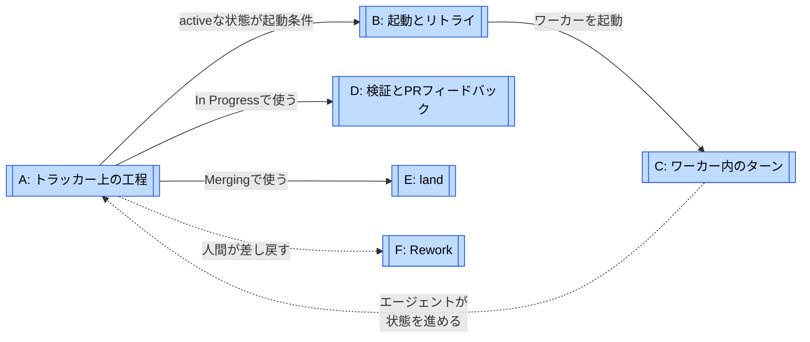
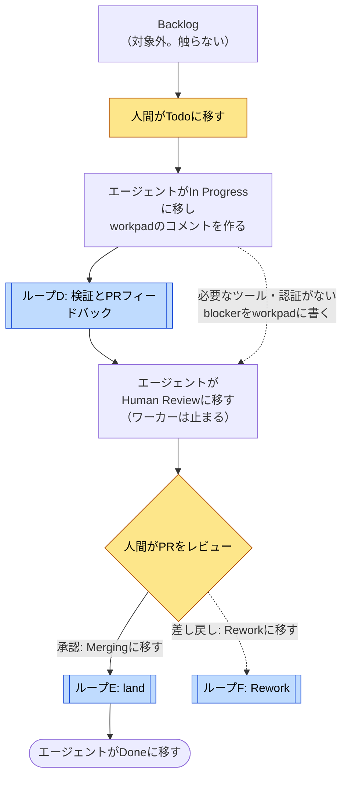
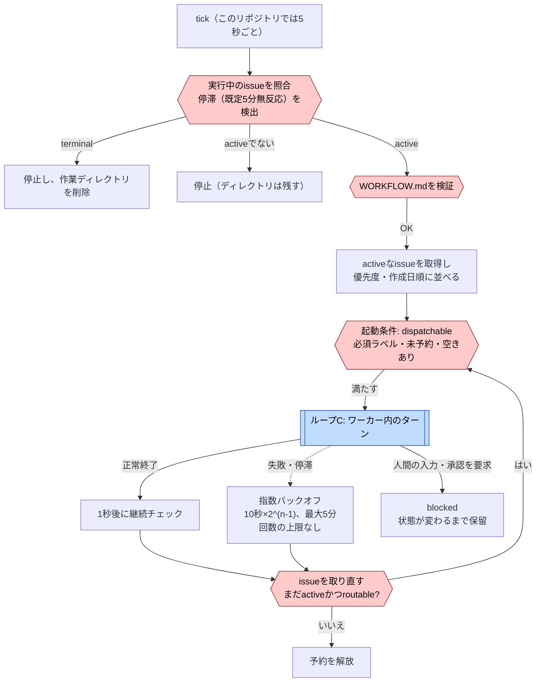
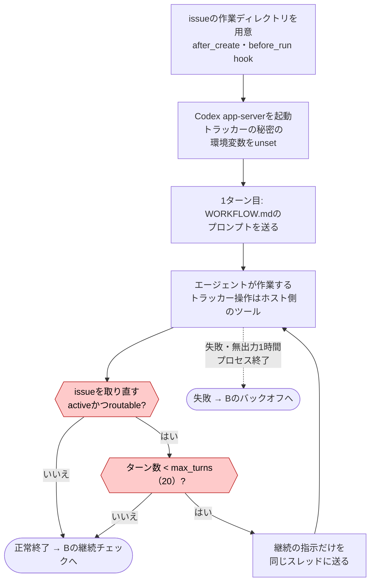
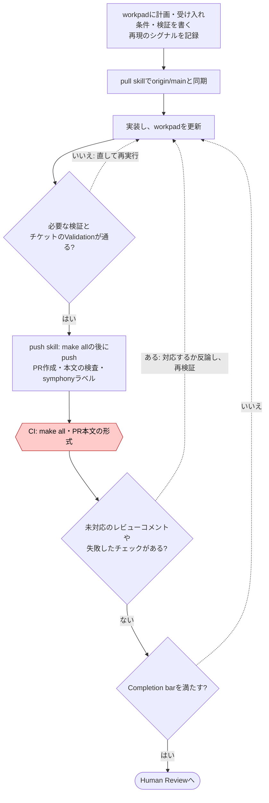
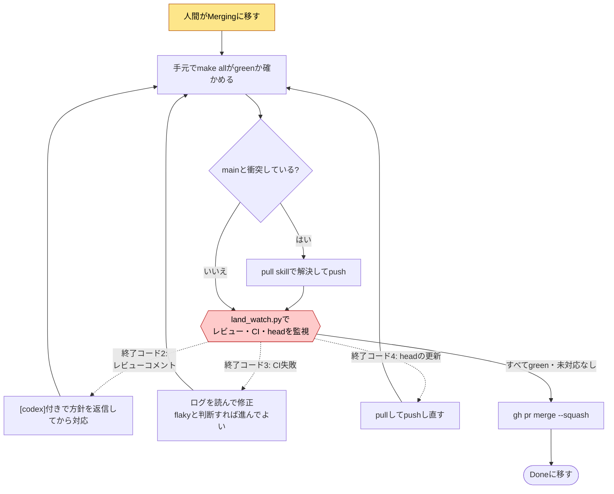
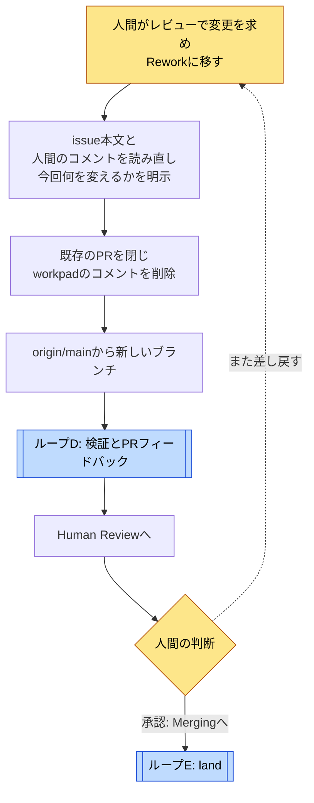

# Symphonyのループ

[← ループで読む](index.md) · [Symphonyの事例ページ](../cases/symphony.md)

**最初は A → B → C の順に読む。** Aでトラッカー上の工程全体、Bでそれを回し続けるオーケストレーター、Cで1つのワーカーの中のターンを見る。D・E・FはAの各状態でエージェントが手順書に従って回す修正ループである。

調査対象は `openai/symphony@be10a1b`。ループ名と分け方は調査者の整理で、Symphonyが公式に定義したものではない。A・D・E・Fは、このリポジトリ自身の [elixir/WORKFLOW.md](https://github.com/openai/symphony/blob/be10a1b/elixir/WORKFLOW.md) とskillの内容で、利用者ごとに書き換える部分。BとCはSPECとElixir実装のコードで、利用者が変えられるのは設定値だけ。

**強制の区別**: 六角形（機械のゲート）はコードで判定するものに限った。菱形はエージェントか人間の判断。A・D・E・Fの分岐は、ほぼすべて手順書の指示である。

## 地図: 誰が何を回すか

実線は「その状態・工程で使う」、点線は「結果を戻す」。**AはBやCの中にあるのではない。** Aの状態はトラッカーにあり、Bはその状態を読んでワーカーを起動するかを決め、Cの中のエージェントがツールでその状態を書き換える。D・E・FはCの中で動くエージェントが実行するが、どれを実行するかはAの状態で決まる。

| 図 | 回る単位・種類 | 評価と戻り先 | 抜ける条件 | 強制 |
| --- | --- | --- | --- | --- |
| [A: トラッカー上の工程](#loop-a) | 1つのissue。全体の工程 | 人間のレビューでRework（F）へ | エージェントが `Done` に移す。または人間がterminalな状態に移す | 手順書。コードは状態に応じて起動・停止するだけ |
| [B: 起動とリトライ](#loop-b) | オーケストレーターのtick（5秒）とリトライ。反復実行 | ワーカーの終了・失敗・停滞を見て再起動 | issueがactiveでなくなる、terminalになる、見えなくなる。**回数の上限はない** | コード |
| [C: ワーカー内のターン](#loop-c) | 1ワーカーのターン。反復実行 | 1ターンごとにissueを取り直す | activeでなくなる、または `max_turns`（20） | コード |
| [D: 検証とPRフィードバック](#loop-d) | 実装・検証・push。修正ループ | 検証の失敗、レビューコメント、CIの失敗で実装へ | Completion barを満たし、エージェントが `Human Review` に移す。上限なし | 手順書。CIの結果は遷移を止めない |
| [E: land](#loop-e) | PRのhead。修正ループ | `land_watch.py` の終了コード（レビュー・CI・head更新） | すべてgreenで未対応がなく、squash merge | 手順書 + 監視スクリプト。required checksはない |
| [F: Rework](#loop-f) | issue全体のやり直し。修正ループ | 人間の差し戻し | 人間が承認して `Merging` に移す。上限なし | 手順書。差し戻しは人間の操作 |

## A: トラッカー上の工程 {#loop-a}

**評価対象は1つのissue。** 状態はLinearにあり、人間とエージェントの両方が動かす。

参照先: [D](#loop-d) · [E](#loop-e) · [F](#loop-f)

`Todo`、`In Progress`、`Merging`、`Rework` がactiveで、この間はループBがワーカーを動かし続ける。`Human Review` と `Backlog` はactiveでもterminalでもないので、ワーカーは起動しない。

**プロンプトと実装の違い**: WORKFLOW.mdのStep 3は「`Human Review` では待ってポーリングする」と指示する。しかし実装では、この状態に移った時点でワーカーのターン継続（C）が終わり、照合（B）がワーカーを止める。再起動もしない。図は実装に合わせて「ワーカーは止まる」と描いた。

**強制の境界**: 状態を移すのはエージェントのツール呼び出し（Linearなら `linear_graphql`）。どの状態からどの状態へ移ってよいか、完了条件を満たしたか、をコードは確かめない。状態の名前も設定で決める。

根拠: [WORKFLOW.mdのfront matter](https://github.com/openai/symphony/blob/be10a1b/elixir/WORKFLOW.md#L1)、[Status map](https://github.com/openai/symphony/blob/be10a1b/elixir/WORKFLOW.md#L107)、[Step 3](https://github.com/openai/symphony/blob/be10a1b/elixir/WORKFLOW.md#L244)、[照合](https://github.com/openai/symphony/blob/be10a1b/elixir/lib/symphony_elixir/orchestrator.ex#L421)。

## B: 起動とリトライ {#loop-b}

**回る単位はオーケストレーターのtickとリトライのタイマー。** issueの中身は見ず、状態と設定だけで動く。

参照先: [C: ワーカー内のターン](#loop-c)

**止まる条件はトラッカーの状態だけ。** 失敗のリトライに回数の上限はなく、issueがactiveなままなら最大5分間隔で再起動を続ける。費用で止める設定もない。トークン数は観測のために集計するだけ。WORKFLOW.mdの検証に失敗したtickは、新しい起動だけを止めて照合は続ける。

**blockedはElixir実装の追加**: SPECは「入力待ちで無期限に止まらないこと」だけを求め、扱いを実装に任せる。Elixir実装は、エージェントが入力や承認を求めた場合はリトライせずに保留し、人間がトラッカーの状態を変えるまで起動しない。`approval_policy: never` のときは承認要求を自動で許可するので、保留になるのは主に、MCPツールの承認以外の質問。

**再起動したとき**: リトライのタイマーと実行中のセッションは失われる。起動時にterminalなissueの作業ディレクトリを消し、activeなissueを改めて取得して起動し直す。

根拠: [SPEC §8](https://github.com/openai/symphony/blob/be10a1b/SPEC.md#L733)、[SPEC §14.3](https://github.com/openai/symphony/blob/be10a1b/SPEC.md#L1690)、[正常終了の扱い](https://github.com/openai/symphony/blob/be10a1b/elixir/lib/symphony_elixir/orchestrator.ex#L208)、[バックオフ](https://github.com/openai/symphony/blob/be10a1b/elixir/lib/symphony_elixir/orchestrator.ex#L1232)、[停滞](https://github.com/openai/symphony/blob/be10a1b/elixir/lib/symphony_elixir/orchestrator.ex#L608)、[blocked](https://github.com/openai/symphony/blob/be10a1b/elixir/lib/symphony_elixir/orchestrator.ex#L757)、[自動承認](https://github.com/openai/symphony/blob/be10a1b/elixir/lib/symphony_elixir/codex/app_server.ex#L55)。

## C: ワーカー内のターン {#loop-c}

**回る単位は1つのCodexスレッドの中のターン。** 作業の中身はエージェント任せで、ワーカーはターンの合間にissueの状態だけを確かめる。

どちらの終わり方でも `after_run` hookを実行し、セッションを止める。作業ディレクトリは成功しても消さず、次のワーカーが引き継ぐ。

2ターン目以降は元のプロンプトを再送せず、「前のターンは正常に終わったが、issueはまだactive。最初からやり直さず、workpadの状態から再開せよ」という継続の指示だけを送る。`turn_timeout_ms`（既定1時間）は**出力がない時間**の上限で、1ターンの合計時間の上限ではない。

`max_turns` に達しても、issueがactiveなら、Bの継続チェックが1秒後に新しいワーカーを起動する。つまり `max_turns` は1つのセッションの長さを区切るもので、issueにかける総量の上限ではない。

根拠: [agent_runner.ex](https://github.com/openai/symphony/blob/be10a1b/elixir/lib/symphony_elixir/agent_runner.ex#L88)、[SPEC §16.5](https://github.com/openai/symphony/blob/be10a1b/SPEC.md#L1932)、[SPEC §10.6](https://github.com/openai/symphony/blob/be10a1b/SPEC.md#L1142)、[秘密の環境変数の除去](https://github.com/openai/symphony/blob/be10a1b/elixir/lib/symphony_elixir/codex/app_server.ex#L221)。

## D: 検証とPRフィードバック {#loop-d}

**評価対象は最新のコミットとPR。** `In Progress` の間に、エージェントが手順書に従って回す。

菱形はすべてエージェントの判断。CIのジョブは機械で判定するが、その結果を読んで次へ進むかを決めるのはエージェントで、CIが失敗しても状態の遷移は止まらない。レビューコメントは人間のものもbotのものも、「対応した」か「理由つきで反論した」まで未解決として扱う。

手順書は計画の「principal-style self-review」も求めるが、別のレビュアーを立てる指示はない。Elixir実装の `AGENTS.md` は自明でない変更でadversarial reviewを使うよう書くが、それを実行するプロンプトや仕組みはリポジトリにない。

**回数の上限はない**: sweepは「未対応がなくなるまで繰り返す」。Cの `max_turns` に達してもBが新しいワーカーを起動するので、このループを止めるのはトラッカーの状態だけ。

根拠: [Step 1](https://github.com/openai/symphony/blob/be10a1b/elixir/WORKFLOW.md#L140)、[PR feedback sweep](https://github.com/openai/symphony/blob/be10a1b/elixir/WORKFLOW.md#L171)、[Step 2](https://github.com/openai/symphony/blob/be10a1b/elixir/WORKFLOW.md#L199)、[Completion bar](https://github.com/openai/symphony/blob/be10a1b/elixir/WORKFLOW.md#L265)、[push skill](https://github.com/openai/symphony/blob/be10a1b/.codex/skills/push/SKILL.md)、[make-all.yml](https://github.com/openai/symphony/blob/be10a1b/.github/workflows/make-all.yml)。

## E: land {#loop-e}

**評価対象はPRのhead。** 人間が `Merging` に移した後、エージェントがマージまで回す。

skillは「マージされるまでユーザーに制御を返さない」と指示する。auto-mergeは禁止で、その理由として「このリポジトリにはrequired checksがないので、auto-mergeだとテストを飛ばしうる」と書く。つまり、マージを止めるゲートはGitHub側になく、エージェントがこの手順を守ることに依存する。

**公開リポジトリでは動いていない部分**: skillは `## Codex Review — <persona>` というコメントをGitHub Actionsが投稿するのを待つ手順や、pnpmのlockfileの対処を含む。このリポジトリにはそのworkflowもpnpmもなく、`symphony` ラベル付きの公開PRにも該当するコメントはなかった。別のリポジトリから移したskillと推測する。

根拠: [land SKILL.md](https://github.com/openai/symphony/blob/be10a1b/.codex/skills/land/SKILL.md)、[land_watch.py](https://github.com/openai/symphony/blob/be10a1b/.codex/skills/land/land_watch.py)、[Step 3](https://github.com/openai/symphony/blob/be10a1b/elixir/WORKFLOW.md#L244)。

## F: Rework {#loop-f}

**評価対象はアプローチ全体。** 人間の差し戻しを、部分的な手直しではなく、作り直しとして扱う。

参照先: [D](#loop-d) · [E](#loop-e)

差し戻しのたびに前回のPRとworkpadを捨てる。前回の試みで何が駄目だったかは、issueと人間のコメントからエージェントが読み取る。差し戻しの回数に上限はなく、人間が止めるかterminalな状態に移すまで続けられる。

`Todo` のissueにPRがすでに付いている場合は、作り直しではなく、PRのフィードバック対応から始める。Reworkとは別の経路。

根拠: [Step 4: Rework handling](https://github.com/openai/symphony/blob/be10a1b/elixir/WORKFLOW.md#L253)、[Step 0](https://github.com/openai/symphony/blob/be10a1b/elixir/WORKFLOW.md#L118)。
