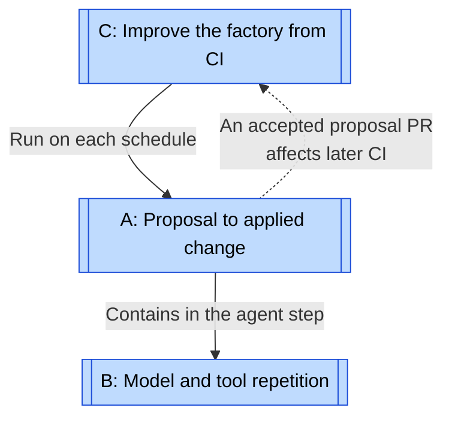
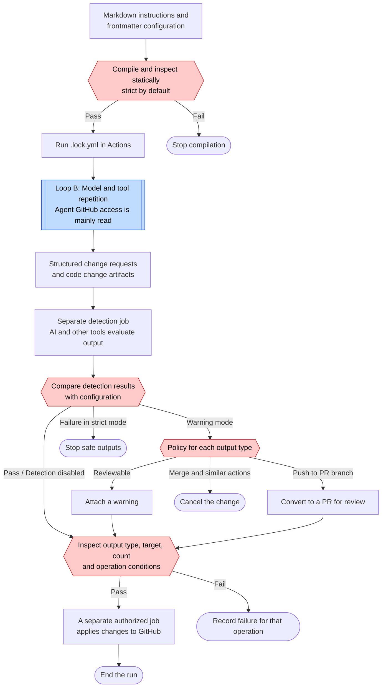
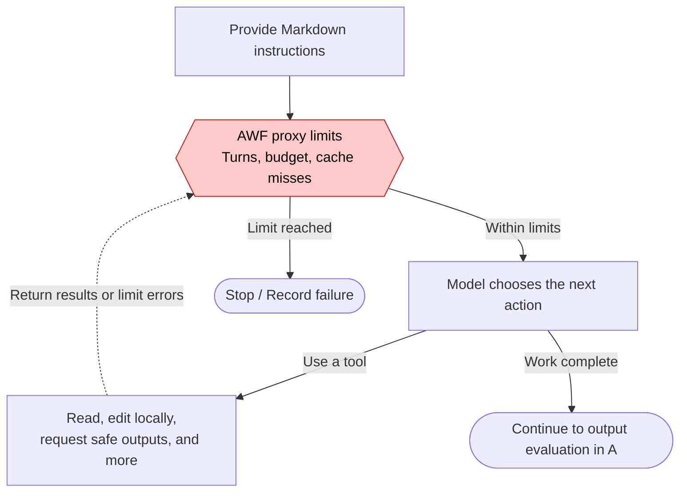
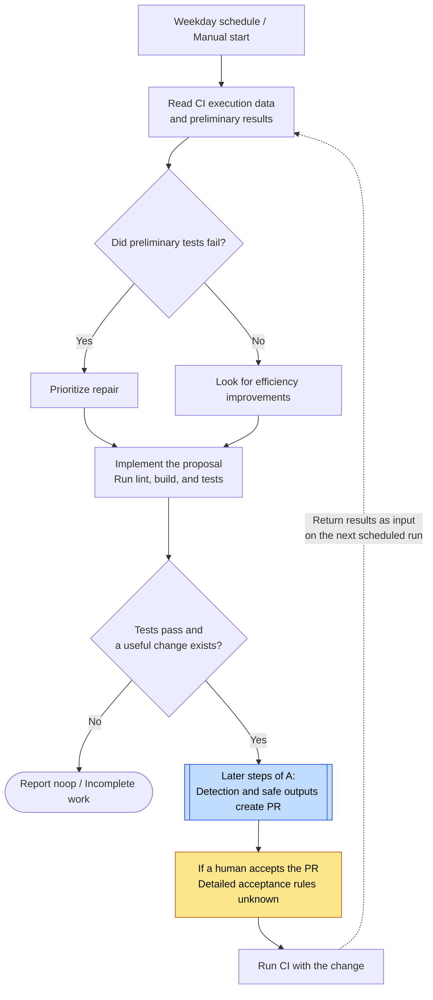

# GitHub Agentic Workflows loops

[← Explore the loops](index.md) · [gh-aw case study](../cases/gh-aw.md)

Research target: `github/gh-aw@633bb2c2383d3ec0623e46b8c928c20c209b38ff`. Research date: 2026-10-31 JST. The researcher chose the names and divisions. A covers one execution, and B repeats model calls within it. C shows operational feedback through the repository's ci-coach. It is not a built-in feature for every user.

## Map: Workflow, repetition, and improvement

Labels on solid arrows distinguish execution order from containment. Dotted arrows show feedback. C does not guarantee automatic PR acceptance. The implementation does not always return to C after A ends. A PR is a pull request for code review. CI runs automated tests and other project tasks.

| Diagram | Unit / type | Evaluation and return path | Exit / limit | Enforcement |
| --- | --- | --- | --- | --- |
| [A: Proposal to applied change](#loop-a) | One Actions run / workflow | Compiler, output rules, and detection. Failure usually stops that run without an automatic return to input. | Output applied, noop, failure, or timeout | Code controls permissions and application. AI evaluates detection. |
| [B: Model and tool repetition](#loop-b) | Model response and tool calls / repeated execution | Tool results and limit errors return to the same agent. | Agent completion, turn limit, budget, or time limit | The compiler passes limits to AWF. Its internal stop implementation is not audited. |
| [C: Improve the factory from CI](#loop-c) | Scheduled ci-coach run and improvement PR / operational repair | CI logs and preliminary results lead to CI configuration or code changes. | No improvement: noop. Otherwise, a PR or failure. Overall attempt limit unknown. | Actions starts the run. A prompt requires successful tests before a PR. Acceptance is separate. |

## A: Proposal to applied change {#loop-a}

This workflow follows the generated `ci-coach.lock.yml`. Input editing and compilation happen before execution. The diagram does not imply automatic model repair after detection fails.

See [B: Model and tool repetition](#loop-b).

The diagram covers normal built-in outputs. In warning mode, unclassified output types can execute with a warning. Administrator configuration needs separate inspection for `strict: false`, disabled detection, custom jobs, tokens, or MCP. Generated files also contain helper jobs such as activation. This diagram focuses on the boundary between reasoning and writes.

Human approval is not a required step. The system can create PRs with warnings. Reviewing and accepting a PR is separate from authorizing the output. Experimental merge rejects default and protected branches. Its only permitted destination is the head of another open PR.

Evidence: [Agent permissions](https://github.com/github/gh-aw/blob/633bb2c2383d3ec0623e46b8c928c20c209b38ff/.github/workflows/ci-coach.lock.yml#L564), [Application job](https://github.com/github/gh-aw/blob/633bb2c2383d3ec0623e46b8c928c20c209b38ff/.github/workflows/ci-coach.lock.yml#L2856), [Detection configuration](https://github.com/github/gh-aw/blob/633bb2c2383d3ec0623e46b8c928c20c209b38ff/pkg/workflow/threat_detection_config.go#L32), [Warning policy](https://github.com/github/gh-aw/blob/633bb2c2383d3ec0623e46b8c928c20c209b38ff/actions/setup/js/safe_output_handler_manager.cjs#L1115), [Merge restrictions](https://github.com/github/gh-aw/blob/633bb2c2383d3ec0623e46b8c928c20c209b38ff/actions/setup/js/merge_pull_request.cjs#L502).

## B: Model and tool repetition {#loop-b}

Each cycle covers one model response and its tool calls. This is engine execution, not a product-wide instruction to rewrite code until it passes.

Defaults are 500 turns, 1,000 AI Credits, and five consecutive cache misses. Detection has a separate default budget of 400 AI Credits. A negative budget disables its limit. The compiler sets proxy configuration, but the full external AWF execution path is not audited. The gate shows that execution contract. The generated ci-coach agent job stops after 60 minutes.

The CLI function `ExecuteWithRepeat` repeats a specified number of times and returns the first error immediately. HTTP/API retries and repeated mergeability queries are separate from this model loop. They do not establish unlimited repair and restart until success.

Evidence: [Default constants](https://github.com/github/gh-aw/blob/633bb2c2383d3ec0623e46b8c928c20c209b38ff/pkg/constants/constants.go#L433), [AWF configuration](https://github.com/github/gh-aw/blob/633bb2c2383d3ec0623e46b8c928c20c209b38ff/pkg/workflow/awf_config_build.go#L109), [Generated timeout](https://github.com/github/gh-aw/blob/633bb2c2383d3ec0623e46b8c928c20c209b38ff/.github/workflows/ci-coach.lock.yml#L581), [Repeat](https://github.com/github/gh-aw/blob/633bb2c2383d3ec0623e46b8c928c20c209b38ff/pkg/cli/retry.go#L37).

## C: Improve the factory from CI {#loop-c}

ci-coach creates improvement PRs from CI records. Its implementation ends there. The diagram labels acceptance and later results as operational feedback.

See [A: Proposal to applied change](#loop-a).

Diamonds show agent decisions under instructions. The prompt says to create a PR only after tests pass. The research did not establish that safe outputs requires proof of passing tests. Preliminary tests are nonfatal, so analysis can continue after failure. A new PR does not imply automatic acceptance. B and the Actions timeout limit each run, but the total duration of improvement across days is unknown.

Evidence: [ci-coach configuration and mission](https://github.com/github/gh-aw/blob/633bb2c2383d3ec0623e46b8c928c20c209b38ff/.github/workflows/ci-coach.md#L1), [Preliminary tests](https://github.com/github/gh-aw/blob/633bb2c2383d3ec0623e46b8c928c20c209b38ff/.github/workflows/ci-coach.md#L80), [Completion conditions](https://github.com/github/gh-aw/blob/633bb2c2383d3ec0623e46b8c928c20c209b38ff/.github/workflows/ci-coach.md#L320), [Normal CI](https://github.com/github/gh-aw/blob/633bb2c2383d3ec0623e46b8c928c20c209b38ff/.github/workflows/ci.yml#L1).
