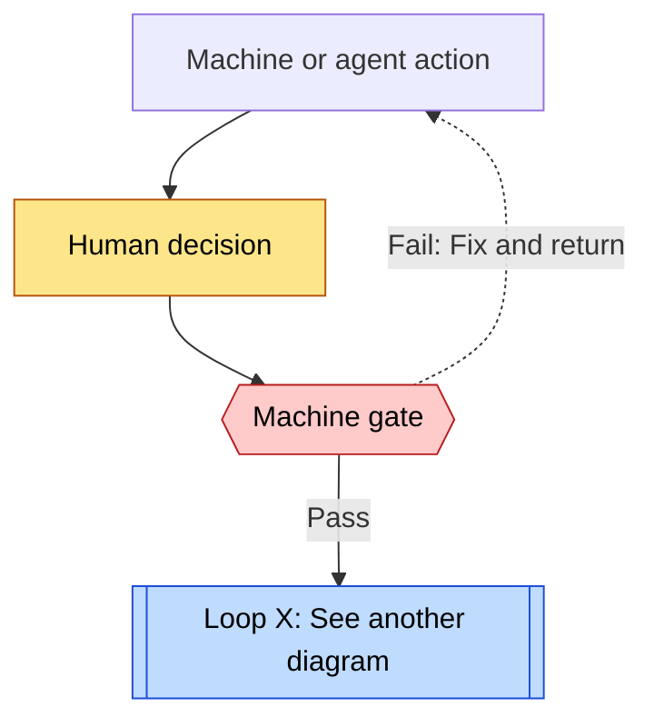

# Explore the loops

[← Home](../../) · [Cases](../index.md) · [Concepts](../concepts.md)

Loops help explain software factories. A feedback loop uses results to change the next attempt. Follow the sequence: build, evaluate, and fix. This shows how a factory maintains quality beyond code generation.

A circular diagram alone does not explain a system. A workflow follows steps in order. Repeated execution processes the next input. A repair loop changes the work based on evaluation results. Human authority, shared state, and trust boundaries also matter.

## What to examine in a loop

| View | Questions |
| --- | --- |
| Purpose and target | What improves: a plan, code, a result, or the factory itself? |
| Trigger and unit | What starts the loop? Does each cycle cover an issue, a plan revision, or a commit? |
| Evaluation | What is the reference? Who evaluates the work, and what records support the result? |
| Return path | After failure, what changes: the plan, implementation, or configuration? |
| Exit and stop conditions | What ends the loop? When does a human take over? Is there an attempt limit? |
| Enforcement and limits | Does code enforce the rule? Is it an instruction or a research interpretation? |

“Repeat until it passes” does not explain stop conditions or cost limits. Do not assume that an undocumented limit exists.

## How to read the diagrams

- Each diagram explains one loop. Separate diagrams show the overall workflow and relationships.
- A reference box such as `Loop B` points to a child loop. The link below opens its diagram without nested detail.
- Containment, sequence, and feedback have different meanings. Sequential steps under one parent are not necessarily parent and child loops.
- Loop names and divisions help explain the system. They are not necessarily official names or guarantees of automatic execution.

## Legend

Solid arrows show progress. Dotted arrows return evaluation results. Relationship maps label arrows when they use another meaning. Text and shapes identify each role alongside color. A gate is a condition that controls progress.

On narrow screens, scroll diagrams horizontally.

## Cases

| Case | Diagrams | Page |
| --- | --- | --- |
| Swamp | Development overview A, details B–E, improvement F, user execution G, and improvement H | [Swamp loops](swamp.md) |
| Superpowers | Workflow A, task loop B, repair loop C (five rounds maximum), final SDD review D, TDD E, skill improvement F, final Native review G | [Superpowers loops](superpowers.md) |
| Symphony | Tracker workflow A, dispatch and retry B (no attempt limit), worker turns C (20 maximum), evaluation and PR feedback D, land E, Rework F | [Symphony loops](symphony.md) |
| OpenHands | Independent scanners, triage A, implementation and review B, base update and merge C, delivery retry D. Unknown status publication is explicit. | [OpenHands loops](openhands.md) |
| Orchestrator.inc | Workflow A, fact collection B, worker feedback C, review for each head D, conditional merge E | [Orchestrator.inc loops](orchestrator.md) |
| GitHub Agentic Workflows | Proposal to applied change A, model and tool repetition B, factory improvement from CI C. Workflow and improvement cycles remain separate. | [GitHub Agentic Workflows loops](gh-aw.md) |
| Matt Pocock | Workflow A, AI review and repair B, factory improvement C. These show skill design rules, not enforced implementation. | [Matt Pocock loops](matt-pocock.md) |
| Stripe Minions | Request to human review A, local lint B, repair with two CI rounds maximum C. Based on official articles. | [Stripe Minions loops](stripe-minions.md) |
| StrongDM | Operational evaluation A remains separate from the public Attractor workflow B and node retry C. | [StrongDM loops](strongdm.md) |
| SSSF | Workflow A, three reviews and two repairs B, JSON correction C, test repair in another template D | [SSSF loops](sssf.md) |

The number of loops depends on the level of detail. Compare evaluation independence, effective feedback, human intervention points, and evidence quality. Loop counts do not rank the cases.
