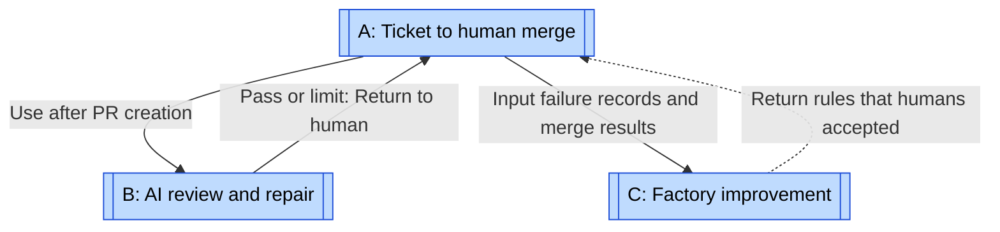
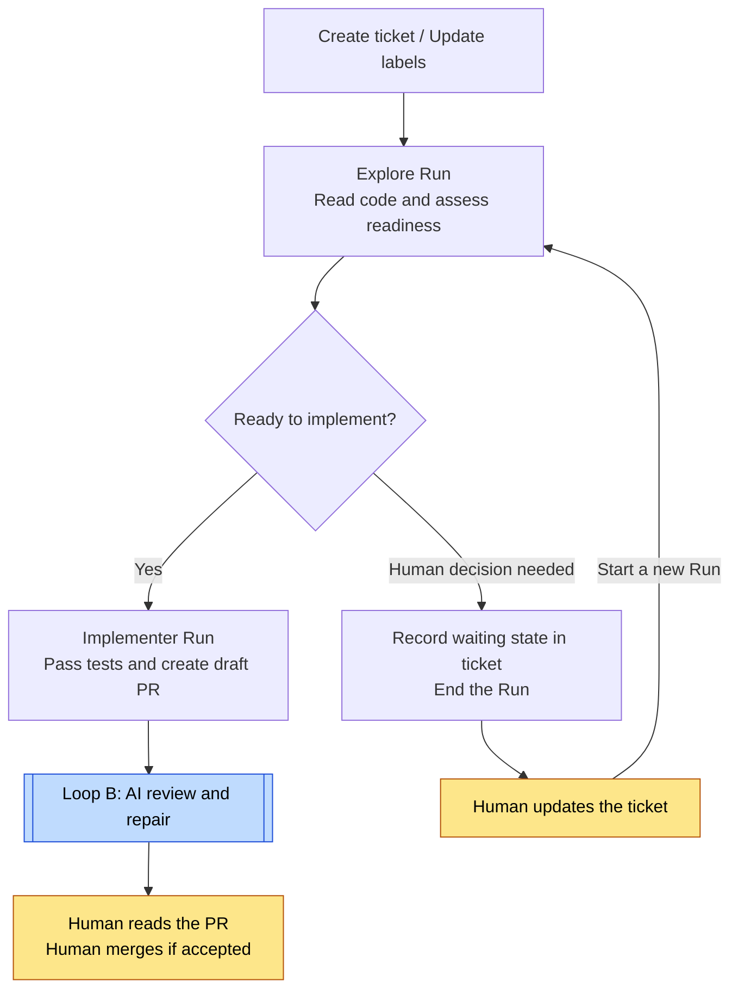
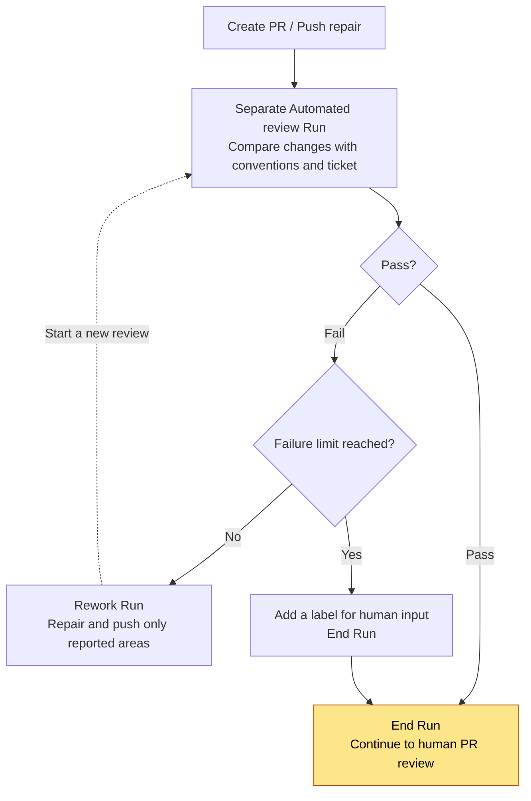
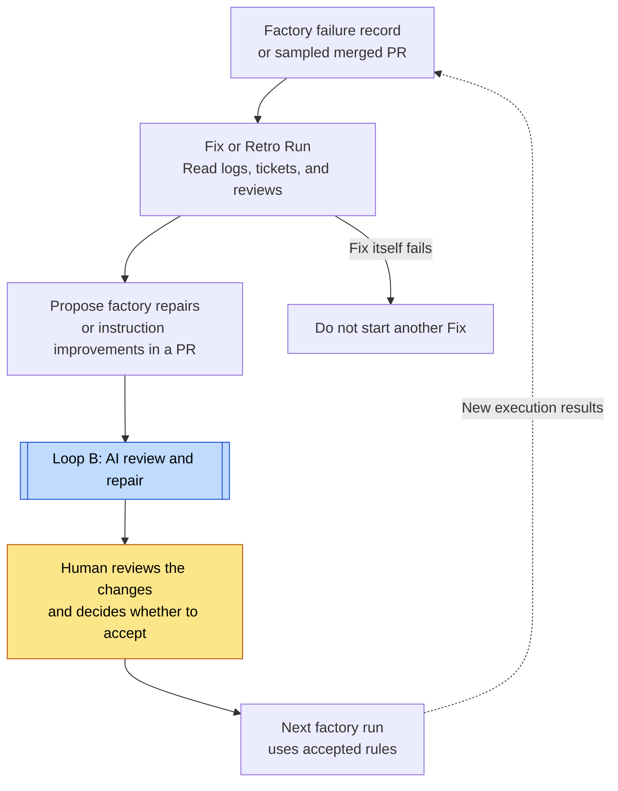

# Matt Pocock loops

[← Explore the loops](index.md) · [Case study](../cases/matt-pocock.md)

Research date: 2026-11-02. Target: `mattpocock/skills@b59cab42bf1206e1363eafc37f71b21c3bcaa12f`. The diagrams organize design rules from SKILL.md and EXAMPLE-TASKS.md. They do not reconstruct a running implementation. The researcher chose the names and divisions.

Diamonds represent conditions in the instructions. These diagrams contain no hexagonal gates because the research did not establish machine enforcement.

## Relationship map

See [A](#loop-a), [B](#loop-b), and [C](#loop-c). A shows the overall workflow. B repairs code. C uses execution results to change the workflow itself. C does not automatically repair itself through recursive runs.

| Diagram | Unit | Evaluation and return path | Exit conditions and limits |
| --- | --- | --- | --- |
| A | Ticket to PR, with multiple Runs inside | Explore decides whether implementation can start. It returns decisions to a human when needed. | A human merges the PR. A Run ends when human input is needed. |
| B | Each review or rework Run for a PR | Compare changes with conventions and the ticket. Repair only reported areas. | Pass or the specified failure limit returns work to a human. No number or enforcement implementation is supplied. |
| C | Failed Run or sampled merged PR | Propose factory changes from logs, findings, and results. | Apply after a human decision. Instructions prohibit starting Fix from a failure of Fix itself. |

## A: Ticket to human merge {#loop-a}

See [B](#loop-b). Users implement ticket update detection, tests, state storage, and disposal of the execution environment. A Run does not keep a process alive until a human replies.

Evidence: [Run / Runner](https://github.com/mattpocock/skills/blob/b59cab42bf1206e1363eafc37f71b21c3bcaa12f/skills/in-progress/software-factory/SKILL.md#L18), [Explore / Implementer](https://github.com/mattpocock/skills/blob/b59cab42bf1206e1363eafc37f71b21c3bcaa12f/skills/in-progress/software-factory/EXAMPLE-TASKS.md#L5).

## B: AI review and repair {#loop-b}

The designer sets the limit. The skill does not implement a counter. A PR at the limit returns to human judgment, not automatic acceptance. Neither a cost limit nor a specific attempt count is supplied.

Evidence: [Starting automation](https://github.com/mattpocock/skills/blob/b59cab42bf1206e1363eafc37f71b21c3bcaa12f/skills/in-progress/software-factory/SKILL.md#L54), [Automated review / Rework](https://github.com/mattpocock/skills/blob/b59cab42bf1206e1363eafc37f71b21c3bcaa12f/skills/in-progress/software-factory/EXAMPLE-TASKS.md#L19).

## C: Factory improvement {#loop-c}

See [B](#loop-b). This diagram combines Fix and Retro into one improvement path, but they have different triggers. Execution failure starts Fix. A sample of merged results starts Retro. One in ten merges is an example, not a fixed default. Human acceptance means that proposals do not necessarily affect the next run.

Ratchet is a separate migration example. It moves files from an exception list into stricter tests, one at a time. Architecture records candidates in tickets and waits for human selection before implementation. These paths do not belong unconditionally inside this diagram.

Evidence: [Fix / Architecture / Retro](https://github.com/mattpocock/skills/blob/b59cab42bf1206e1363eafc37f71b21c3bcaa12f/skills/in-progress/software-factory/EXAMPLE-TASKS.md#L61), [Ratchet](https://github.com/mattpocock/skills/blob/b59cab42bf1206e1363eafc37f71b21c3bcaa12f/skills/in-progress/software-factory/EXAMPLE-TASKS.md#L39).
