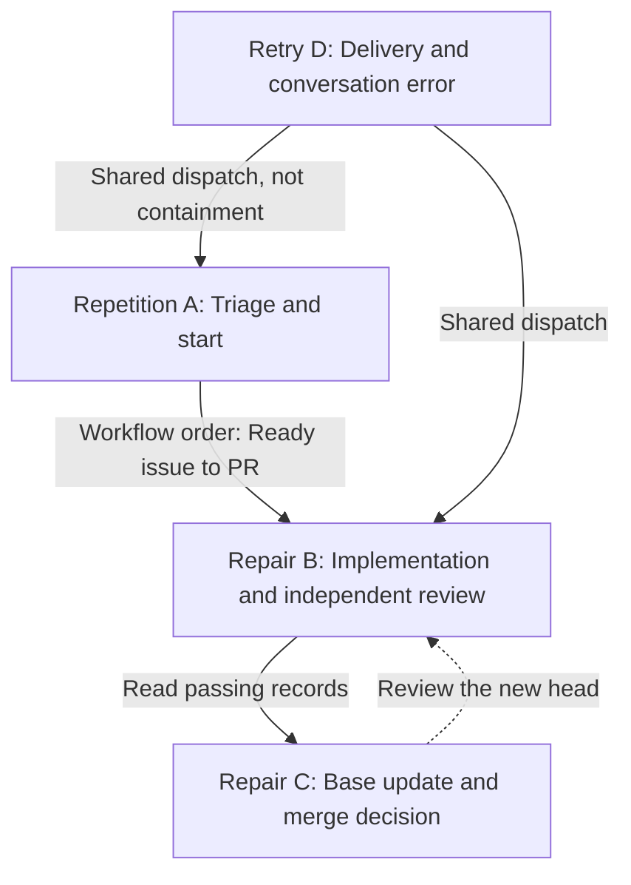
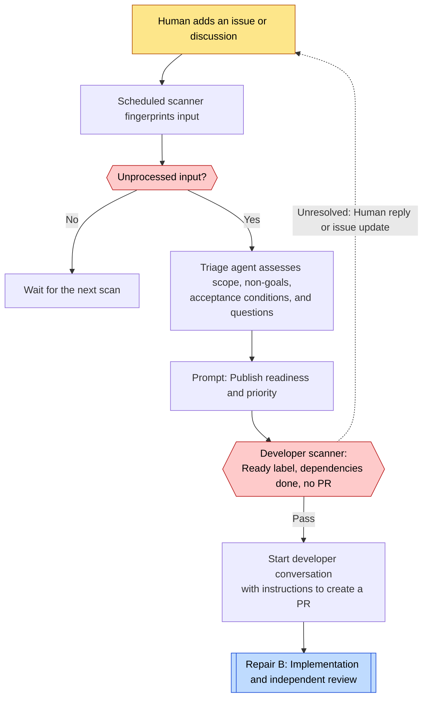
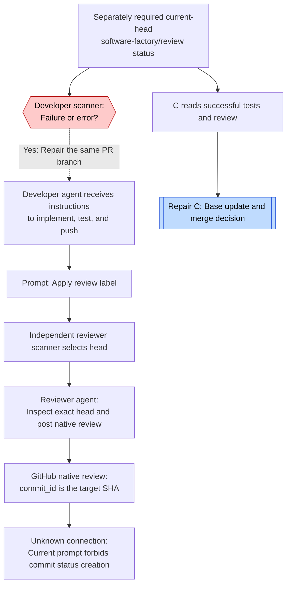
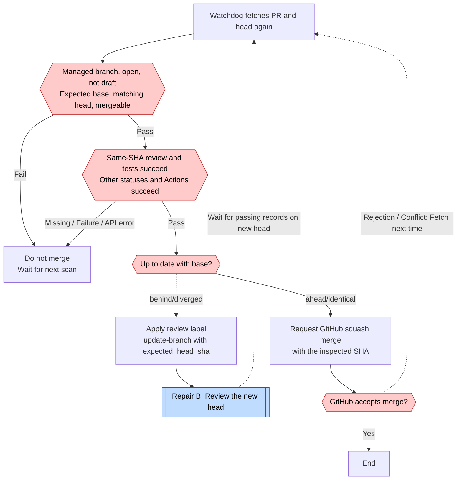
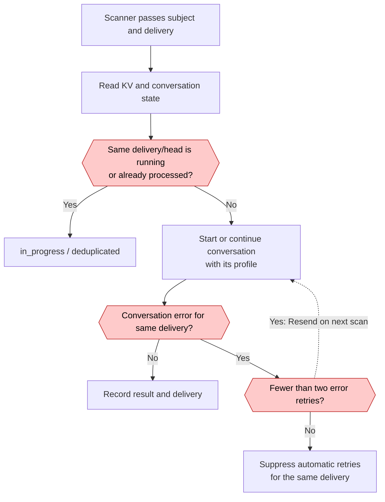

# OpenHands loops

[← Case study](../cases/openhands.md) · [Loop index and legend](index.md)

Research date: 2026-10-31 JST. Main target: `OpenHands/extensions@6fb2b67680b9a5b41452a148e5705f99c7df1a75`. The researcher chose the following names and divisions.

## Relationship map

Four automations run independently on schedules. One parent loop does not call all four roles. The current reviewer catalog does not establish a path that creates the required status. Therefore, the passing-record connection from B to C and the repair trigger within B remain unknown. The official demo and the current HEAD implementation do not establish one complete cycle together.

| Unit | Cycle unit | Evaluation and return path | Exit / enforcement and limits |
| --- | --- | --- | --- |
| Repetition A | Issue input fingerprint and scheduled scan | Triage assesses scope, questions, and acceptance conditions. Unresolved decisions return to human discussion. | `ready-for-dev` and completed dependencies start the developer. Triage correctness depends on the prompt. |
| Repair B | PR head SHA | Instructions tell the developer to read reviewer findings. The scanner starts repair on review status failure/error. | Review the new head. Current catalog status publisher unknown. The overall repair limit is unknown, not established as unlimited. |
| Repair C | PR head with passing records and current base | If the base is stale, request GitHub update-branch and return to B. | Same-head passing status, all status/Actions success, fresh base, and mergeable state. Merge specifies the SHA. No LLM. |
| Retry D | Delivery for an automation and subject | Resend the same work after a conversation error for that delivery. | Two error retries. A new delivery resets the count. This is not a total cost or repair limit. |

## Repetition A: Triage and start {#loop-a}

[Continue to repair B](#loop-b)

This repeats input processing. It does not evaluate and repair one implementation. Standard catalog triage uses legacy direct mode. The guarded publisher, which inspects JSON recommendations, is optional. The developer scanner does not reassess whether the agent correctly followed readiness instructions. [Triage](https://github.com/OpenHands/extensions/blob/6fb2b67680b9a5b41452a148e5705f99c7df1a75/skills/github-issue-triage/scripts/worker.py) · [Developer](https://github.com/OpenHands/extensions/blob/6fb2b67680b9a5b41452a148e5705f99c7df1a75/skills/github-issue-to-pr/scripts/worker.py#L117)

## Repair B: Implementation and independent review {#loop-b}

[Continue to repair C](#loop-c)

The missing arrow from native review to status is deliberate. The reviewer prompt requires `commit_id`. Completion reads a review from the same account for the same SHA. However, developer repair reads `software-factory/review` failure/error rather than native reviews. This condition also does not start repair when only tests fail. A separate status publisher or a working historical demo remains possible. [Reviewer prompt](https://github.com/OpenHands/extensions/blob/6fb2b67680b9a5b41452a148e5705f99c7df1a75/skills/github-pr-reviewer/scripts/main.py#L934) · [Repair trigger](https://github.com/OpenHands/extensions/blob/6fb2b67680b9a5b41452a148e5705f99c7df1a75/skills/github-issue-to-pr/scripts/worker.py#L136)

## Repair C: Base update and merge decision {#loop-c}

[Continue to repair B](#loop-b)

All these decisions use deterministic Python code, which follows fixed rules. With no Actions present, an empty `required_workflow_ids` permits progress. The code trusts status context and state without inspecting the publisher. The SHA fixes the head, but does not freeze base updates between comparison and merge. [Watchdog](https://github.com/OpenHands/extensions/blob/6fb2b67680b9a5b41452a148e5705f99c7df1a75/skills/github-delivery-watchdog/scripts/worker.py#L12) · [Status reading](https://github.com/OpenHands/extensions/blob/6fb2b67680b9a5b41452a148e5705f99c7df1a75/skills/github/scripts/github_client.py#L214)

## Retry D: Delivery and conversation error {#loop-d}

The diagram summarizes the shared dispatcher. Local and cloud modes have separate launch and recovery paths. Error retries count per delivery and reset when a new head or input changes the delivery. By default, the reviewer starts two new conversations per scan. The catalog scanner has a 300-second timeout. Neither value limits total factory cost or repair attempts. [Dispatcher](https://github.com/OpenHands/extensions/blob/6fb2b67680b9a5b41452a148e5705f99c7df1a75/skills/github/scripts/agent_conversation.py#L228) · [Reviewer launch capacity](https://github.com/OpenHands/extensions/blob/6fb2b67680b9a5b41452a148e5705f99c7df1a75/skills/github-pr-reviewer/scripts/worker.py#L45)
