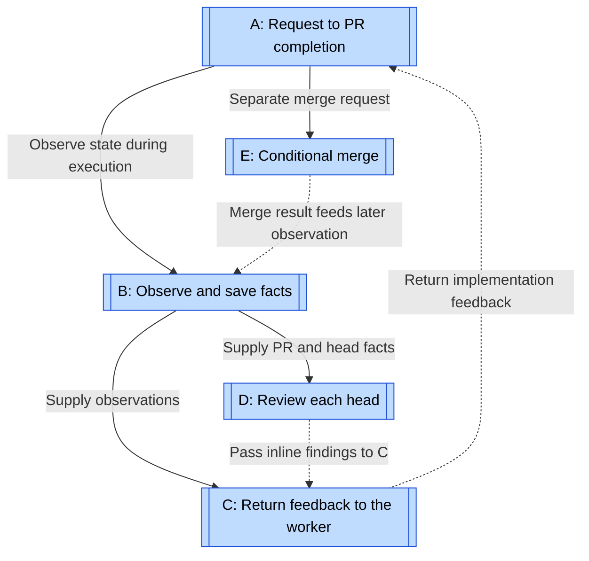
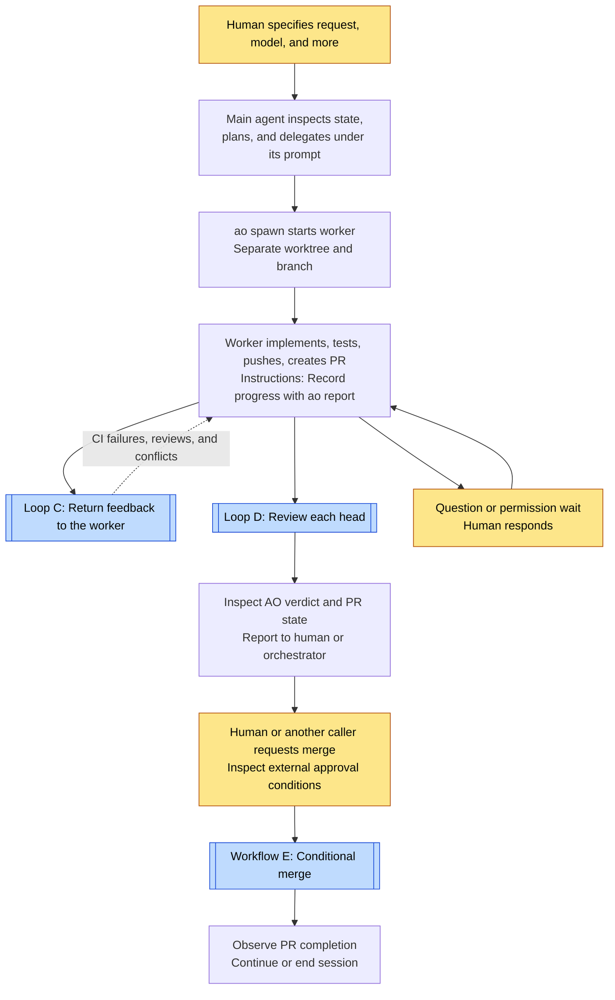
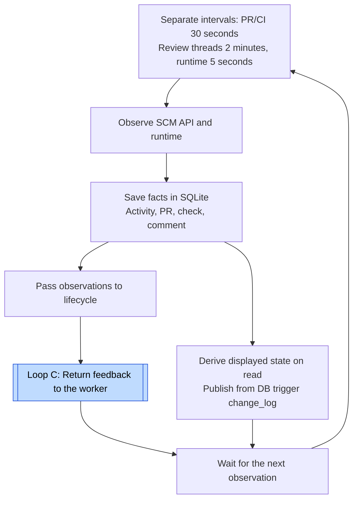
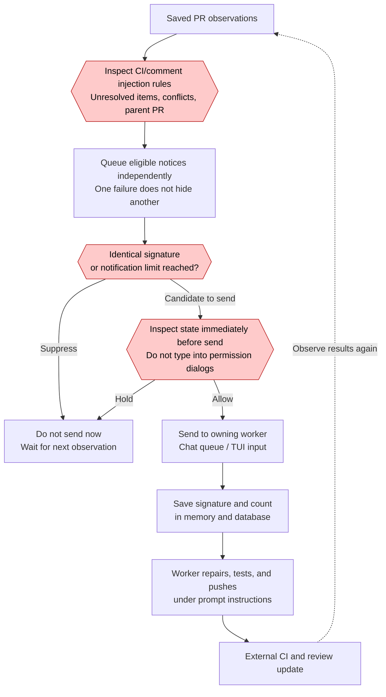
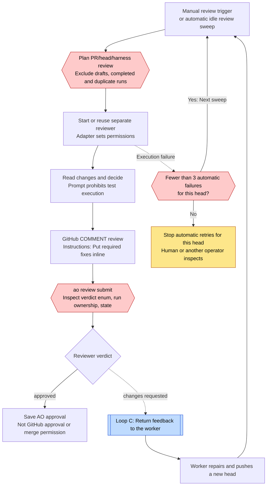
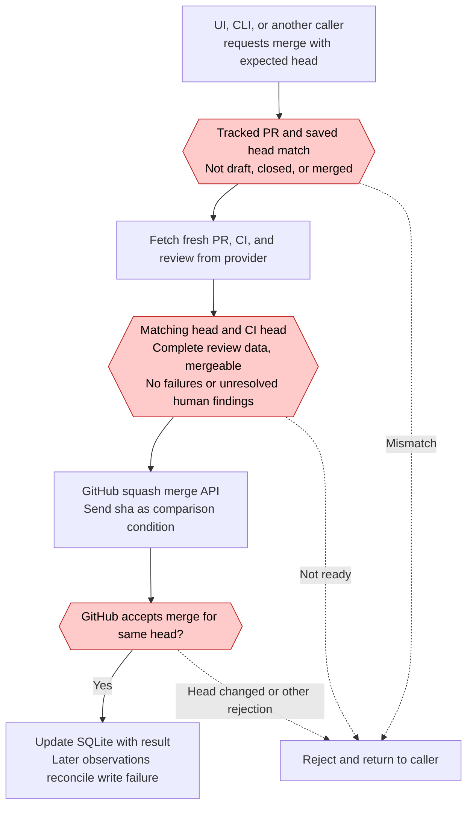

# Orchestrator.inc loops

[← Explore the loops](index.md) · [Case study](../cases/orchestrator.md)

Research target: `OrchestratorInc/agent-orchestrator@c0b351a31eccaf1ac55f8e5015fd21ab414545ca`. Research date: 2026-10-31 JST. The researcher chose the names and divisions. A shows the workflow, B repeats observation, C and D return evaluation results, and E covers merge. B does not necessarily call C and D in sequence.

Hexagons show code decisions. Diamonds show human or agent decisions. Role instructions and repair requests remain separate from machine gates. These diagrams cover the public local daemon, a background service. They do not cover the private AO Cloud.

## Relationship map

See [A](#loop-a), [B](#loop-b), [C](#loop-c), [D](#loop-d), and [E](#loop-e).

Solid arrows show execution or information flow. Dotted arrows show feedback. A uses C and D. However, polling in B, automatic review sweeps in D, and agent work run independently in parallel. No arrow automatically starts merge E from an approved result in D.

| Diagram | Unit / type | Evaluation and return path | Exit / limit |
| --- | --- | --- | --- |
| [A](#loop-a) | Request and worker session / full workflow | CI, reviews, and human instructions return to the worker. | PR completion or human stop. Overall attempt and cost limits unknown. |
| [B](#loop-b) | PR/CI and runtime polling / repeated execution | Save observations for displayed state and actions. | Daemon stops or target leaves scope. Defaults: PR/CI 30 seconds, review threads two minutes, runtime five seconds. |
| [C](#loop-c) | PR and notification key / repair loop | CI failures, comments, and conflicts return to the owning worker. | No resend for an identical signature. Review/comment: three notifications per key maximum. CI/conflicts: no attempt limit. |
| [D](#loop-d) | Review run per PR/head/harness / repair loop | Required inline findings reach the worker through C. | Usually reuse same-head results. Three automatic execution failures stop retries for that head. This is not an overall repair limit. |
| [E](#loop-e) | Merge request with expected head / workflow | Reject failed conditions and return to the caller. | Squash merge after current conditions and SHA match. AO review approval is not mandatory. |

## A: Request to PR completion {#loop-a}

See [C](#loop-c), [D](#loop-d), and [E](#loop-e).

This is a representative workflow. Review dispatch and final approval depend on configuration and requests. D is not mandatory for every session. Prompts assign coordination to the main agent and repairs to workers. The merge API has no AO-specific gate that proves independent human approval.

Evidence: [Role prompts](https://github.com/OrchestratorInc/agent-orchestrator/blob/c0b351a31e/backend/internal/session_manager/prompt.go#L215), [Worker and review policy](https://github.com/OrchestratorInc/agent-orchestrator/blob/c0b351a31e/backend/internal/session_manager/prompt.go#L324).

## B: Observe and save facts {#loop-b}

See [C](#loop-c).

B repeats polling. It does not improve code itself. A failed probe does not establish that a process is dead. The UI derives columns from saved facts rather than storing and transitioning the columns themselves. Review threads do not use the same 30-second interval as PR/CI.

Evidence: [SCM interval](https://github.com/OrchestratorInc/agent-orchestrator/blob/c0b351a31e/backend/internal/observe/scm/observer.go#L29), [Reaper interval](https://github.com/OrchestratorInc/agent-orchestrator/blob/c0b351a31e/backend/internal/observe/reaper/reaper.go#L19), [Architecture](https://github.com/OrchestratorInc/agent-orchestrator/blob/c0b351a31e/docs/architecture.md#L639).

## C: Return feedback to the worker {#loop-c}

CI and conflict notices have no count limit, but identical signatures do not repeat. Review/comment notices have a maximum of three per key. This does not guarantee three machine-enforced repair attempts for one finding. An unresolved item with an unchanged signature receives no repeat notice. A definite observation of conflict resolution re-arms the notice for recurrence.

The database write follows delivery. If persistence fails and the service restarts, an extra notification is possible. Normal notices wait during needs-input. Even urgent conflict notices do not enter permission waits or input fields without established safety.

Evidence: [Notification conditions](https://github.com/OrchestratorInc/agent-orchestrator/blob/c0b351a31e/backend/internal/lifecycle/reactions.go#L65), [Deduplication and send order](https://github.com/OrchestratorInc/agent-orchestrator/blob/c0b351a31e/backend/internal/lifecycle/reactions.go#L929).

## D: Review each head {#loop-d}

See [C](#loop-c).

By default, automatic dispatch uses a one-minute sweep and requires an eligible worker to be idle for one minute. After changes requested on the same head, it waits for a new head rather than repeating the review. `--rerun` separately requests deliberate same-head review. Three automatic execution failures do not mean three review and repair rounds.

The prompt requests a structured AO result after the GitHub post. AO can record a result without an ID if the post fails. Adapter code supplies the Codex read-only sandbox and Claude Code tool restrictions. Experimental host-trusted reviewers do not share one universal sandbox policy.

Evidence: [Automatic review conditions and limits](https://github.com/OrchestratorInc/agent-orchestrator/blob/c0b351a31e/backend/internal/autoreview/coordinator.go), [Prompt](https://github.com/OrchestratorInc/agent-orchestrator/blob/c0b351a31e/backend/internal/review/prompt.go), [Submit](https://github.com/OrchestratorInc/agent-orchestrator/blob/c0b351a31e/backend/internal/service/review/review.go#L884), [Gateway ADR](https://github.com/OrchestratorInc/agent-orchestrator/blob/c0b351a31e/docs/adr/0002-secure-interactive-reviewer-gateway.md).

## E: Conditional merge {#loop-e}

E returns failure to its caller. It is not itself a repair loop. The caller separately decides whether to repair and request again. This API does not require AO reviewer approval or independent human approval as dedicated inputs. GitHub protection rules apply separately.

Post-merge termination applies per session. With the feature enabled, it stops when no PR remains open, at least one PR is merged, and the worker is inactive. One merge does not stop a worker that is creating another PR.

Evidence: [Merge service](https://github.com/OrchestratorInc/agent-orchestrator/blob/c0b351a31e/backend/internal/service/pr/action_service.go#L125), [Readiness](https://github.com/OrchestratorInc/agent-orchestrator/blob/c0b351a31e/backend/internal/domain/pr.go#L235), [GitHub SHA condition](https://github.com/OrchestratorInc/agent-orchestrator/blob/c0b351a31e/backend/internal/adapters/scm/github/merge_action.go#L19), [Session completion](https://github.com/OrchestratorInc/agent-orchestrator/blob/c0b351a31e/backend/internal/lifecycle/reactions.go#L65).
