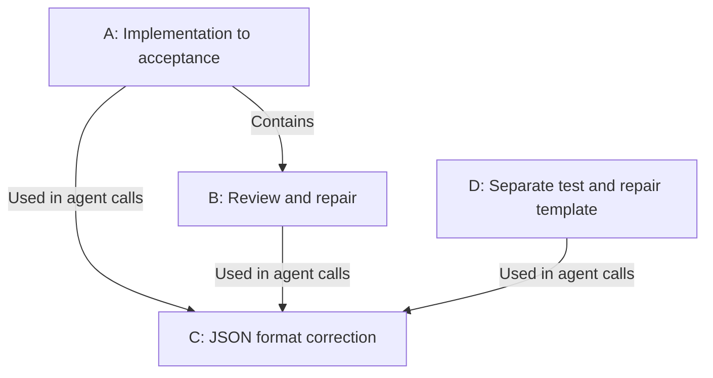
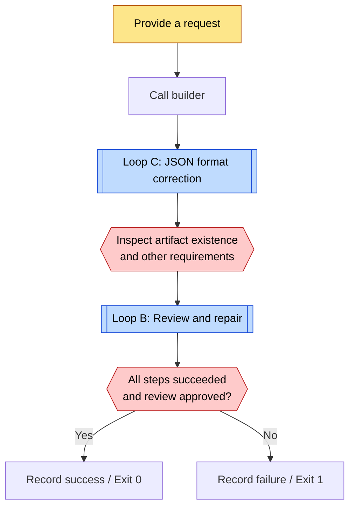
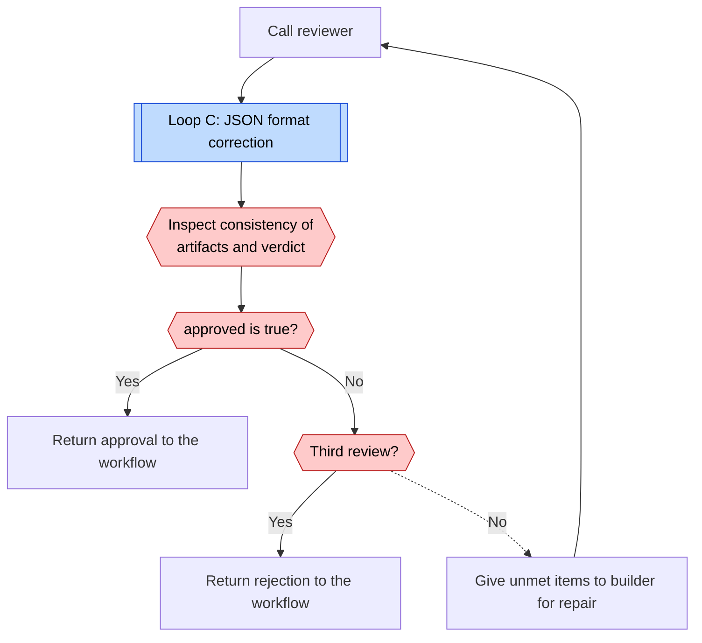
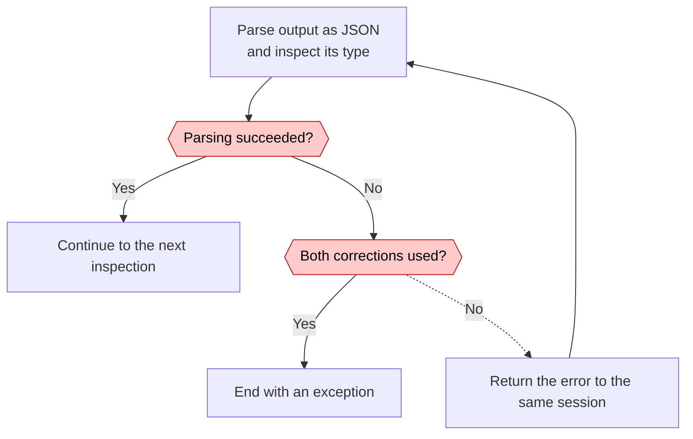
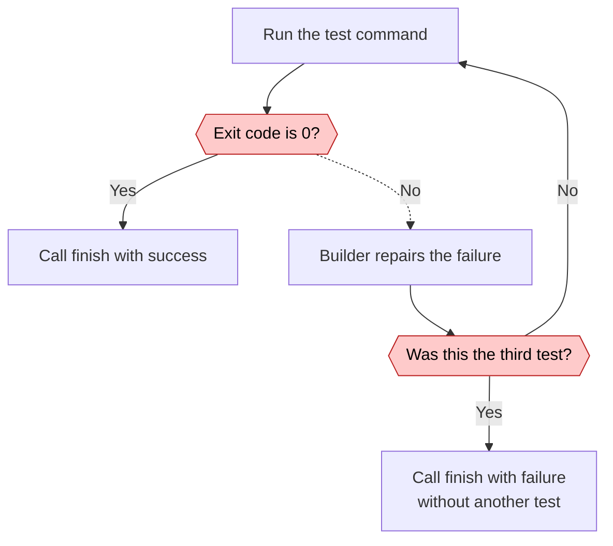

# SSSF loops

[← Loop index](index.md) · [Case study](../cases/sssf.md)

Research date: 2026-11-02. Target commit: `de31374882e7a4e3e5b7bb9bd09e69dc2f779356`. A and B follow `adw_build_review.py`. D follows the separate `adw_build_test.py`. C retries JSON parsing in a shared component. The researcher chose these divisions.

| Diagram | Unit | Evaluation and return path | Exit condition |
| --- | --- | --- | --- |
| A: Workflow | One request | State of every step and review approval | `finish` finalizes the record and exit code. |
| B: Repair | Implementation result | Reviewer returns unmet and blocking items to the builder. | Approval or three reviews. Two repairs maximum. |
| C: Retry | Parse one response | JSON parsing error returns to the same session. | Type requirements met, or an exception after two corrections. |
| D: Repair | Changes under test | Command failure returns to the builder. | Pass, or failure after three tests and the final repair. |

## A. Implementation to acceptance {#loop-a}

[B: Review and repair](#loop-b) · [C: JSON format correction](#loop-c)

An exception marks the step as failed and propagates to its caller. The diagram shows the normal call path. This template does not include human PR approval or merge. [Workflow](https://github.com/disler/super-simple-software-factory/blob/de31374882e7a4e3e5b7bb9bd09e69dc2f779356/.claude/skills/sssf/templates/adws/adw_build_review.py), [finish](https://github.com/disler/super-simple-software-factory/blob/de31374882e7a4e3e5b7bb9bd09e69dc2f779356/.claude/skills/sssf/templates/adws/adw_modules/runner.py#L114)

## B. Review and repair {#loop-b}

[C: JSON format correction](#loop-c)

A gate violation raises an exception, which differs from rejection. The default `retries=0` fails at that point. The repair step sets `retries=1`, which permits one gate correction. This local resubmission does not count as a review round in B. [Step configuration](https://github.com/disler/super-simple-software-factory/blob/de31374882e7a4e3e5b7bb9bd09e69dc2f779356/.claude/skills/sssf/templates/adws/adw_build_review.py), [Gate repetition](https://github.com/disler/super-simple-software-factory/blob/de31374882e7a4e3e5b7bb9bd09e69dc2f779356/.claude/skills/sssf/templates/adws/adw_modules/agents.py#L148)

## C. JSON format correction {#loop-c}

Parsing uses the initial response and at most two corrections. Correct format does not prove a correct artifact. The permission audit runs later, so a parsing exception can bypass that audit. [Parsing](https://github.com/disler/super-simple-software-factory/blob/de31374882e7a4e3e5b7bb9bd09e69dc2f779356/.claude/skills/sssf/templates/adws/adw_modules/agents.py#L267), [Call order](https://github.com/disler/super-simple-software-factory/blob/de31374882e7a4e3e5b7bb9bd09e69dc2f779356/.claude/skills/sssf/templates/adws/adw_modules/agents.py#L141)

## D. Separate test and repair template {#loop-d}

This loop starts after the initial implementation. The implementation does not retest the final repair. Comments do not override that behavior. The default test command is a successful `echo`, so the first test passes before real tests are connected. [Workflow](https://github.com/disler/super-simple-software-factory/blob/de31374882e7a4e3e5b7bb9bd09e69dc2f779356/.claude/skills/sssf/templates/adws/adw_build_test.py), [Placeholder command](https://github.com/disler/super-simple-software-factory/blob/de31374882e7a4e3e5b7bb9bd09e69dc2f779356/.claude/skills/sssf/templates/adws/adw_modules/quality.py)
