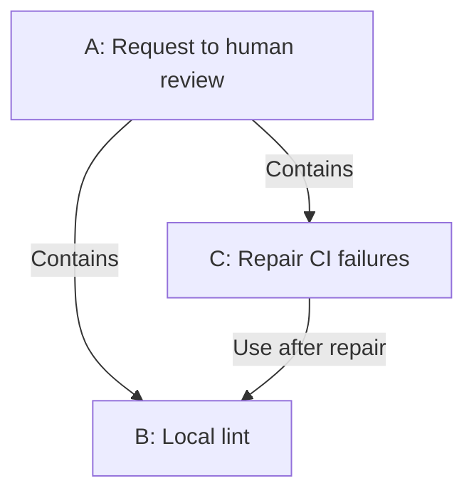
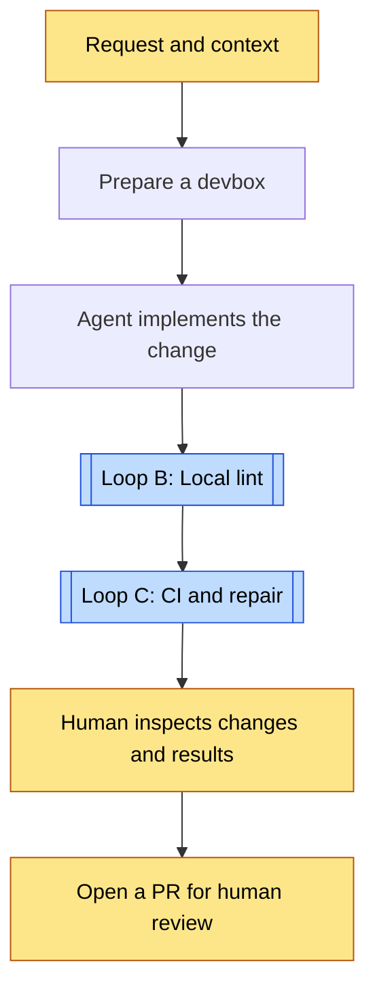
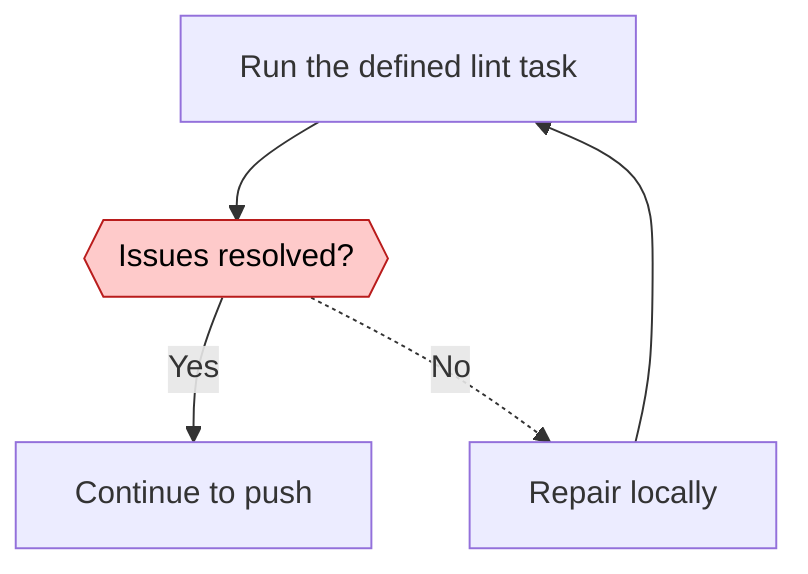
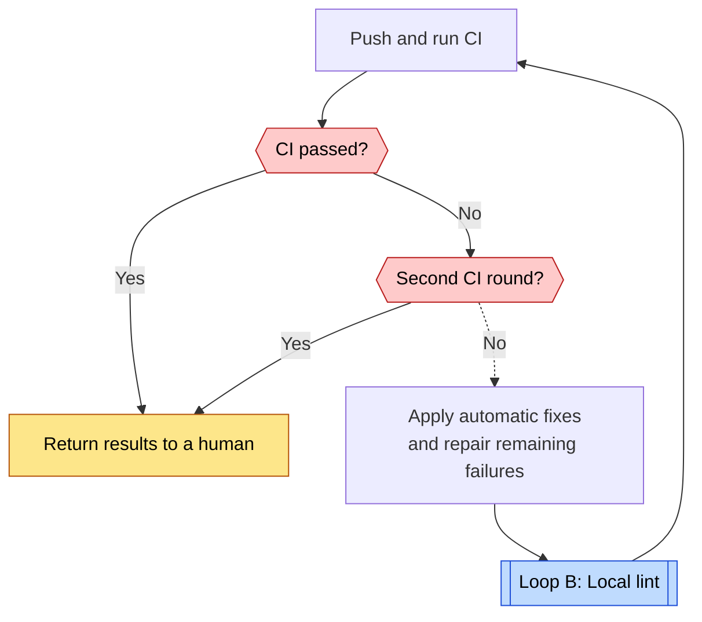

# Stripe Minions loops

[← Loop index](index.md) · [Case study](../cases/stripe-minions.md)

Research date: 2026-11-02. The researcher organized these diagrams from official articles. Code enforcement is not established. A shows the full workflow. B and C repair work inside it.

| Diagram | Unit | Evaluation and return path | Exit condition |
| --- | --- | --- | --- |
| A: Workflow | One request | A human reads the output. | Handoff to human review. Automatic merge is not shown. |
| B: Repair | Local changes | Lint results return to local repair. | Lint issues resolved. Attempt limit unknown. |
| C: Repair | One Minion run | CI failures return to repair. | Return to a human after a pass or two CI rounds. |

## A. Request to human review {#loop-a}

[B: Local lint](#loop-b) · [C: CI and repair](#loop-c)

Humans can add instructions or edit manually. The total number of later attempts is unknown. This does not imply that every PR automatically reaches review. [Part 1](https://stripe.dev/blog/minions-stripes-one-shot-end-to-end-coding-agents)

## B. Local lint {#loop-b}

The article states that code controls the lint loop. Lint detects code style and static errors. The exact division between automatic and agent repairs is unknown, as is the stop limit. [Part 2](https://stripe.dev/blog/minions-stripes-one-shot-end-to-end-coding-agents-part-2)

## C. CI and repair {#loop-c}

[B: Local lint](#loop-b)

The two-round CI limit comes from the official account. Work can return to a human without passing. This is not a lifetime attempt count that includes later human requests. [Part 1](https://stripe.dev/blog/minions-stripes-one-shot-end-to-end-coding-agents), [Part 2](https://stripe.dev/blog/minions-stripes-one-shot-end-to-end-coding-agents-part-2)
