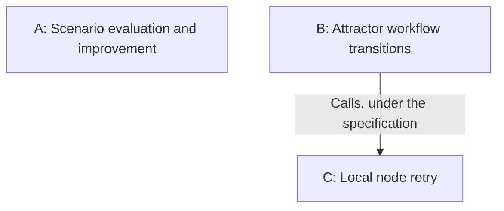
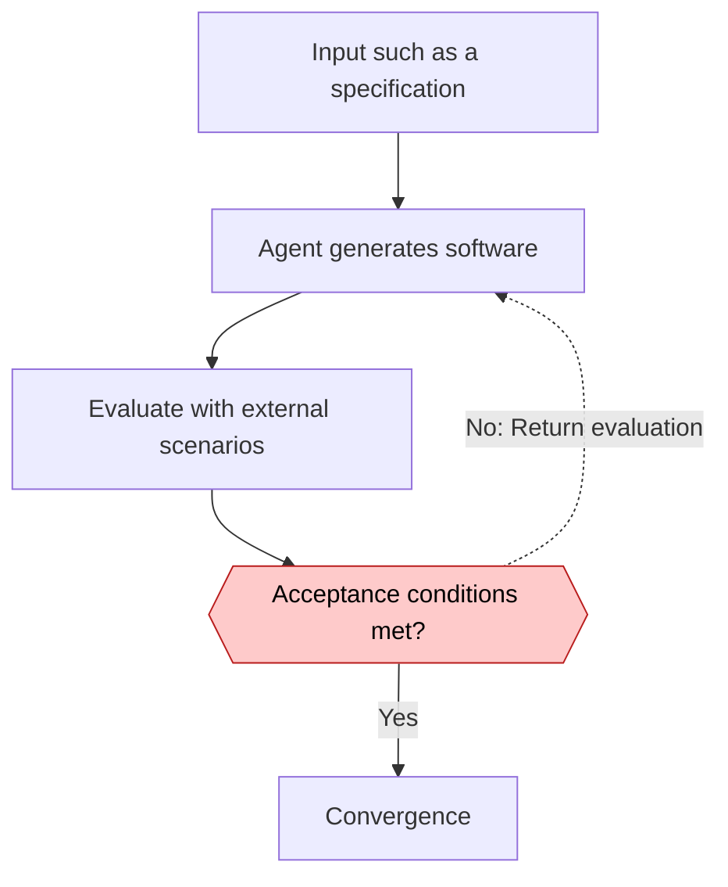
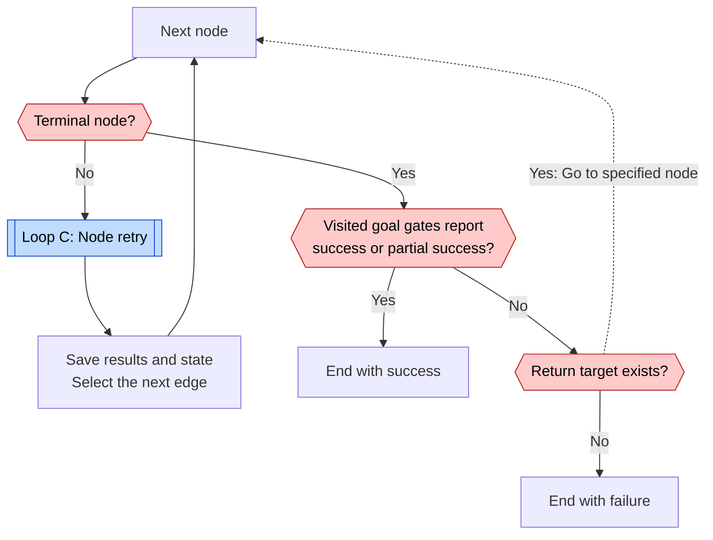
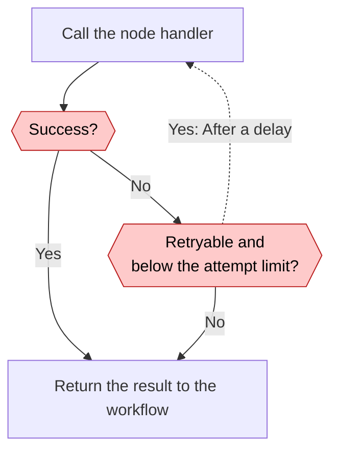

# StrongDM loops

[← Loop index](index.md) · [Case study](../cases/strongdm.md)

Research date: 2026-11-02. A describes operating principles. B and C describe the public Attractor specification at `fb57a55ed97372a27ac90102f436947e29f48426`. The research does not establish that the internal factory uses B and C to run A. The diagram therefore shows no containment relationship.

| Diagram | Unit | Evaluation and return path | Exit condition |
| --- | --- | --- | --- |
| A: Repair | Generated software | Scenario results return to the next generation. | Evaluation scenarios keep passing. Numeric thresholds and cost limits unknown. |
| B: Repetition and conditional return | DOT graph execution | Inspect visited goal gates at the terminal node. | Success, or failure without a return target. Overall cycle limit unknown. |
| C: Retry | One node invocation | Failure or retry results return to the same node. | Success, a nonretryable error, or a local limit. |

## A. Scenario evaluation and improvement {#loop-a}

Acceptance and convergence here summarize [Principles](https://factory.strongdm.ai/principles). Score thresholds, required consecutive passes, and decision code are not public. A policy without human code review does not exclude humans from specification or evaluation design.

## B. Attractor workflow transitions {#loop-b}

[C: Node retry](#loop-c)

The diagram focuses on terminal goal gates, conditions that determine completion. It omits exits without edges, `loop_restart`, and individual failure edges. The specification does not guarantee execution of unvisited nodes or require full success at every goal gate. [Specification §3.3–3.4](https://github.com/strongdm/attractor/blob/fb57a55ed97372a27ac90102f436947e29f48426/attractor-spec.md#L335)

## C. Local node retry {#loop-c}

`max_retries` counts additional attempts and defaults to zero. A value of three permits four attempts, including the first. This is not an overall cycle limit for B. Implementation also needs attention to partial success under `allow_partial`. [Specification §3.5](https://github.com/strongdm/attractor/blob/fb57a55ed97372a27ac90102f436947e29f48426/attractor-spec.md#L480)
