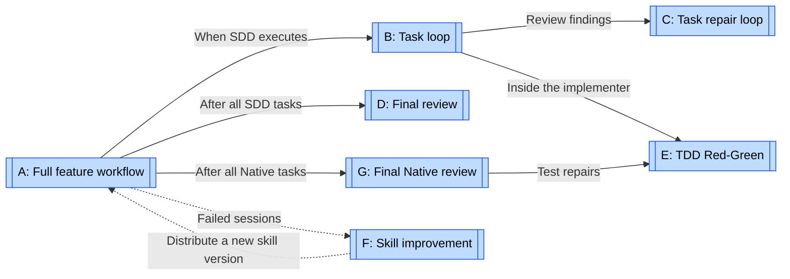
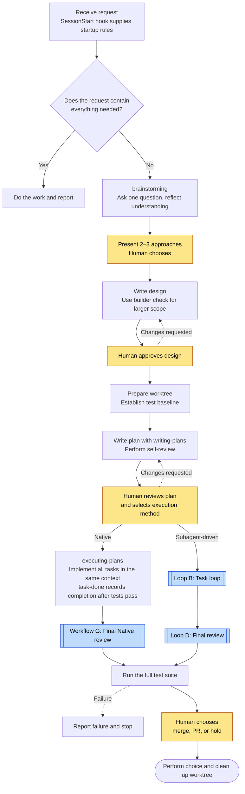
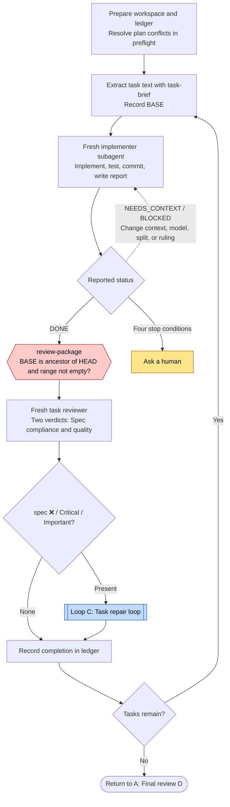
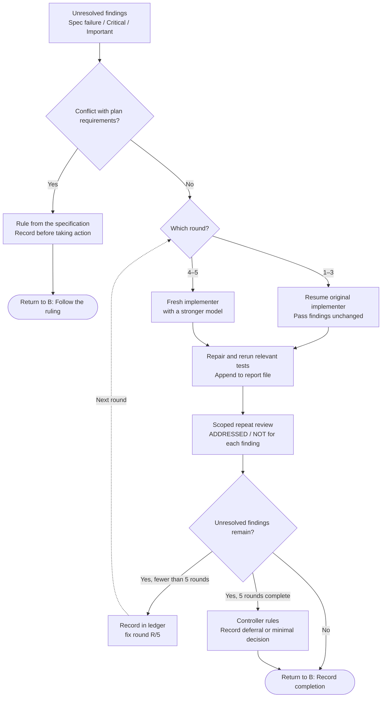
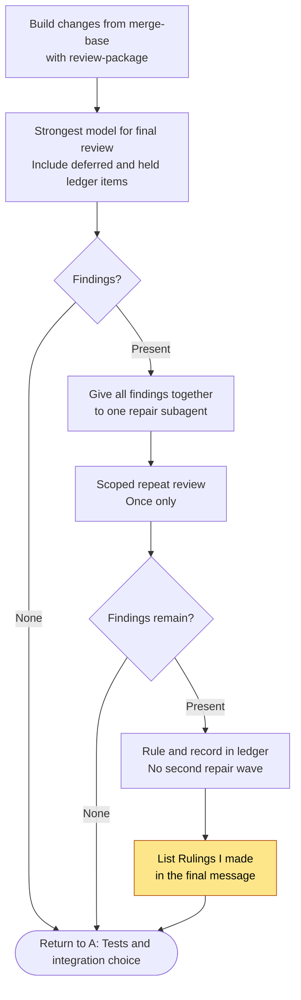
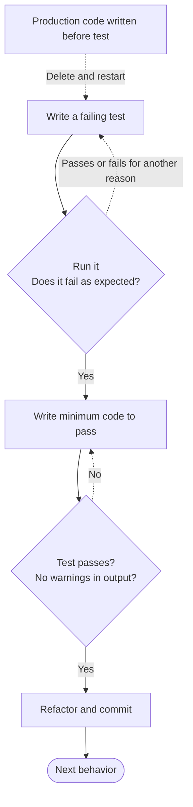
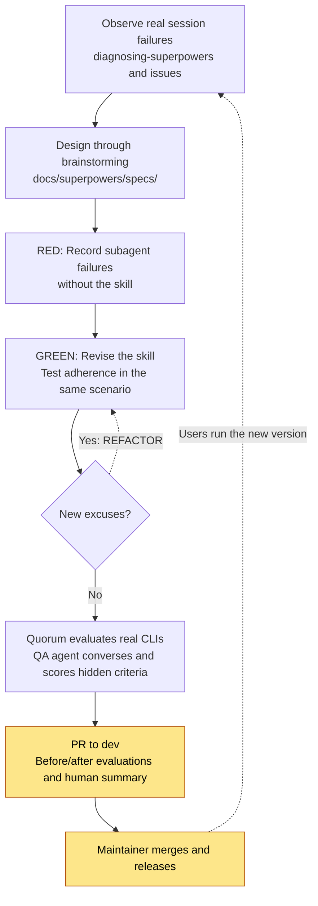
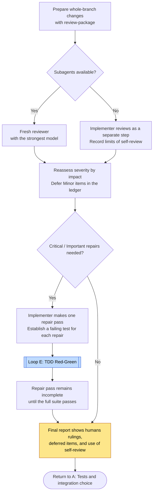

# Superpowers loops

[← Explore the loops](index.md) · [Superpowers case study](../cases/superpowers.md)

Start with A, then B, then C. A covers the full feature workflow. B processes tasks one at a time. C repairs each task. D reviews the whole branch, and E covers TDD inside implementation. F improves Superpowers skills themselves, while G separately covers final Native review.

Research target: `obra/superpowers@2ce8aa1`. The researcher chose these names and divisions. Superpowers does not define “seven loops.” The diagrams focus on SDD (`subagent-driven-development`). A separate branch in A covers `executing-plans`, which works in the same session.

Almost every gate in this case is a skill instruction. Few conditions stop execution through code. Hexagons represent code decisions only. Diamonds represent decisions by the LLM controller, the agent that coordinates work.

## Map: Calls and feedback

Solid arrows mean “used in this step.” Dotted arrows return results. Native bypasses B, C, and D. It implements tasks in the same context, then enters G. F is an operational relationship, not an implemented parent loop. Failures in user sessions inform maintainer skill changes for the next version.

| Diagram | Unit and type | Feedback | Exit or progress condition |
| --- | --- | --- | --- |
| [A: Full feature workflow](#loop-a) | One request. Design discussion and plan review return to humans. | Human corrections and feedback on design or plan | Human chooses and performs integration. Discard requires an explicit human request. |
| [B: Task loop](#loop-b) | Repeated execution of individual plan tasks | Implementer status and task review verdict | All tasks complete, clean or with deferred items after the limit. Four stop conditions return to humans. |
| [C: Task repair loop](#loop-c) | One repair round per task: repair plus scoped review | ADDRESSED / NOT ADDRESSED and new breakage in the repair changes | Resolve conflicts with the plan before starting. Otherwise, resolve all findings or make a ruling after five rounds. |
| [D: Final review](#loop-d) | Whole SDD branch. One repair wave only. | Findings from the strongest review model | Clean result, or rulings on remaining items before integration. No second repair wave. |
| [E: TDD Red-Green](#loop-e) | Test and implementation of one behavior | Does the test fail and pass as expected? | Tests pass, then commit. Delete code written before the test and restart. |
| [F: Skill improvement](#loop-f) | Operational improvement of skill versions | Session failures, pressure tests, and Quorum evaluation | Each change passes evaluation and releases through `dev` → `main`. Overall improvement has no endpoint. |
| [G: Final Native review](#loop-g) | Whole Native branch. One repair pass by the implementer. | Fresh reviewer findings, or self-review if unavailable, and repair test results | Record RED→GREEN and a passing full suite. No repeat review. Show rulings and deferred items to humans. |

## A: Full feature workflow {#loop-a}

This overview follows a request through integration and identifies human decision points. B represents task repetition without nested detail.

See [B](#loop-b), [D](#loop-d), and [G](#loop-g).

Approvals, reviews, and choices are skill instructions ([brainstorming HARD-GATE](https://github.com/obra/superpowers/blob/2ce8aa1/skills/brainstorming/SKILL.md#L247), [writing-plans Execution Handoff](https://github.com/obra/superpowers/blob/2ce8aa1/skills/writing-plans/SKILL.md#L179), [finishing Step 4](https://github.com/obra/superpowers/blob/2ce8aa1/skills/finishing-a-development-branch/SKILL.md#L53)). The session-start [hook](https://github.com/obra/superpowers/blob/2ce8aa1/hooks/session-start#L41) injects startup rules, but the model decides whether to call a skill. Native [`task-done`](https://github.com/obra/superpowers/blob/2ce8aa1/skills/executing-plans/scripts/task-done#L39) runs each task's test command and records completion only after success. Correct command selection and use of the script still depend on instructions.

If the human declines questions, brainstorming ends and removes its HARD-GATE. Worktree creation requires consent unless the human already expressed a preference ([using-git-worktrees L41](https://github.com/obra/superpowers/blob/2ce8aa1/skills/using-git-worktrees/SKILL.md#L41)). Failed tests lead to a report and stop, not an automatic return to review ([finishing L18](https://github.com/obra/superpowers/blob/2ce8aa1/skills/finishing-a-development-branch/SKILL.md#L18)).

## B: Task loop {#loop-b}

Each cycle handles one plan task. This repeats task execution rather than repairing a failure. C separately describes repairs inside the task.

See [C: Task repair loop](#loop-c). [E](#loop-e) covers Red-Green inside the implementer.

`review-package` exits with code 3 if BASE is not an ancestor of HEAD or the range is empty ([L27–28](https://github.com/obra/superpowers/blob/2ce8aa1/skills/subagent-driven-development/scripts/review-package#L27)). It also accepts `HEAD~1` and does not establish that the range covers the whole task. Instructions must supply the correct starting BASE.

`sdd-workspace` uses a `plan-path` ownership marker to separate workspaces. The controller receives instructions to compare the plan path on the first ledger line. `task-brief` exits with code 3 if it cannot find the task. The LLM controller reads review text and decides acceptance and task completion.

Instructions prohibit asking humans between tasks except under four conditions. These are irreversible actions, security-sensitive actions, effects outside the worktree, or a plan broken beyond reliable interpretation ([SKILL.md L27](https://github.com/obra/superpowers/blob/2ce8aa1/skills/subagent-driven-development/SKILL.md#L27)). The controller resolves other conflicts and ambiguities and records rulings. Implementers do not run in parallel. For BLOCKED, instructions prohibit unchanged retries with the same model ([handling-reports](https://github.com/obra/superpowers/blob/2ce8aa1/skills/subagent-driven-development/references/handling-reports.md)).

Minor findings bypass the repair loop. The ledger records them as deferred for D. The controller investigates warning items that the changes alone cannot establish. Real omissions enter C. The instructions state no retry limit for status-based returns, so that limit remains unknown.

## C: Task repair loop {#loop-c}

This loop evaluates repair changes for one task. It limits rounds and changes the implementer partway through. It is the most explicitly designed repair loop in this case.

One round contains one repair and one repeat review, with a maximum of five rounds ([fix-loop.md L21](https://github.com/obra/superpowers/blob/2ce8aa1/skills/subagent-driven-development/references/fix-loop.md#L21)). Repeat review reads only repair changes since the previous head. Findings outside that scope enter the deferred ledger. This scope restriction avoids endless new findings from unrelated areas. The controller does not repair code itself.

Before the loop, it resolves and records findings that challenge required implementation or conflict with the plan, using the specification ([fix-loop L14](https://github.com/obra/superpowers/blob/2ce8aa1/skills/subagent-driven-development/references/fix-loop.md#L14)). Other findings cannot receive early rulings to bypass repair. The controller rules after the five-round limit.

The 2026-07-15 design records the five-round choice as Jesse's judgment. The previous instruction repeated until approval without a limit. Review round counts were the largest source of cost variation between runs ([Design document](https://github.com/obra/superpowers/blob/2ce8aa1/docs/superpowers/specs/2026-07-15-sdd-fix-loop-redesign-design.md)).

Code does not count the rounds. Ledger lines track them, and the controller must follow the limit. Deferred rulings reach humans through final review and the final “Rulings I made” report.

## D: Final review {#loop-d}

D evaluates the whole branch. This short repair loop permits only one repair wave.

Instructions prohibit one repair agent per finding. The rationale cites real sessions where final repair costs exceeded all task costs combined. There is no second repair wave. Humans see remaining important findings with integration choices ([final-review.md](https://github.com/obra/superpowers/blob/2ce8aa1/skills/subagent-driven-development/references/final-review.md#L17)). Every `Ruling:` line appears under “Rulings I made” before workspace deletion.

Native uses different repair and repeat-review rules, so [G](#loop-g) covers it separately.

## E: TDD Red-Green {#loop-e}

TDD means writing a failing test before implementation. E evaluates one behavior. This is the shortest loop, inside the implementer or Native session.

The instructions prohibit production code before a failing test and require deletion and restart if this happens ([TDD L31](https://github.com/obra/superpowers/blob/2ce8aa1/skills/test-driven-development/SKILL.md#L31)). Plan steps use the same order. However, the implementer template makes TDD conditional on the task requesting it. Reports and review inspect TDD evidence. Execution determines test results, but code does not enforce Red-Green order.

## F: Skill improvement {#loop-f}

F evaluates the skill that controls how work happens, rather than an individual task. This operational loop returns failures from user sessions to the next skill version.

Skill changes require `writing-skills` pressure tests and before/after evaluation results. Tuned wording requires evidence before a change ([AGENTS.md L99](https://github.com/obra/superpowers/blob/2ce8aa1/AGENTS.md#L99), [writing-skills](https://github.com/obra/superpowers/blob/2ce8aa1/skills/writing-skills/SKILL.md#L30)). A PR requires a human summary and a human review of the full changes.

Quorum lives in [superpowers-evals](https://github.com/prime-radiant-inc/superpowers-evals) at `e64684c`. It scores hidden acceptance criteria and deterministic inspections after execution. Live evaluations run agents without permission prompts. Public CI therefore runs only static inspections. Trusted maintainers run live evaluations locally or on a dedicated appliance. Campaigns limit attempts, runtime, and reserve capacity rather than stopping at a monetary threshold, according to the README.

The main Superpowers repository has no CI or merge gate that requires passing evaluations. Maintainers decide whether to merge. The research does not establish that every change follows this sequence. Some harness and hook changes use `tests/` or manual inspection instead of Quorum. `diagnosing-superpowers` only produces evidence-based reports from session records. Maintainers decide whether to repair the skill.

Evidence: [Design documents](https://github.com/obra/superpowers/tree/2ce8aa1/docs/superpowers/specs), [Plan-scoped workspace evaluation results](https://github.com/obra/superpowers/blob/2ce8aa1/docs/superpowers/specs/2026-07-06-sdd-plan-scoped-workspace-eval-results.md), [diagnosing-superpowers](https://github.com/obra/superpowers/blob/2ce8aa1/skills/diagnosing-superpowers/SKILL.md).

## G: Final Native review {#loop-g}

G evaluates the whole Native branch. Unlike SDD loop D, the implementer performs one repair pass and does not request another review.

See [E: TDD Red-Green](#loop-e).

When subagents are available, instructions require a fresh context for final review. Otherwise, the ledger and final report must explicitly identify self-review. The implementer repairs Critical / Important findings and records RED→GREEN for each repair plus a passing full suite. Minor findings enter the ledger and final report as deferred items. Decisions against repair use `Ruling:` records. Repeat review and a second repair pass are prohibited ([executing-plans: Final Review](https://github.com/obra/superpowers/blob/2ce8aa1/skills/executing-plans/SKILL.md#L234)).

Repair pass limits, TDD order, and the prohibition on repeat review are instructions. `task-done` adds a task completion line only after its test command succeeds. It does not enforce final repair records or prevent direct ledger edits.

