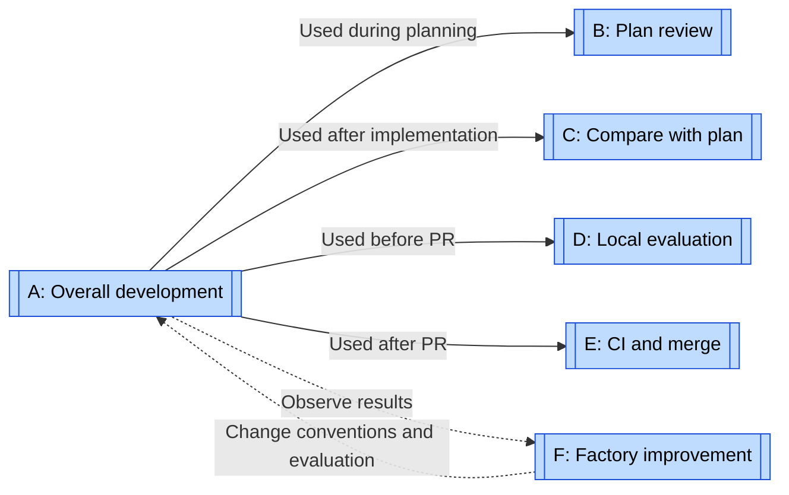
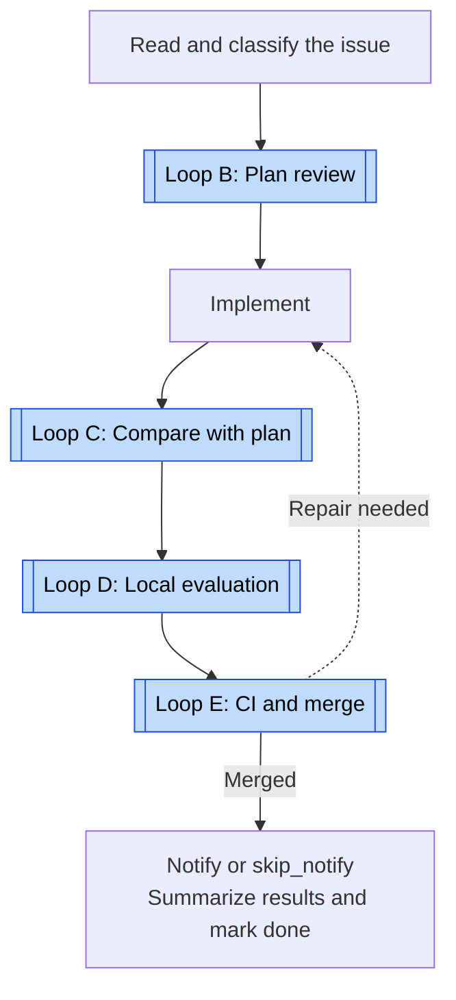
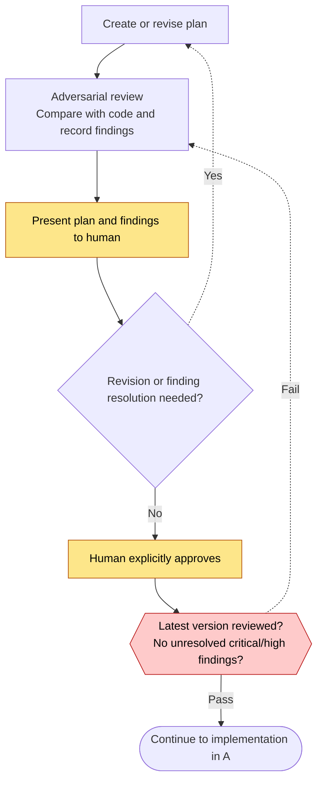
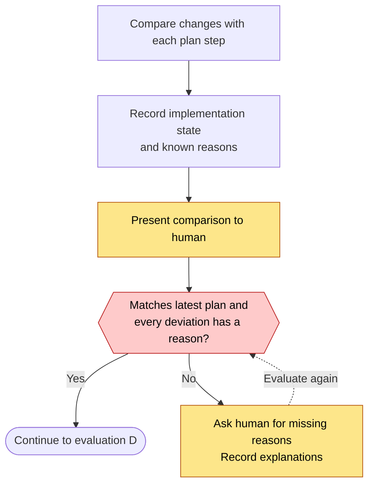
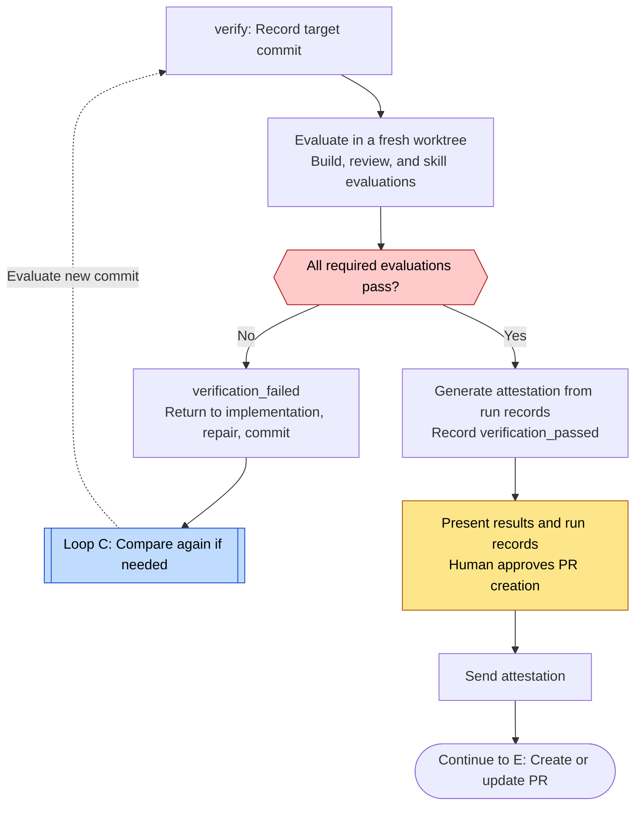
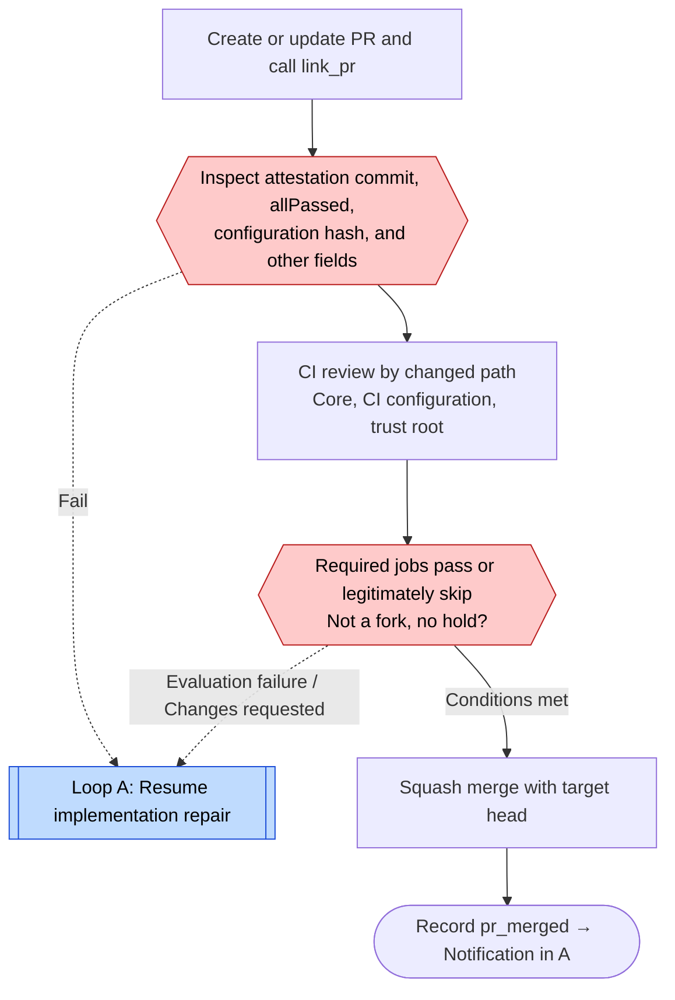
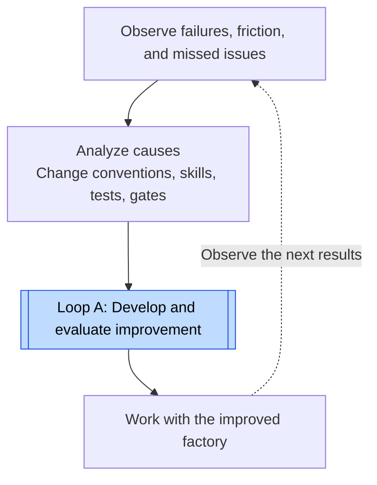
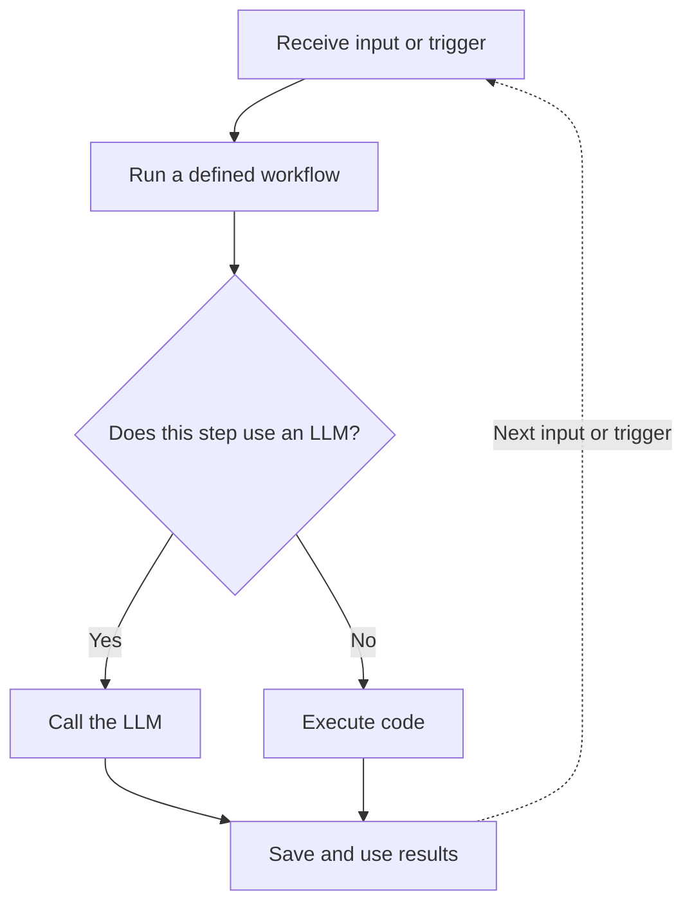
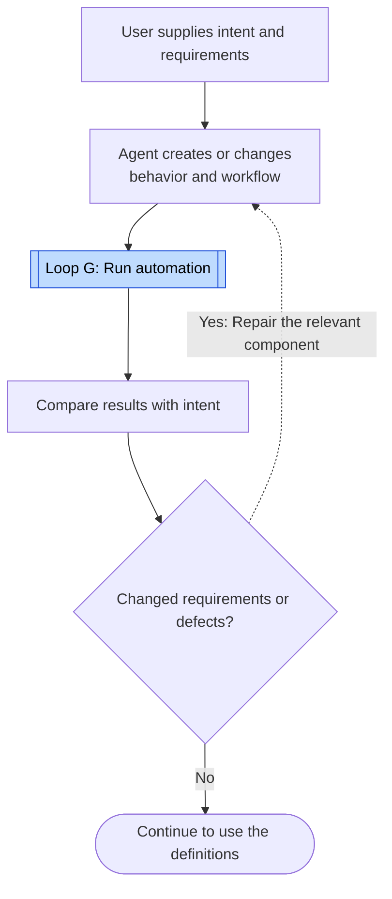

# Swamp loops

[← Explore the loops](index.md) · [Swamp case study](../cases/swamp.md)

Start with A, then D, E, and F. A introduces development. D shows repeated repair. E shows trust boundaries before merge. F improves the factory itself. B and C explain planning, while G and H cover users who build automation with Swamp.

Research target: `swamp-club/swamp@963e0d2`. These diagrams organize code and instructions for explanation. Swamp does not officially define “eight loops.” They focus on the normal planned development path. The text describes exceptions and unknowns.

## Map: Calls and feedback

A uses B, C, D, and E. This is containment. F observes results from outside and improves the factory for later work. The research does not establish that F repeatedly calls A as an implemented parent loop.

Solid arrows mean “used in this step.” Dotted arrows return observations. The A diagram below shows the execution order B→C→D→E. D references C for comparison after repair. E returns failures to implementation in A. The structure is not a strict tree.

| Diagram | Unit and type | Feedback | Exit or progress condition |
| --- | --- | --- | --- |
| [A: Overall development](#loop-a) | Full workflow for an issue | Failures from evaluation or CI | Record notification and summary after merge. `done` does not guarantee that the goal was met. |
| [B: Plan review](#loop-b) | Repeated plan revision | Review findings and human feedback | Resolve critical/high findings on the latest plan and obtain human approval. |
| [C: Compare with plan](#loop-c) | Repeated addition of explanations for deviations | An item other than `implemented` lacks a reason. | Review covers the latest plan and every deviation has a reason. |
| [D: Local evaluation](#loop-d) | Repeated commit repair | Failed tests, reviews, or skill evaluations | Required evaluations pass and a human approves PR creation. |
| [E: CI and merge](#loop-e) | Repeated PR head updates | CI rejection and repair requests | Required jobs succeed or legitimately skip, and merge conditions hold. |
| [F: Factory improvement](#loop-f) | Operational improvement across issues | Repeated failures and missed problems at gates | Evaluate and apply each improvement. The activity has no fixed endpoint. |
| [G: User automation execution](#loop-g) | Reuse with the next input | Next input or trigger | One workflow ends. This is separate from code repair. |
| [H: User automation improvement](#loop-h) | Repeated behavior or workflow revision | Gaps between results and requirements | User evaluates the intended outcome. No general automatic acceptance gate is established. |

## A: Overall development {#loop-a}

This overview separates the sequential workflow from repair loops inside it. Open B–E for their internal repetition.

See [B](#loop-b), [C](#loop-c), [D](#loop-d), and [E](#loop-e). After plan approval but before implementation, `iterate` can return to B.

`TRANSITIONS` limits the phases in which each method can run. `verify` requires a comparison record. `link_pr` inspects comparison with the plan and evaluation results. The datastore persists state for later resumption.

Not all work must follow this order. `fast_forward` records existing work after the fact, and `complete` closes work that already merged. `link_issue` can associate several issues with one task, so one PR does not always mean one issue. `summarize` can move to `done` with `outcomeMet: false`. Workflow completion therefore differs from achieving the goal.

Evidence: [Transition definitions](https://github.com/swamp-club/swamp/blob/963e0d2/extensions/models/_lib/schemas.ts#L83), [Lifecycle implementation](https://github.com/swamp-club/swamp/blob/963e0d2/extensions/models/issue_lifecycle.ts), [Operating instructions](https://github.com/swamp-club/swamp/blob/963e0d2/.claude/skills/issue-lifecycle/SKILL.md).

## B: Plan review {#loop-b}

B evaluates the plan. Before code changes, findings and human intent return to the plan.

The plan includes DDD analysis, test strategy, and effects on UAT and documentation. DDD organizes software around domain concepts. UAT evaluates whether the product meets user requirements. Each plan revision receives another review and a record of finding resolution.

`adversarial-review-clear` requires a review of the latest plan and resolution of critical/high findings. Explicit human approval is a skill instruction. The research found no requirement for human approval evidence in `approve` arguments. The machine therefore does not prove human approval itself.

Evidence: [Review instructions](https://github.com/swamp-club/swamp/blob/963e0d2/.claude/skills/issue-lifecycle/references/adversarial-review.md), [Conditions before approve](https://github.com/swamp-club/swamp/blob/963e0d2/extensions/models/issue_lifecycle.ts#L883).

## C: Compare with plan {#loop-c}

C evaluates differences between the approved plan and implementation. It removes unexplained differences rather than all differences. An explained omission can pass. The gate therefore does not guarantee functional completeness or correctness.

Before `verify`, the code requires only that a review exists. Before `link_pr` or `complete`, `code-conformance-clear` requires the latest plan and reasons for deviations. The diagram follows the recommended instruction to resolve these earlier. This condition alone does not prove valid reasons or complete coverage of the code.

Evidence: [Comparison instructions](https://github.com/swamp-club/swamp/blob/963e0d2/.claude/skills/issue-lifecycle/references/code-conformance-review.md), [Comparison gate](https://github.com/swamp-club/swamp/blob/963e0d2/extensions/models/issue_lifecycle.ts#L765).

## D: Local evaluation {#loop-d}

D evaluates a specific commit. Failures return to code repair, followed by evaluation of a new commit. This is the repair cycle intended to stay shortest during normal development.

See [C: Compare with plan](#loop-c). If repairs change the correspondence with the plan, repeat the comparison. The gate compares plan versions. It does not establish that the comparison record matches the latest code commit.

Three workflows run: `verify-build` for lint, types, tests, compilation, and more, `verify-reviews` for changed-path reviews, and `verify-skills` for quality and trigger evaluation. `check_review_verdict.ts` parses explicit results such as `VERDICT: pass` to decide LLM review acceptance. Deterministic parsing does not guarantee correct LLM evaluation.

An attestation records evaluation results for a particular commit. `build-attestation` generates it from run records and binds it to the evaluated commit and configuration hash. A changed commit requires regeneration and evaluation. The origin of these records is not authenticated. This is not cryptographically signed proof of evaluation. Waiting for human approval is also an instruction-level condition.

Evidence: [Evaluation conventions](https://github.com/swamp-club/swamp/blob/963e0d2/agent-constraints/verification-conventions.md), [Verdict parsing](https://github.com/swamp-club/swamp/blob/963e0d2/scripts/check_review_verdict.ts).

## E: CI and merge {#loop-e}

E evaluates the PR head, the latest commit on its branch. CI receives local results and inspects additional reviews and merge conditions. Failures return to local repair.

See [Implementation in A](#loop-a) → [Comparison in C](#loop-c) → [Evaluation in D](#loop-d) → return to E.

The diagram uses a readable sequence. CI reviews and attestation inspection actually run as separate jobs under their dependencies. A `hold` or pending execution waits rather than always returning to repair.

Correction to the earlier diagram: the attestation's 24-hour threshold does not reject it. Age over 24 hours, a missing timestamp, or a parsing failure produces a warning. Without `errors`, the result succeeds. Commit mismatch, failed `allPassed`, and required configuration hash mismatch have different handling.

After PR failure, state returns through `pr_failed → implement → verify`. Even a small repair cannot jump directly from `pr_failed → verify`. After comparison, evaluation, and a new attestation, `link_pr` can reference the same PR. Calls to `pr_merged` and `pr_failed` must wait three minutes after `link_pr`. This delay does not prove that CI finished.

Changes matching the trust root receive extra review. The trust root contains files that control factory decisions. This defense uses LLM review and does not fully prevent gate modification. Automatic CI merge, deployment to a user environment, and passing UAT are separate events.

Evidence: [CI configuration: Freshness produces warnings](https://github.com/swamp-club/swamp/blob/963e0d2/.github/workflows/ci.yml#L688), [PR failure instructions](https://github.com/swamp-club/swamp/blob/963e0d2/agent-constraints/verification-conventions.md#L500).

## F: Factory improvement {#loop-f}

F evaluates the system that produces work, rather than one task. Repeated failures and missed problems lead to changes in conventions, tests, and gates. This operational diagram combines instructions, improvement examples, and scheduled jobs. It does not represent one integrated infinite loop in code.

See [A: Overall development](#loop-a). Changes to trust-root files trigger integrity review in their CI run. The improvement ships before later work uses it.

Inputs include Session Learnings in AGENTS.md and improvements that tightened verdict parsing or attestation generation. Scheduled inputs include flaky-test detection every six hours and Windows compatibility inspection every four hours. The research does not establish that all these paths automatically analyze causes and finish repairs.

Evidence: [Session Learnings](https://github.com/swamp-club/swamp/blob/963e0d2/AGENTS.md#L264), [Scheduled flaky-test detection](https://github.com/swamp-club/swamp/blob/963e0d2/.github/workflows/flaky-tests.yml), [Evaluation conventions](https://github.com/swamp-club/swamp/blob/963e0d2/agent-constraints/verification-conventions.md).

## G: User automation execution {#loop-g}

G and H describe users of Swamp, separate from Swamp development in A–F. G repeats automation with different inputs. It is not necessarily a feedback loop that repairs failures.

This conceptual diagram omits the sequence of steps inside the workflow. Repeated execution does not require an LLM to rethink the entire procedure. Steps that call an LLM still incur inference costs on each run. External APIs, time, state, and LLMs can change output or cause failures. “Deterministic” does not guarantee identical successful results every time.

To change definitions based on results, continue to [H](#loop-h).

Evidence: [Swamp README](https://github.com/swamp-club/swamp/blob/963e0d2/README.md), [Design](https://github.com/swamp-club/swamp/blob/963e0d2/design/README.md), [Syntax #1049](https://syntax.fm/show/1049/wtf-is-a-software-factory), 03:28–09:37.

## H: User automation improvement {#loop-h}

H evaluates generated automation. It turns intent into definitions, then uses execution results to change the relevant components. A reference box represents execution inside G.

See [G: User automation execution](#loop-g). This diagram explains component reuse and revision. It does not establish a shared approval gate or automatic repair for every user. Users can design further evaluation loops inside their automation. Each such structure needs its own case study.

Evidence: [Swamp README](https://github.com/swamp-club/swamp/blob/963e0d2/README.md), [Syntax #1049](https://syntax.fm/show/1049/wtf-is-a-software-factory), 03:28–09:37.
