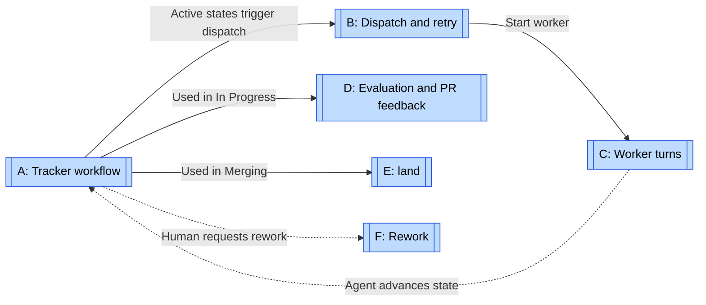
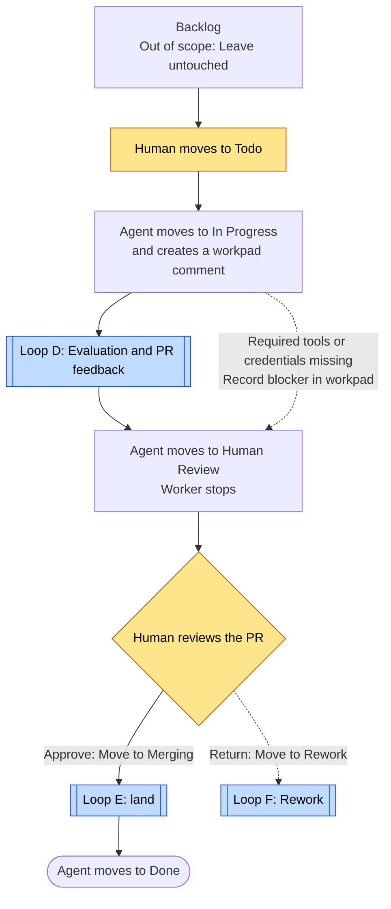
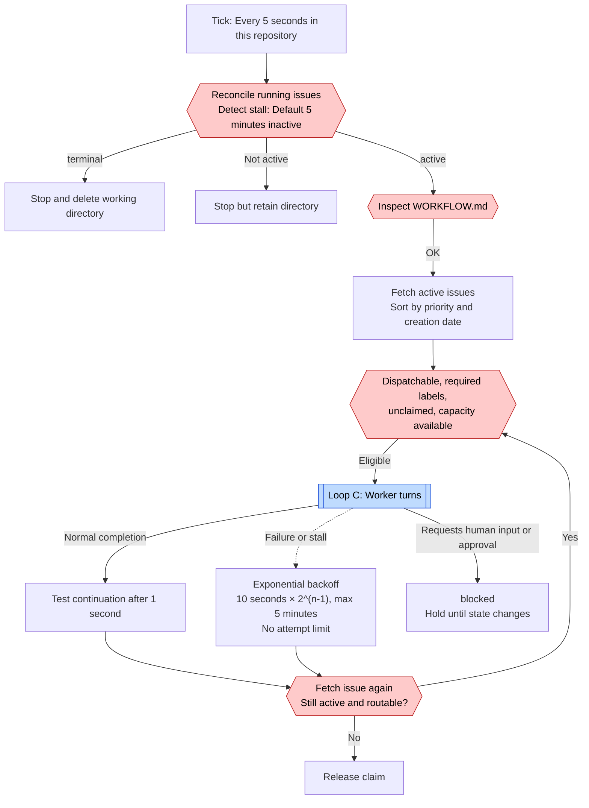
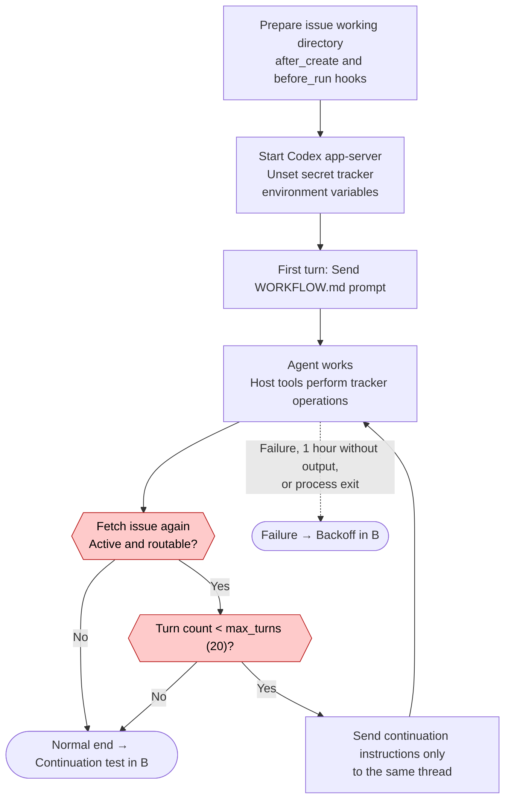
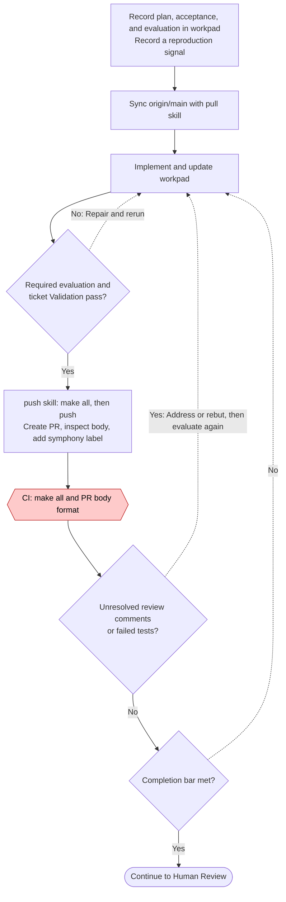
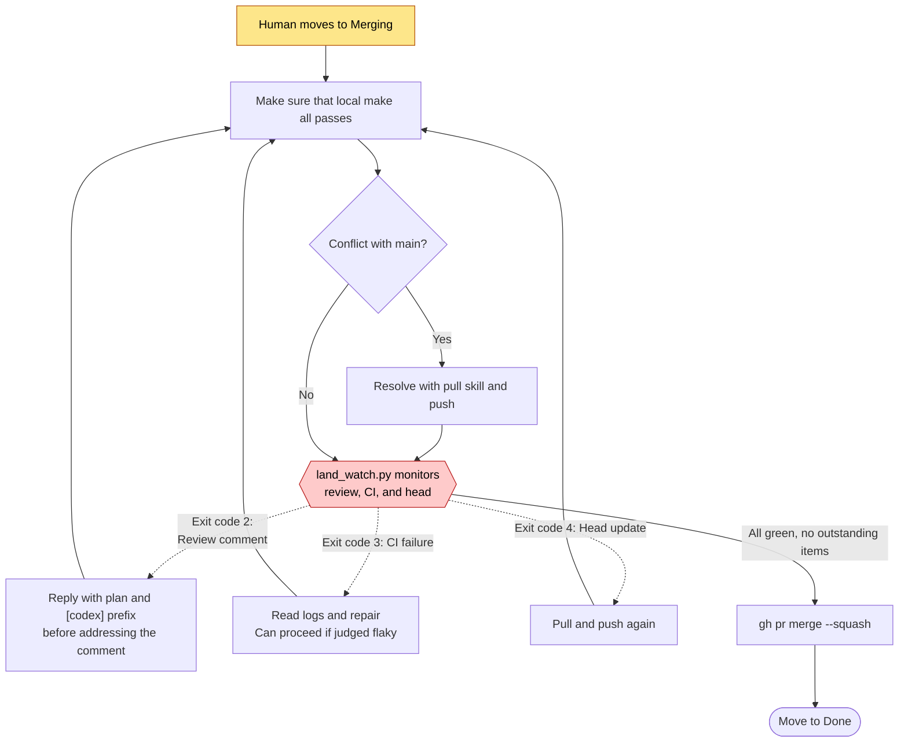
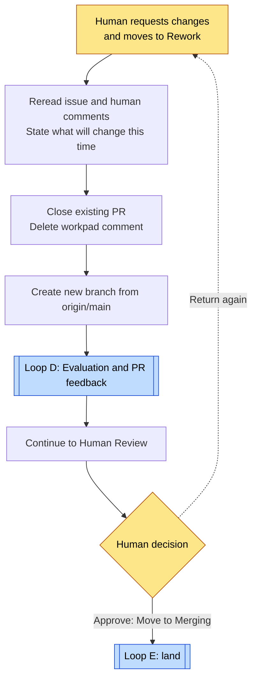

# Symphony loops

[← Explore the loops](index.md) · [Symphony case study](../cases/symphony.md)

Start with A, then B, then C. A covers the tracker workflow. B shows the orchestrator that keeps work running. C shows turns inside one worker. D, E, and F are repair loops that agents follow under instructions for each state in A.

Research target: `openai/symphony@be10a1b`. The researcher chose the names and divisions, not Symphony. A, D, E, and F follow this repository's [elixir/WORKFLOW.md](https://github.com/openai/symphony/blob/be10a1b/elixir/WORKFLOW.md) and skills. Users replace these instructions for their own projects. B and C follow SPEC and Elixir code, where users change configuration values.

Hexagons represent code decisions only. Diamonds represent human or agent decisions. Almost all branches in A, D, E, and F are instructions.

## Map: Who runs each loop

Solid arrows mean “used in this state or step.” Dotted arrows return results. A does not sit inside B or C. Its state lives in the tracker. B reads that state to decide whether to start workers, and agents in C change it through tools. Agents inside C execute D, E, or F according to the state in A.

| Diagram | Unit and type | Evaluation and return path | Exit condition | Enforcement |
| --- | --- | --- | --- | --- |
| [A: Tracker workflow](#loop-a) | One issue / full workflow | Human review returns work to Rework F. | Agent moves to `Done`, or human chooses a terminal state. | Instructions. Code only starts and stops work by state. |
| [B: Dispatch and retry](#loop-b) | Orchestrator tick (five seconds) and retry / repeated execution | Restart after worker completion, failure, or stall. | Issue becomes inactive, terminal, or invisible. No attempt limit. | Code |
| [C: Worker turns](#loop-c) | Turns in one worker / repeated execution | Fetch the issue again after each turn. | Inactive state or `max_turns` (20). | Code |
| [D: Evaluation and PR feedback](#loop-d) | Implement, evaluate, push / repair loop | Test failure, review comments, and CI failure return to implementation. | Completion bar met and agent moves to `Human Review`. No limit. | Instructions. CI results do not prevent state transitions. |
| [E: land](#loop-e) | PR head / repair loop | `land_watch.py` exit codes for review, CI, and head updates | All green, no outstanding items, then squash merge. | Instructions and monitoring script. No required checks. |
| [F: Rework](#loop-f) | Restart the whole issue / repair loop | Human requests rework. | Human approves and moves to `Merging`. No limit. | Instructions. A human requests rework through the tracker. |

## A: Tracker workflow {#loop-a}

A evaluates one issue. Linear stores its state. Both humans and agents change that state.

See [D](#loop-d), [E](#loop-e), and [F](#loop-f).

`Todo`, `In Progress`, `Merging`, and `Rework` are active states. B keeps workers running in those states. `Human Review` and `Backlog` are neither active nor terminal, so workers do not start.

WORKFLOW.md Step 3 tells the agent to wait and poll in `Human Review`. However, the implementation ends turn continuation in C and stops the worker through reconciliation in B after this state change. It does not restart the worker. The diagram follows the implementation and shows the worker stopping.

Agent tool calls change state, through `linear_graphql` for Linear. Code does not establish valid source-to-target transitions or fulfillment of completion conditions. Configuration also defines state names.

Evidence: [WORKFLOW.md frontmatter](https://github.com/openai/symphony/blob/be10a1b/elixir/WORKFLOW.md#L1), [Status map](https://github.com/openai/symphony/blob/be10a1b/elixir/WORKFLOW.md#L107), [Step 3](https://github.com/openai/symphony/blob/be10a1b/elixir/WORKFLOW.md#L244), [Reconciliation](https://github.com/openai/symphony/blob/be10a1b/elixir/lib/symphony_elixir/orchestrator.ex#L421).

## B: Dispatch and retry {#loop-b}

Each cycle follows an orchestrator tick or retry timer. The orchestrator uses state and configuration, not issue content.

See [C: Worker turns](#loop-c).

Tracker state determines when retries stop. Failure retries have no attempt limit. If the issue remains active, restarts continue with a delay capped at five minutes. No cost-based stop configuration exists. Token totals serve observation only. Invalid WORKFLOW.md prevents new dispatches on that tick but does not stop reconciliation.

The Elixir implementation adds blocked handling. SPEC only requires avoiding indefinite waits for input and leaves the method to implementations. Elixir holds input or approval requests without retry until a human changes tracker state. With `approval_policy: never`, it automatically permits approval requests. Holds therefore mainly involve questions other than MCP tool approval.

A service restart loses retry timers and running sessions. Startup removes working directories for terminal issues. It then fetches active issues again and restarts work.

Evidence: [SPEC §8](https://github.com/openai/symphony/blob/be10a1b/SPEC.md#L733), [SPEC §14.3](https://github.com/openai/symphony/blob/be10a1b/SPEC.md#L1690), [Normal completion](https://github.com/openai/symphony/blob/be10a1b/elixir/lib/symphony_elixir/orchestrator.ex#L208), [Backoff](https://github.com/openai/symphony/blob/be10a1b/elixir/lib/symphony_elixir/orchestrator.ex#L1232), [Stall detection](https://github.com/openai/symphony/blob/be10a1b/elixir/lib/symphony_elixir/orchestrator.ex#L608), [Blocked handling](https://github.com/openai/symphony/blob/be10a1b/elixir/lib/symphony_elixir/orchestrator.ex#L757), [Automatic approval](https://github.com/openai/symphony/blob/be10a1b/elixir/lib/symphony_elixir/codex/app_server.ex#L55).

## C: Worker turns {#loop-c}

Each cycle is a turn in one Codex thread. The agent controls the work. Between turns, the worker only inspects issue state.

Both exit paths run the `after_run` hook and stop the session. Even after success, the working directory remains for the next worker.

Later turns do not resend the original prompt. They say that the previous turn ended normally but the issue remains active. They direct the agent to resume from the workpad rather than restart. `turn_timeout_ms`, one hour by default, limits time without output. It does not limit total turn duration.

After `max_turns`, if the issue remains active, continuation in B starts a new worker after one second. Thus, `max_turns` limits one session, not the total work spent on an issue.

Evidence: [agent_runner.ex](https://github.com/openai/symphony/blob/be10a1b/elixir/lib/symphony_elixir/agent_runner.ex#L88), [SPEC §16.5](https://github.com/openai/symphony/blob/be10a1b/SPEC.md#L1932), [SPEC §10.6](https://github.com/openai/symphony/blob/be10a1b/SPEC.md#L1142), [Removal of secret environment variables](https://github.com/openai/symphony/blob/be10a1b/elixir/lib/symphony_elixir/codex/app_server.ex#L221).

## D: Evaluation and PR feedback {#loop-d}

D evaluates the latest commit and PR. During `In Progress`, the agent repeats these steps under the instructions.

All diamonds represent agent decisions. Machines evaluate CI jobs, but the agent reads results and decides whether to proceed. Failed CI does not block state transitions. Human and bot review comments remain unresolved until the agent addresses them or gives a reasoned rebuttal.

The instructions also require a “principal-style self-review” of the plan, but do not require a separate reviewer. Elixir `AGENTS.md` requests adversarial review for nontrivial changes. The repository contains no prompt or mechanism that executes it.

The sweep has no attempt limit. It repeats until no outstanding items remain. After C reaches `max_turns`, B starts another worker. Tracker state is therefore the stop condition for this loop.

Evidence: [Step 1](https://github.com/openai/symphony/blob/be10a1b/elixir/WORKFLOW.md#L140), [PR feedback sweep](https://github.com/openai/symphony/blob/be10a1b/elixir/WORKFLOW.md#L171), [Step 2](https://github.com/openai/symphony/blob/be10a1b/elixir/WORKFLOW.md#L199), [Completion bar](https://github.com/openai/symphony/blob/be10a1b/elixir/WORKFLOW.md#L265), [push skill](https://github.com/openai/symphony/blob/be10a1b/.codex/skills/push/SKILL.md), [make-all.yml](https://github.com/openai/symphony/blob/be10a1b/.github/workflows/make-all.yml).

## E: land {#loop-e}

E evaluates the PR head. After a human moves the issue to `Merging`, the agent continues until merge.

The skill instructs the agent to retain control until merge. It prohibits auto-merge because this repository has no required checks and auto-merge can bypass tests. GitHub therefore has no corresponding merge gate. The system depends on the agent following the instructions.

Some skill steps do not operate in the public repository. They wait for GitHub Actions comments headed `## Codex Review — <persona>` and handle a pnpm lockfile. The repository contains neither that workflow nor pnpm. Public PRs labeled `symphony` also lacked those comments. The researcher infers that the skill came from another repository.

Evidence: [land SKILL.md](https://github.com/openai/symphony/blob/be10a1b/.codex/skills/land/SKILL.md), [land_watch.py](https://github.com/openai/symphony/blob/be10a1b/.codex/skills/land/land_watch.py), [Step 3](https://github.com/openai/symphony/blob/be10a1b/elixir/WORKFLOW.md#L244).

## F: Rework {#loop-f}

F evaluates the whole approach. It treats a human return as a restart rather than a small repair.

See [D](#loop-d) and [E](#loop-e).

Each return discards the previous PR and workpad. The agent reads the issue and human comments to understand what failed last time. Rework has no count limit. It can continue until a human stops it or moves the issue to a terminal state.

If a `Todo` issue already has a PR, work starts with PR feedback rather than a restart. This is a separate path from Rework.

Evidence: [Step 4: Rework handling](https://github.com/openai/symphony/blob/be10a1b/elixir/WORKFLOW.md#L253), [Step 0](https://github.com/openai/symphony/blob/be10a1b/elixir/WORKFLOW.md#L118).
